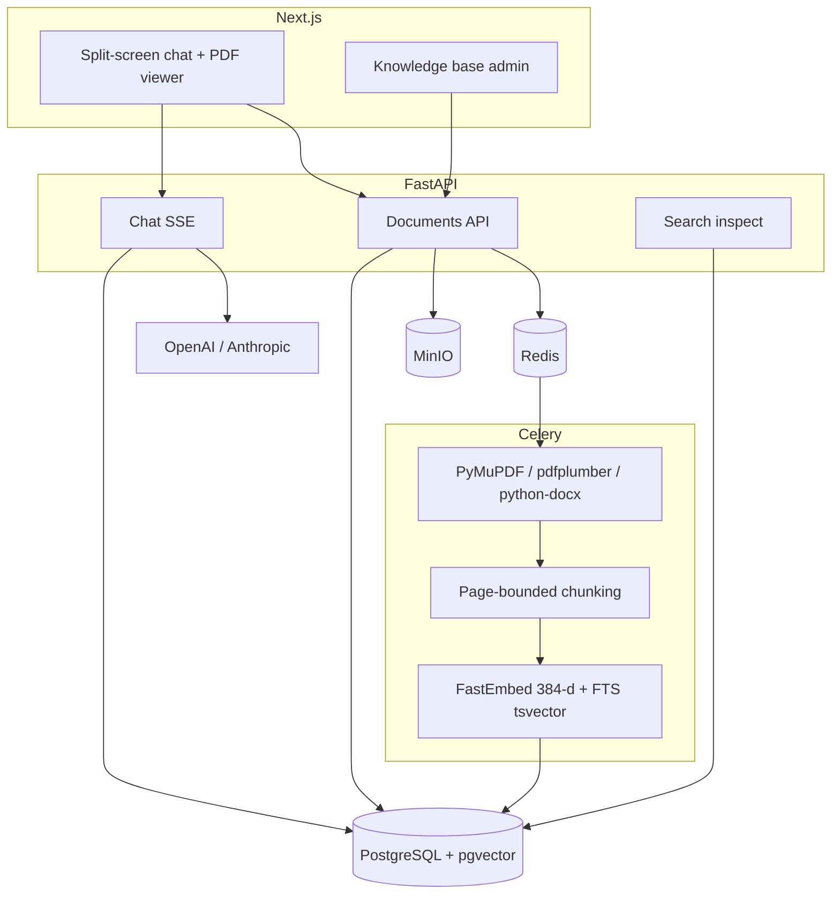
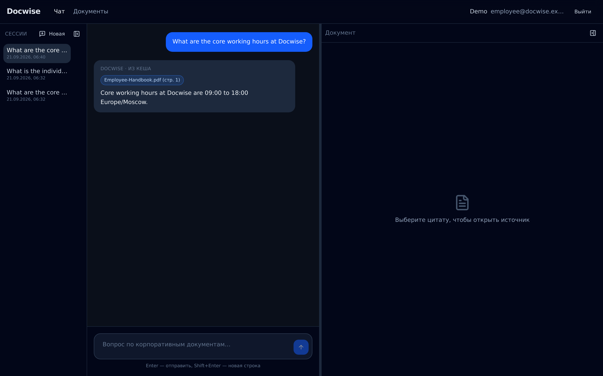
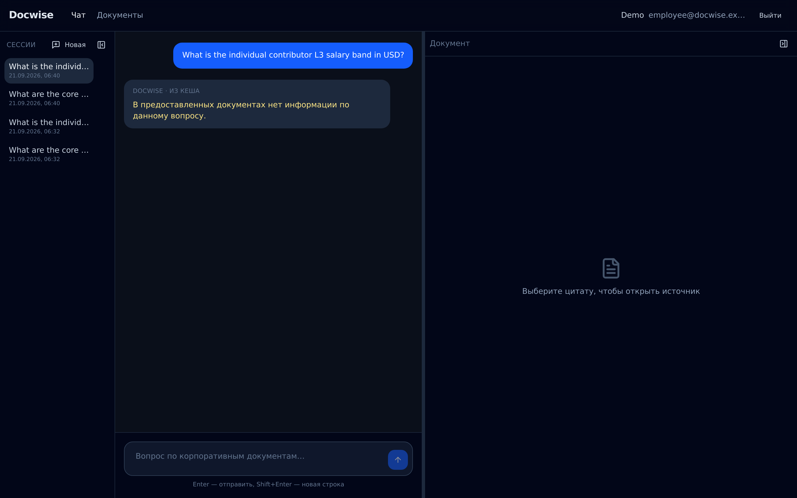

# Docwise

Production-grade **enterprise RAG** for PDF and DOCX knowledge bases: FastAPI, PostgreSQL/pgvector, Celery, Next.js. Permission-aware hybrid retrieval, cross-encoder rerank, PDF page citations, and DOCX citations by section.

Target deploy is **shared B2B SaaS** (many organizations on one stack). Isolation is SQL `organization_id` plus inner `access_roles`.

> Product spec: [docs/srs.md](docs/srs.md) (Russian). Tenancy: [docs/tenancy.md](docs/tenancy.md). Adapted from sibling [ChainWise](../chainwise) (cookies, Celery, SSE) with a different parser and **SQL RBAC on every search**.

## Why not naive RAG

Naive “split every 500 characters, embed, stuff Top-K into a prompt” fails in a company corpus:

| Pain | What naive RAG does | What Docwise does |
| --- | --- | --- |
| PDF structure | Cuts through tables and headings | Page/section-bounded chunks; tables as Markdown; meta header before embed |
| Access leaks | One vector index, filter in the prompt | SQL `access_roles && allowed_roles` on **dense and sparse** *before* RRF, rerank, or the LLM |
| Trust | A paragraph with no source | PDF: `{doc_id, doc_title, page, snippet}` + page highlight; DOCX: `section` instead of a fake page |
| Empty context | The model invents | Refuse: no Top-4 after rerank → no “creative” completion |

Keyword search does not understand the question. A junior employee must never receive an answer derived from a file they cannot open. `all` means everyone **in this org**, not every logged-in SaaS user.

## Not ChatPDF / not ChainWise

- **Not ChatPDF** — shared B2B SaaS (`organization_id` + document `access_roles`), hybrid retrieval in SQL (dense + FTS → RRF → rerank), and grounded refuse when Top-4 is empty; not a single-upload consumer chat with prompt-only guardrails.
- **Not ChainWise** — reuses auth, Celery, and SSE envelopes from the sibling audit app; product is **corpus-wide document RAG** (PDF + DOCX ingest) with pgvector in Postgres, not one Solidity contract with in-memory BM25 over Qdrant scroll.

## Architecture



**Hybrid pipeline (chat):** session roles → SQL ACL → pgvector Top-25 **and** independent Postgres FTS Top-25 → RRF (`k=60`) → cross-encoder rerank (threshold 0.25) → Top-4 → grounded stream (`citations` → `token` → `meta` → `[DONE]`). Org-admin `/inspect` exposes the same stages under the same SQL filters (dev flag).

## SQL RBAC

Retrieval is not “please ignore unauthorized chunks” in the system prompt. Every chat, inspect, list, and `/raw` query uses the session (never `access_roles` / `org_id` from the body):

```sql
WHERE organization_id = :current_org
  AND access_roles && ARRAY['employee', 'all']::text[]
```

`allowed_roles = {role} ∪ departments ∪ {all}` of the current membership. The LLM cache key includes `org_id` and those roles. Eval ACL negatives: **0 leaks** — [reports/rag_benchmark.md](reports/rag_benchmark.md).

## Stack

| Layer | Tech |
| --- | --- |
| Backend | Python 3.12, FastAPI, Pydantic v2, SQLAlchemy 2 **sync Session** |
| Queue | Redis 7, Celery 5 |
| Data | PostgreSQL 15 + pgvector (`vector(384)` cosine; FTS `tsvector` + GIN, independent of dense) |
| Parse | PyMuPDF, pdfplumber; DOCX via `python-docx` (section-bounded chunks) |
| ML | fastembed `bge-small-en-v1.5` + `bge-reranker-base`; LLM via OpenAI/Anthropic |
| Frontend | Next.js 15, React 19, TypeScript 5, Tailwind 4, shadcn/ui, pdf.js |
| Infra | Docker Compose, MinIO, GitHub Actions (ruff + mypy + pytest; frontend `tsc` + vitest + lint + build) |

## Eval metrics

**How we measure:** `eval/golden_dataset.json` (35 cases) runs through the same hybrid retrieval, rerank, and chat path as production, under `eval-employee@docwise.example.com` (`employee`, no `hr`/`finance` department). Ragas judges (Faithfulness, Context Precision, Answer Relevance) use the same LLM client as chat; release gates are Faithfulness ≥ 0.8 and **zero** Top-4 leaks from `must_not_doc_ids` (every case lists HR/Finance doc ids). ACL negative example: employee asks for the L3 salary band → `acl-l3-band` in the golden set; HR compensation chunks never enter Top-4 (see demo walkthrough below). Details: [docs/evaluation.md](docs/evaluation.md).

Last live Ragas run (**2026-09-21**, post FTS migration `012`; 35 cases). Full per-question table: [reports/rag_benchmark.md](reports/rag_benchmark.md). Default CI does **not** run eval (needs an LLM key and indexed fixtures).

| Metric | Score | Gate |
| --- | ---: | --- |
| Faithfulness | 1.000 | ≥ 0.8 |
| Context Precision | 0.994 | diagnostic |
| Answer Relevance | 0.725 | diagnostic |
| Target page hit | 0.929 | diagnostic |
| ACL `must_not_doc_ids` | **0 leaks** | **0** |

Two positives still miss target page after rerank (`hb-security-email`, `eng-python`): empty context → grounded refuse, not an ACL leak.

## Run the demo

**Quickstart (~15 min):** copy env → one-time `make deps` (downloads models and `node_modules`) → `make up` → `make demo` → open UI. Chat needs `OPENAI_API_KEY` (or KodikRouter) in `.env`; see [`.env.example`](.env.example). Images build **offline** (`network: none`) after deps.

```bash
cp .env.example .env          # set OPENAI_API_KEY (or KodikRouter) for chat
make deps                     # backend/.venv + FastEmbed ONNX + frontend/node_modules
make up                       # postgres, redis, minio, backend, worker, frontend
make health                   # GET http://localhost:8001/health
make demo                     # Demo org: 3 users + 12 PDFs (all / hr / finance)
```

Open http://localhost:3001 — on localhost the login screen has **Войти как сотрудник / HR / admin**. Cookies `dw_*` are host-only. Tenant host `{slug}.localhost:3001` talks to `{slug}.localhost:8001`. `{slug}.localhost` is loopback (RFC 6761). Custom CNAME in Compose is `/etc/hosts` (not Let's Encrypt).

| User | Password | Sees in the KB |
| --- | --- | --- |
| `employee@docwise.example.com` | `demo-employee-pass` | eight `all` PDFs (handbook, leave, expense, engineering, security runbook, travel policy, IT checklist, operations handbook) |
| `hr@docwise.example.com` | `demo-hr-pass` | those eight **plus** `HR-Compensation.pdf`, `Recruiting-FAQ.pdf`, and `People-Compendium.pdf` |
| `admin@docwise.example.com` | `demo-admin-pass` | same retrieval ACL as their membership (`all` only unless you add `hr`); KB upload + `/inspect` |

`Finance-Q4-Memo.pdf` is `finance` only — neither demo employee nor HR lists it or can open `/raw`.

**ACL walkthrough (same question, two roles):**

1. Employee: “What are the core working hours at Docwise?” → handbook page 1; click the citation → PDF highlight.
2. Employee: “What is the individual contributor L3 salary band in USD?” → refuse (HR chunk never reaches the LLM).
3. Log out → HR → same salary question → `72000`–`88000` USD from `HR-Compensation.pdf`.
4. Org-admin `/inspect`: stages dense / FTS / RRF / reranked. Admin without `hr` still does not see the compensation chunk.

Script: `eval/seed_demo.py` (same fixture PDFs as eval; real `index_pdf`, not Celery). Local passwords only.

**Sample files (upload tests):** regenerate with `backend/.venv/bin/python samples/export-sample-documents.py` → [samples/documents/](samples/documents/) (12 demo PDFs + `Travel-Policy-Test.docx`). DOCX has no in-browser Word preview in the KB modal — chat pane shows the cited snippet and download.

## Screenshots

Demo org (`make demo`). Regenerate: [docs/screenshots/README.md](docs/screenshots/README.md) or `node scripts/capture-portfolio-screenshots.mjs`.

| Chat + citation | PDF highlight | ACL refuse (employee / salary) | Inspect pipeline (admin) |
| --- | --- | --- | --- |
|  |  |  |  |

## Security scenarios (what CI already guards)

These are SQL + session checks, not prompt instructions. The UI does not explain *why* a file is missing.

| # | Scenario | Expected |
| --- | --- | --- |
| 1 | Other org, document tagged `all` | Empty list / chat / inspect; `GET /raw` → `404` (same as missing). `all` is not global SaaS. |
| 2 | HR-only PDF, caller is employee with `departments=[]` | No row in `GET /documents`, no chunk in chat or inspect, salary question refuses. |
| 3 | LLM cache after PATCH ACL | Cache key includes `org_id` + allowed roles + index generation; bump on ACL change so a newly restricted file is not served from cache. |
| 4 | `GET /documents/{id}/raw` without overlapping `access_roles` (or other org) | `404`, no title leak. Viewer shows «Документ недоступен». |
| 5 | `POST /search/inspect` | Flag off → `404` even for admin. Non-admin → `403`. Body `access_roles` / `org_id` ignored. |

Tests: `backend/tests/test_inspect.py`, tenancy/ACL cases in documents and retrieval tests.

## Out of scope (frozen)

This repo is a portfolio-complete RAG workspace, not a billing company. Intentionally **not** built:

- Live Stripe / real customer IdP (SAML in prod) / SCIM
- Postgres RLS (SQL `organization_id` + `access_roles` is the product gate)
- Platform operator console that can read customer corpora
- Agents with tool-calling beyond the corpus
- Training custom embeddings; rewrite to asyncpg

Compose billing is `BILLING_PROVIDER=dev`. Inspect is on in Compose (`ENABLE_SEARCH_INSPECT=true`) and off by default when `ENVIRONMENT=production`.

Portfolio: level A done locally; B/C checklist — [docs/portfolio-levels.md](docs/portfolio-levels.md). Repo showcase items — [docs/portfolio.md](docs/portfolio.md).

## CI

GitHub Actions on every push/PR:

- **ruff** + **mypy** on `backend/app` and `worker` (ruff also `tests`, `scripts`)
- **pytest** (parser, FTS/RRF `k=60`, ACL) against pgvector + Redis — no GPU, no live LLM, no eval runner
- **frontend** `tsc --noEmit`, Vitest, `next lint`, `next build`

No coverage gates on ChainWise `pragma_parser` / `risk_scorer` (those modules are not in this repo).

```bash
make lint            # ruff + mypy
make test            # pytest in the backend container → docwise_test
make typecheck       # frontend tsc --noEmit
make test-frontend   # vitest
```

## Layout

```
backend/          # FastAPI + Celery worker
frontend/         # Next.js 15 App Router
eval/             # golden set, Ragas runner, demo seed
docs/             # architecture and SRS (Russian)
reports/          # rag_benchmark.md
.github/workflows/ci.yml
```

## Docs

| Doc | Contents |
| --- | --- |
| [docs/README.md](docs/README.md) | Index |
| [docs/srs.md](docs/srs.md) | Product requirements |
| [docs/architecture.md](docs/architecture.md) | System and flows |
| [docs/decisions.md](docs/decisions.md) | ADRs vs ChainWise / the draft TZ |
| [docs/tenancy.md](docs/tenancy.md) | Shared SaaS org isolation |
| [docs/billing.md](docs/billing.md) | Plans, quotas, billing port |
| [docs/auth.md](docs/auth.md) | Session, roles, ACL assembly |
| [docs/retrieval.md](docs/retrieval.md) | Hybrid search (dense + FTS), SSE, inspect |
| [docs/api.md](docs/api.md) | HTTP contract |
| [docs/milestones.md](docs/milestones.md) | v1 roadmap |
| [docs/tech-debt.md](docs/tech-debt.md) | Structural backlog after M0–M6 |
| [docs/portfolio.md](docs/portfolio.md) | Demo / showcase freeze (not product milestones) |
| [docs/portfolio-levels.md](docs/portfolio-levels.md) | Portfolio levels A/B/C (interview-ready, abroad) |
| [AGENTS.md](AGENTS.md) | Agent checklist |
