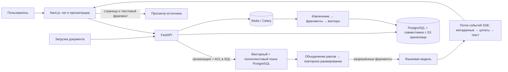

# Docwise

[](https://github.com/vladweat/docwise/actions/workflows/ci.yml)

**Корпоративный поиск по PDF и DOCX с ответами, подтверждёнными источниками и ограниченными правами доступа.**

Docwise индексирует документы организации и находит релевантные текстовые фрагменты. Ответ сопровождается цитатой, которая ведёт к странице PDF или разделу DOCX. Интерфейс и API показывают ход поиска и обработки документов.

## Возможности

- **Загрузка и индексация документов.** Фоновый обработчик Celery извлекает текст, делит его на фрагменты и строит векторные представления. Состояние обработки доступно через API.
- **Объединённый поиск.** Векторный и полнотекстовый поиск PostgreSQL объединяются по взаимным позициям результатов (RRF); модель сопоставления текстов типа `cross-encoder` повторно ранжирует найденные фрагменты перед подготовкой ответа.
- **Проверка доступа до генерации.** Система фильтрует документы по организации и списку управления доступом (ACL) до объединения результатов, повторного ранжирования и передачи контекста языковой модели.
- **Ответы с источниками.** Цитаты указывают на место в PDF или DOCX. Если разрешённых фрагментов недостаточно для ответа, система отказывается от генерации.
- **Диагностика поиска.** Раздел `/inspect` показывает доступные этапы обработки запроса.

## Архитектура



### Граница доступа

`organization_id` берётся из аутентифицированной сессии или доверенной записи базы данных. `access_roles` проверяются внутри организации. Векторный и полнотекстовый поиск фильтруют документы по организации и доступу до RRF, повторного ранжирования и передачи контекста языковой модели; данные из запроса клиента не расширяют права пользователя.

Политики защиты строк PostgreSQL (RLS) служат дополнительной защитой при запуске с ролью `docwise_rls`. Они не заменяют проверки приложения и обходятся суперпользователем базы данных.

Подробнее: [изоляция организаций](docs/platform/tenancy.md), [вход и ACL](docs/platform/auth.md), [обзор безопасности](docs/security/overview.md).

## Технологии

| Область | Технологии |
| --- | --- |
| API и фоновые задачи | Python 3.12, FastAPI, SQLAlchemy 2, Celery |
| Данные и поиск | PostgreSQL 15, pgvector, полнотекстовый поиск PostgreSQL, Redis |
| Файлы и обработка | MinIO или S3-совместимое хранилище, PyMuPDF, pdfplumber, python-docx, FastEmbed |
| Поиск и генерация | Векторный поиск, RRF, cross-encoder, API, совместимый с OpenAI |
| Интерфейс | Next.js 15, React 19, TypeScript, Tailwind, PDF.js |
| Локальная среда и автоматические проверки | Docker Compose, GitHub Actions |

## Локальная разработка

Нужны Docker Compose, Python 3.12, Node.js 20 и интернет для установки зависимостей. Для генерации ответов укажите в локальном `.env` ключ API совместимого с OpenAI сервиса; не добавляйте ключи в Git.

```bash
cp .env.example .env       # задайте SECRET_KEY; ключ языковой модели нужен для генерации ответов
make deps                  # виртуальное окружение сервера, модели и зависимости интерфейса
make up
curl -fsS http://localhost:8001/ready
make demo                  # загрузить синтетические данные для локальной разработки
```

Интерфейс откроется на `http://localhost:3001`. Настройка окружения, команды разработки и проверки описаны в [руководстве по запуску](docs/development/getting-started.md) и [конфигурации](docs/development/configuration.md).

## Документация

| Задача | Материалы |
| --- | --- |
| Понять устройство системы | [Архитектура](docs/product/architecture.md) → [поиск и чат](docs/pipeline/retrieval.md) → [изоляция организаций](docs/platform/tenancy.md) |
| Запустить и менять код | [Быстрый старт](docs/development/getting-started.md) → [конфигурация](docs/development/configuration.md) → [API](docs/engineering/api.md) |
| Разобраться с решениями | [Архитектурные решения](docs/engineering/decisions.md) → [технический долг](docs/maintenance/technical-debt.md) |
| Обслуживать окружение | [Операционные инструкции](docs/operations/operations.md) |

Полный указатель находится в [docs/README.md](docs/README.md). Правила внесения изменений — в [CONTRIBUTING.md](CONTRIBUTING.md).

## Интерфейс

| Чат и цитата | Переход к странице PDF | Проверка ACL | Этапы поиска |
| --- | --- | --- | --- |
|  |  |  |  |

Инструкция по обновлению изображений: [скриншоты интерфейса](docs/portfolio/screenshots/README.md).
