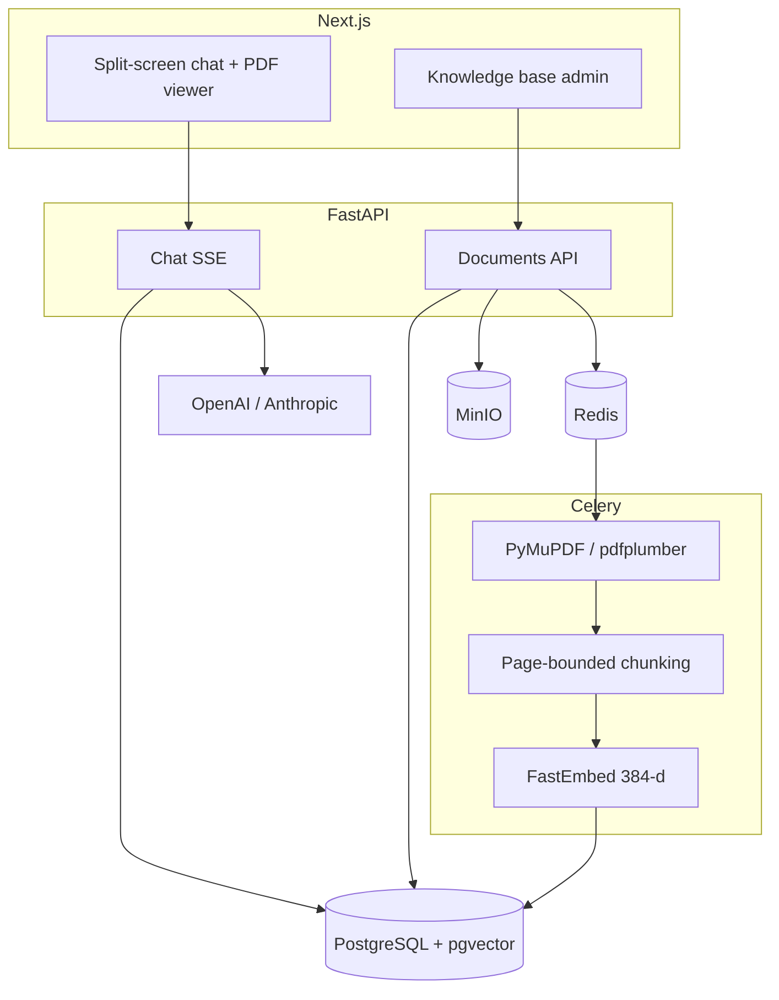

# Docwise

Production-grade **enterprise RAG** for PDF knowledge bases: FastAPI, PostgreSQL/pgvector, Celery, Next.js. Permission-aware hybrid retrieval, cross-encoder rerank, and exact PDF page citations.

Target deploy is **shared B2B SaaS** (many organizations on one stack). Isolation is SQL `organization_id` plus inner `access_roles`.

> Product spec: [docs/srs.md](docs/srs.md) (Russian). Tenancy: [docs/tenancy.md](docs/tenancy.md). Adapted from sibling [ChainWise](../chainwise) (cookies, Celery, SSE) with a different parser and **SQL RBAC on every search**.

## Why not naive RAG

Naive “split every 500 characters, embed, stuff Top-K into a prompt” fails in a company corpus:

| Pain | What naive RAG does | What Docwise does |
| --- | --- | --- |
| PDF structure | Cuts through tables and headings | Page/section-bounded chunks; tables as Markdown; meta header before embed |
| Access leaks | One vector index, filter in the prompt | SQL `access_roles && allowed_roles` on **dense and sparse** *before* RRF, rerank, or the LLM |
| Trust | A paragraph with no page | Citations `{doc_id, doc_title, page, snippet}`; click opens that PDF page |
| Empty context | The model invents | Refuse: no Top-4 after rerank → no “creative” completion |

Keyword search does not understand the question. A junior employee must never receive an answer derived from a file they cannot open. `all` means everyone **in this org**, not every logged-in SaaS user.

## Architecture



Question path: session roles → SQL ACL → pgvector Top-25 + BM25 on that pool → RRF (`k=60`) → rerank → Top-4 → grounded stream (`citations` → `token` → `meta` → `[DONE]`).

## SQL RBAC

Retrieval is not “please ignore unauthorized chunks” in the system prompt. Every chat, inspect, list, and `/raw` query uses the session (never `access_roles` / `org_id` from the body):

```sql
WHERE organization_id = :current_org
  AND access_roles && ARRAY['employee', 'all']::text[]
```

`allowed_roles = {role} ∪ departments ∪ {all}` of the current membership. The LLM cache key includes `org_id` and those roles. Eval ACL negatives: **0 leaks** — [reports/rag_benchmark.md](reports/rag_benchmark.md).

## Stack

| Layer | Tech |
| --- | --- |
| Backend | Python 3.12, FastAPI, Pydantic v2, SQLAlchemy 2 **sync Session** |
| Queue | Redis 7, Celery 5 |
| Data | PostgreSQL 15 + pgvector (`vector(384)` cosine; BM25 on SQL candidates) |
| Parse | PyMuPDF, pdfplumber |
| ML | fastembed `bge-small-en-v1.5` + `bge-reranker-base`; LLM via OpenAI/Anthropic |
| Frontend | Next.js 15, React 19, TypeScript 5, Tailwind 4, shadcn/ui, pdf.js |
| Infra | Docker Compose, MinIO, GitHub Actions (ruff + pytest + `tsc --noEmit`) |

## Eval metrics

Live Ragas run (2026-09-10, 35 cases, employee with no `hr`/`finance` department):

| Metric | Score | Gate |
| --- | ---: | --- |
| Faithfulness | 1.000 | ≥ 0.8 |
| Context Precision | 0.976 | diagnostic |
| Answer Relevance | 0.789 | diagnostic (two empty-after-rerank refusals) |
| Target page hit | 0.929 | diagnostic |
| ACL `must_not_doc_ids` | **0 leaks** | **0** |

Full table: [reports/rag_benchmark.md](reports/rag_benchmark.md). Method: [docs/evaluation.md](docs/evaluation.md). Default CI does **not** run eval (needs an LLM key and indexed fixtures).

## Run the demo

Dependencies are installed on the host (`make deps`); images build **offline** (`network: none`).

```bash
cp .env.example .env          # set OPENAI_API_KEY (or KodikRouter) for chat
make deps                     # backend/.venv + FastEmbed ONNX + frontend/node_modules
make up                       # postgres, redis, minio, backend, worker, frontend
make health                   # GET http://localhost:8001/health
make demo                     # employee vs HR users + two PDFs with different ACLs
```

UI: http://localhost:3001 (cookies `dw_*`).

| User | Password | Sees |
| --- | --- | --- |
| `employee@docwise.example.com` | `demo-employee-pass` | `Employee-Handbook.pdf` (`all`) only |
| `hr@docwise.example.com` | `demo-hr-pass` | handbook **and** `HR-Compensation.pdf` (`hr`) |
| `admin@docwise.example.com` | `demo-admin-pass` | KB upload; retrieval still respects document ACL |

Try as **employee**: “What are the core working hours at Docwise?” (handbook, page 1). Then “What is the individual contributor L3 salary band in USD?” — the model must refuse. Log in as **hr** and ask the salary question again.

Script: `eval/seed_demo.py` (same fixture PDFs as eval; real `index_pdf`, not Celery). Local passwords only.

## CI

GitHub Actions on every push/PR:

- **ruff** on `backend/app`, `tests`, `scripts`
- **pytest** (parser, RRF `k=60`, ACL) against pgvector + Redis — no GPU, no live LLM, no eval runner
- **frontend** `tsc --noEmit`

No coverage gates on ChainWise `pragma_parser` / `risk_scorer` (those modules are not in this repo).

```bash
make lint          # flake8 (same rules as ruff E/F/W)
make test          # pytest in the backend container → docwise_test
npx tsc --noEmit   # from frontend/
```

## Layout

```
backend/          # FastAPI + Celery worker
frontend/         # Next.js 15 App Router
eval/             # golden set, Ragas runner, demo seed
docs/             # architecture and SRS (Russian)
reports/          # rag_benchmark.md
.github/workflows/ci.yml
```

## Docs

| Doc | Contents |
| --- | --- |
| [docs/README.md](docs/README.md) | Index |
| [docs/srs.md](docs/srs.md) | Product requirements |
| [docs/architecture.md](docs/architecture.md) | System and flows |
| [docs/decisions.md](docs/decisions.md) | ADRs vs ChainWise / the draft TZ |
| [docs/tenancy.md](docs/tenancy.md) | Shared SaaS org isolation |
| [docs/auth.md](docs/auth.md) | Session, roles, ACL assembly |
| [docs/retrieval.md](docs/retrieval.md) | Hybrid search, SSE, inspect |
| [docs/milestones.md](docs/milestones.md) | v1 roadmap |
| [AGENTS.md](AGENTS.md) | Agent checklist |
