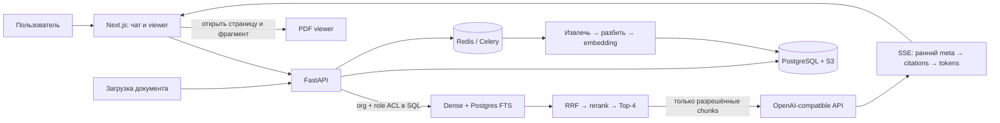

# Docwise

[](https://github.com/vladweat/docwise/actions/workflows/ci.yml)

**Docwise — корпоративный поиск по PDF и DOCX с ответами, которые можно проверить по источнику.**
Проект показывает полный путь от загрузки документов и разграничения доступа до hybrid search,
LLM-ответа и подсветки цитаты в PDF.

Публичное демо **приостановлено и недоступно с 2026-11-05** · [Инструкция запуска](docs/operations/public-demo.md) · [Документация](docs/README.md) · [Оценка RAG](docs/product/evaluation.md) · [Каталог экспериментов](reports/README.md)

## Что показывает проект

- **Hybrid retrieval:** dense search и Postgres FTS объединяются через RRF, затем cross-encoder выбирает контекст для ответа.
- **Доступ до LLM:** `organization_id` и `access_roles` фильтруют обе поисковые ветки до reranking и генерации.
- **Проверяемые ответы:** цитата ведёт к странице PDF или разделу DOCX; при недостатке разрешённого контекста система отказывает.
- **Полный цикл документов:** загрузка → Celery ingestion → поиск → чат; администратор может увидеть этапы поиска в `/inspect`.

## Как устроен поток



**Граница доступа:** организация определяется аутентифицированной сессией. Теги `access_roles`
работают внутри организации. Ни тело запроса, ни подсказка для LLM не задают права доступа.
Подробнее — [модель tenancy](docs/platform/tenancy.md) и [безопасность](docs/security/overview.md).

## Сценарий продукта для локального запуска

После локального запуска с синтетическим corpus сценарий показывает:

1. Войти как сотрудник и найти правило в handbook — ответ содержит цитату и открывает страницу PDF.
2. Спросить о закрытой HR-информации — сотрудник получает отказ без подтверждения содержимого файла.
3. Войти как HR и задать тот же вопрос — разрешённый источник появляется в ответе.
4. Открыть `/inspect` под администратором организации и пройти путь dense/FTS → RRF → rerank.

Публичный профиль также рассчитан на синтетические документы: SSO отключён, `BILLING_PROVIDER=dev`,
Garage — одноузловое хранилище, это не HA production-конфигурация. На 2026-11-05 его контейнеры были
остановлены, а HTTPS завершался ошибкой TLS. Порядок подготовки и запуска описан в
[руководстве публичного демо](docs/operations/public-demo.md).

## Оценка качества

Последний полный end-to-end прогон Top-4 от **2026-11-01** охватывает 132 кейса: 85 positive, 6 no-answer и
41 ACL-negative. Он выполнен на `multilingual-compact` с `BAAI/bge-reranker-v2-m3-int8` и threshold `0.01`.

| Метрика Top-4 | Результат |
| --- | ---: |
| Target document / exact target section | `85/85` / `51/52` |
| Context Precision / Faithfulness | `0.952` / `0.974` |
| Citation support | `0.931` |
| Answer Relevance: English (`n=53`) / Russian (`n=28`) / mixed-script (`n=4`) | `0.799` / `0.635` / `0.369` |
| No-answer refusals / ACL leaks / case errors | `6/6` / `0` / `0` |

Context Precision (`0.975`) и English Answer Relevance (`0.827`) не проходят gates. Парный Top-2 также не прошёл:
он потерял document/section hits и снизил Faithfulness и English Answer Relevance, поэтому не выбран. Production
Top-4 и threshold `0.01` остались без изменений. English score включает три точных отказа на positive-кейсах,
получивших `0.0`.

Оба артефакта Top-4/Top-2 указывают `code_revision=unrecorded`: hash датасета и параметры записаны, но
byte-for-byte воспроизводимость не подтверждена. Полные результаты, ограничения и исторические эксперименты:
[оценка RAG](docs/product/evaluation.md) и [каталог отчётов](reports/README.md).

## Технологии

| Часть | Технологии |
| --- | --- |
| API и фоновые задачи | Python 3.12, FastAPI, SQLAlchemy 2, Celery |
| Данные и очередь | PostgreSQL 15 + pgvector/FTS, Redis, MinIO или S3-compatible storage |
| Ingestion | PyMuPDF, pdfplumber, python-docx, FastEmbed |
| Поиск и генерация | Dense + FTS, RRF, cross-encoder, OpenAI-compatible API |
| Интерфейс | Next.js 15, React 19, TypeScript, Tailwind, PDF.js |
| Доставка | Docker Compose, GitHub Actions |

## Запуск локально

Нужны Docker Compose, Python 3.12, Node.js 20 и интернет для первичной установки зависимостей.
Для генерации ответов нужен OpenAI-compatible API key; не добавляйте его в Git.

```bash
cp .env.example .env       # задайте SECRET_KEY; LLM key — если нужен чат
make deps                  # backend venv, модели и frontend dependencies
make up
curl -fsS http://localhost:8001/ready
make demo                  # synthetic organization, 3 users, 12 PDF
```

Интерфейс: `http://localhost:3001`. Локальный сценарий, тесты и восстановление описаны в
[руководстве разработки](docs/development/getting-started.md).

## Материалы проекта

| Для кого | Начать здесь |
| --- | --- |
| Интервьюер / обзор проекта | [архитектура](docs/product/architecture.md) → [retrieval](docs/pipeline/retrieval.md) → [evaluation](docs/product/evaluation.md) |
| Разработчик | [локальный запуск](docs/development/getting-started.md) → [API](docs/engineering/api.md) → [решения (ADR)](docs/engineering/decisions.md) |
| Эксплуатация | [operations](docs/operations/operations.md) → [public demo](docs/operations/public-demo.md) → [технический долг](docs/maintenance/technical-debt.md) |

Полный указатель — [docs/README.md](docs/README.md). Скриншоты UI находятся ниже.

## Интерфейс

| Чат и цитата | Переход к странице PDF | ACL-отказ | Этапы поиска |
| --- | --- | --- | --- |
|  |  |  |  |

Скриншоты: [как пересоздать](docs/portfolio/screenshots/README.md).
