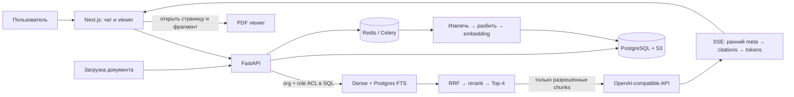

# Docwise

[](https://github.com/vladweat/docwise/actions/workflows/ci.yml)

**Docwise — корпоративный поиск по PDF и DOCX с ответами, которые можно проверить по источнику.**
Проект показывает полный путь от загрузки документов и разграничения доступа до hybrid search,
LLM-ответа и подсветки цитаты в PDF.

[Открыть публичное демо](https://docwise.wvzl.site) · [Документация](docs/README.md) · [Отчёт оценки RAG](reports/rag_benchmark.md)

## Что показывает проект

- **Hybrid retrieval:** dense search и Postgres FTS объединяются через RRF, затем cross-encoder выбирает контекст для ответа.
- **Доступ до LLM:** `organization_id` и `access_roles` фильтруют обе поисковые ветки до reranking и генерации.
- **Проверяемые ответы:** цитата ведёт к странице PDF или разделу DOCX; при недостатке разрешённого контекста система отказывает.
- **Полный цикл документов:** загрузка → Celery ingestion → поиск → чат; администратор может увидеть этапы поиска в `/inspect`.

## Как устроен поток



**Граница доступа:** организация определяется аутентифицированной сессией. Теги `access_roles`
работают внутри организации. Ни тело запроса, ни подсказка для LLM не задают права доступа.
Подробнее — [модель tenancy](docs/platform/tenancy.md) и [безопасность](docs/security/overview.md).

## Короткий сценарий демо

В [публичном демо](https://docwise.wvzl.site) можно показать:

1. Войти как сотрудник и найти правило в handbook — ответ содержит цитату и открывает страницу PDF.
2. Спросить о закрытой HR-информации — сотрудник получает отказ без подтверждения содержимого файла.
3. Войти как HR и задать тот же вопрос — разрешённый источник появляется в ответе.
4. Открыть `/inspect` под администратором организации и пройти путь dense/FTS → RRF → rerank.

Демо использует синтетические документы. SSO в публичном профиле отключён; `BILLING_PROVIDER=dev`,
а Garage работает как одноузловое хранилище. Это демонстрация продукта и архитектуры, не HA production-конфигурация.
Порядок запуска и ограничения описаны в [руководстве публичного демо](docs/operations/public-demo.md).

## Оценка качества

Сохранённый прогон от 2026-09-22 покрывает **35 кейсов**: 28 положительных и 7 проверок ACL. Golden set
сейчас расширен до 41 кейса; метрики старого отчёта остаются historical до нового прогона.
Target document/page hit rate — `1.000`, Faithfulness — `1.000`, Context Precision — `0.994`,
Answer Relevance — `0.776`; ограниченные документы не попали в Top-4 ни в одном из 7 отрицательных кейсов.
Это результат конкретного benchmark-прогона, а не гарантия качества на произвольных данных.

Подробности, датасет и release gates: [evaluation](docs/product/evaluation.md) и [полный отчёт](reports/rag_benchmark.md).

## Технологии

| Часть | Технологии |
| --- | --- |
| API и фоновые задачи | Python 3.12, FastAPI, SQLAlchemy 2, Celery |
| Данные и очередь | PostgreSQL 15 + pgvector/FTS, Redis, MinIO или S3-compatible storage |
| Ingestion | PyMuPDF, pdfplumber, python-docx, FastEmbed |
| Поиск и генерация | Dense + FTS, RRF, cross-encoder, OpenAI-compatible API |
| Интерфейс | Next.js 15, React 19, TypeScript, Tailwind, PDF.js |
| Доставка | Docker Compose, GitHub Actions |

## Запуск локально

Нужны Docker Compose, Python 3.12, Node.js 20 и интернет для первичной установки зависимостей.
Для генерации ответов нужен OpenAI-compatible API key; не добавляйте его в Git.

```bash
cp .env.example .env       # задайте SECRET_KEY; LLM key — если нужен чат
make deps                  # backend venv, модели и frontend dependencies
make up
curl -fsS http://localhost:8001/ready
make demo                  # synthetic organization, 3 users, 12 PDF
```

Интерфейс: `http://localhost:3001`. Локальный сценарий, тесты и восстановление описаны в
[руководстве разработки](docs/development/getting-started.md).

## Материалы проекта

| Для кого | Начать здесь |
| --- | --- |
| Интервьюер / обзор проекта | [архитектура](docs/product/architecture.md) → [retrieval](docs/pipeline/retrieval.md) → [evaluation](docs/product/evaluation.md) |
| Разработчик | [локальный запуск](docs/development/getting-started.md) → [API](docs/engineering/api.md) → [решения (ADR)](docs/engineering/decisions.md) |
| Эксплуатация | [operations](docs/operations/operations.md) → [public demo](docs/operations/public-demo.md) → [технический долг](docs/maintenance/technical-debt.md) |

Полный указатель — [docs/README.md](docs/README.md). Скриншоты UI находятся ниже.

## Интерфейс

| Чат и цитата | Переход к странице PDF | ACL-отказ | Этапы поиска |
| --- | --- | --- | --- |
|  |  |  |  |

Скриншоты: [как пересоздать](docs/portfolio/screenshots/README.md).
