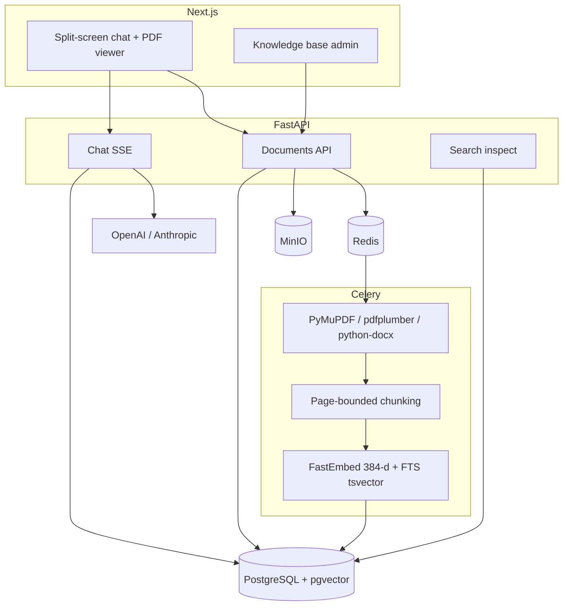
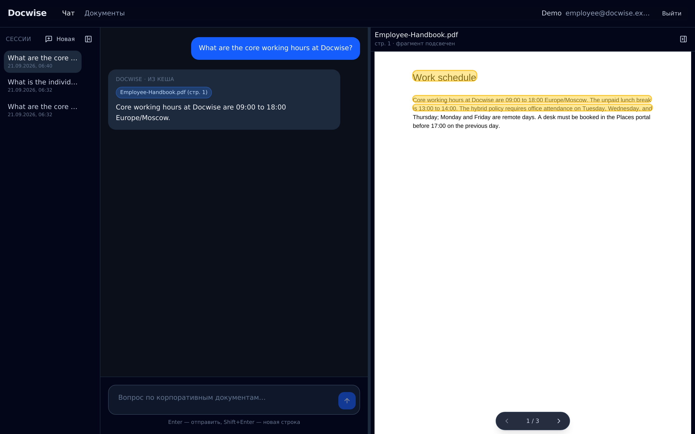
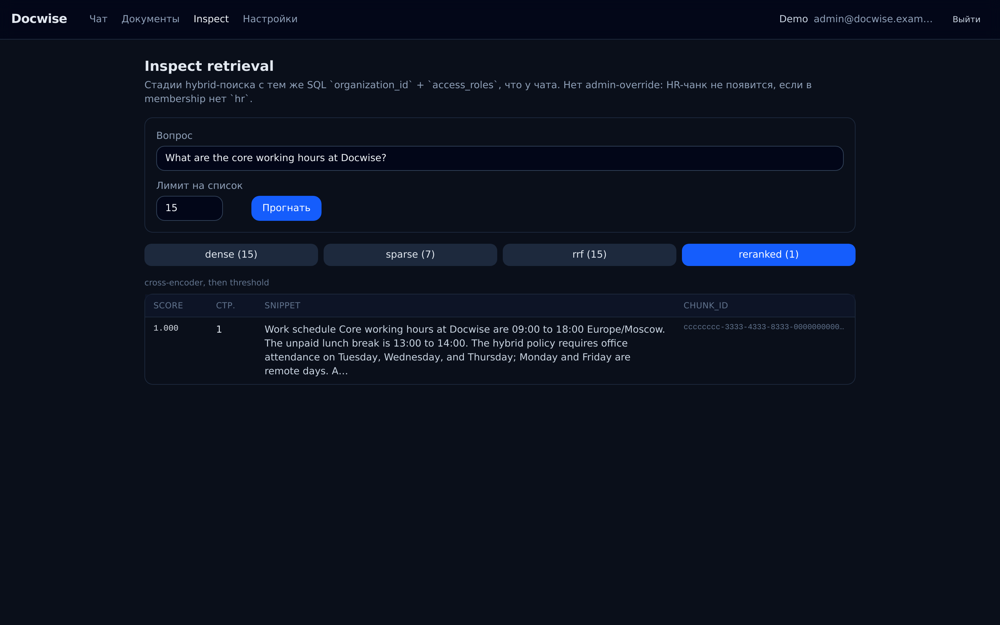

# Docwise

[](https://github.com/vladweat/docwise/actions/workflows/ci.yml)

RAG over shared PDF/DOCX knowledge bases: FastAPI, PostgreSQL/pgvector, Celery, Next.js. Hybrid retrieval with cross-encoder rerank, page/section citations, and SQL access control before the LLM.

Deploy model: **shared B2B SaaS** (many organizations on one stack). Isolation is `organization_id` plus document `access_roles` — applied on every dense and FTS query before fusion, rerank, or generation. Spec: [docs/product/srs.md](docs/product/srs.md). Tenancy: [docs/platform/tenancy.md](docs/platform/tenancy.md).

## Why not naive RAG

| Pain | Naive RAG | Docwise |
| --- | --- | --- |
| PDF structure | Fixed-size splits break tables | Page/section-bounded chunks; meta header before embed |
| Access leaks | Filter in the prompt | SQL `organization_id` + `access_roles` on dense and FTS before RRF |
| Trust | Paragraph with no source | Citations `{doc_id, page, snippet}` + PDF highlight; refuse if Top-4 empty |

Corpus-wide search in Postgres (not chat over one uploaded file). Details: [docs/product/architecture.md](docs/product/architecture.md), [docs/pipeline/retrieval.md](docs/pipeline/retrieval.md).

## Architecture



**Chat pipeline:** session roles → SQL ACL → pgvector Top-25 **and** Postgres FTS Top-25 → RRF (`k=60`) → cross-encoder rerank → Top-4 → SSE (`citations` → `token` → `meta` → `[DONE]`).

## Stack

| Layer | Tech |
| --- | --- |
| Backend | Python 3.12, FastAPI, Pydantic v2, SQLAlchemy 2 **sync Session** |
| Queue | Redis 7, Celery 5 |
| Data | PostgreSQL 15 + pgvector (`vector(384)` cosine; FTS `tsvector` + GIN) |
| Parse | PyMuPDF, pdfplumber; DOCX via `python-docx` |
| ML | fastembed `bge-small-en-v1.5` + `bge-reranker-base`; LLM via OpenAI/Anthropic |
| Frontend | Next.js 15, React 19, TypeScript 5, Tailwind 4, shadcn/ui, pdf.js |
| Infra | Docker Compose, MinIO, GitHub Actions |

## Eval

Golden set (35 cases) through the same hybrid path as production. Latest: Faithfulness 1.000, Context Precision 0.994, page hit rate 1.000; 0 ACL leaks on 7 restricted-document questions. Release gates and how to run: [docs/product/evaluation.md](docs/product/evaluation.md). Full report: [reports/rag_benchmark.md](reports/rag_benchmark.md). Optional CI: [`.github/workflows/eval.yml`](.github/workflows/eval.yml).

## Run the demo

**Quickstart (~15 min):** copy env → `make deps` → `make up` → `make demo` → open UI. Chat needs `OPENAI_API_KEY` (or any OpenAI-compatible endpoint) in `.env`; see [`.env.example`](.env.example).

```bash
cp .env.example .env          # set OPENAI_API_KEY (or any OpenAI-compatible endpoint) for chat
make deps                     # backend/.venv + FastEmbed ONNX + frontend/node_modules
make up                       # postgres, redis, minio, backend, worker, frontend
make health                   # GET http://localhost:8001/health
make demo                     # Demo org: 3 users + 12 PDFs (all / hr / finance)
```

Open http://localhost:3001 — on localhost the login screen has **Войти как сотрудник / HR / admin**. Cookies `dw_*` are host-only. Tenant host `{slug}.localhost:3001` talks to `{slug}.localhost:8001`.

| User | Password | Sees in the KB |
| --- | --- | --- |
| `employee@docwise.example.com` | `demo-employee-pass` | eight `all` PDFs |
| `hr@docwise.example.com` | `demo-hr-pass` | those eight **plus** HR compensation / recruiting / people PDFs |
| `admin@docwise.example.com` | `demo-admin-pass` | same retrieval ACL as membership; KB upload + `/inspect` |

`Finance-Q4-Memo.pdf` is `finance` only — neither demo employee nor HR can open it.

**ACL walkthrough:**

1. Employee: “What are the core working hours at Docwise?” → handbook citation → PDF highlight.
2. Employee: “What is the individual contributor L3 salary band in USD?” → refuse.
3. Log out → HR → same salary question → `72000`–`88000` USD from `HR-Compensation.pdf`.
4. Org-admin `/inspect`: dense / FTS / RRF / reranked under the same SQL filters.

Script: `eval/seed_demo.py`. Re-seed: `make demo-fresh`. Full reset: `make demo-fresh-volumes`.

### Fast frontend loop

```bash
make deps-frontend    # once
make up-fast          # API on :8001
cd frontend && NEXT_PUBLIC_API_URL=http://localhost:8001 npm run dev
```

Open http://localhost:3000. After edits under `backend/app/services/ingestion/` or `worker/`, run `make restart-worker`.

**Sample files:** `backend/.venv/bin/python samples/export-sample-documents.py` → [samples/documents/](samples/documents/).

## Screenshots

| Chat + citation | PDF highlight | ACL refuse | Inspect |
| --- | --- | --- | --- |
|  |  |  |  |

Regenerate: [docs/portfolio/screenshots/README.md](docs/portfolio/screenshots/README.md) or `node scripts/capture-portfolio-screenshots.mjs`.

## CI

On every push/PR: **ruff** + **mypy**, **pytest** (no live LLM), frontend `tsc` / vitest / lint / build, non-blocking supply-chain advisory. Dependabot weekly.

```bash
make lint            # ruff + mypy
make test-smoke      # fast subset (~3 min); full suite: make test
make test
make typecheck       # frontend tsc --noEmit
make test-frontend   # vitest
```

## Layout

```
backend/          # FastAPI + Celery worker
frontend/         # Next.js 15 App Router
eval/             # golden set, Ragas runner, demo seed
docs/             # product, platform, pipeline, engineering (see docs/README.md)
reports/          # rag_benchmark.md
.github/workflows/ci.yml
```

## Docs

| Doc | Contents |
| --- | --- |
| [docs/README.md](docs/README.md) | Index and reading order |
| [docs/product/srs.md](docs/product/srs.md) | Product requirements |
| [docs/product/architecture.md](docs/product/architecture.md) | Components and flows |
| [docs/platform/tenancy.md](docs/platform/tenancy.md) | Shared SaaS org isolation |
| [docs/platform/auth.md](docs/platform/auth.md) | Session, roles, ACL assembly |
| [docs/pipeline/retrieval.md](docs/pipeline/retrieval.md) | Hybrid search, SSE, inspect |
| [docs/engineering/api.md](docs/engineering/api.md) | HTTP contract |
| [docs/engineering/decisions.md](docs/engineering/decisions.md) | ADRs |
