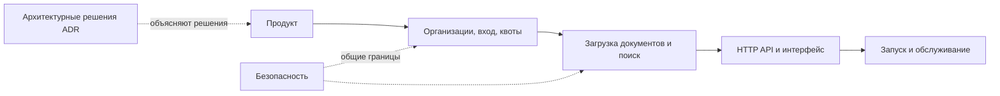

# Документация Docwise

Здесь собраны продуктовая спецификация, устройство системы и рабочие инструкции.
Код, миграции и тесты — источники истины; если текст расходится с реализацией, сначала сверяйтесь с ними.

## Маршруты чтения

| Если вы… | Читайте по порядку |
| --- | --- |
| Знакомитесь с проектом | [Кратко о проекте](../README.md) → [архитектура](product/architecture.md) → [поиск и чат](pipeline/retrieval.md) → [оценка поиска](product/evaluation.md) → [каталог экспериментов](../reports/README.md) |
| Хотите запустить код | [быстрый старт](development/getting-started.md) → [конфигурация](development/configuration.md) → [API](engineering/api.md) |
| Разбираетесь в доступах | [изоляция организаций](platform/tenancy.md) → [вход и ACL](platform/auth.md) → [безопасность](security/overview.md) |
| Обслуживаете развёртывание | [эксплуатационные инструкции](operations/operations.md) → [публичный профиль](operations/public-demo.md) → [технический долг](maintenance/technical-debt.md) |

## Карта системы

## Каталог

| Раздел | Основное содержание |
| --- | --- |
| Продукт | [Архитектура](product/architecture.md), спецификация требований, интерфейс, нефункциональные требования, оценка поиска |
| Платформа | [Изоляция организаций](platform/tenancy.md), модель данных, вход, оплата и хранение данных |
| Обработка документов и поиск | [Загрузка и индексация](pipeline/ingestion.md), [поиск и чат](pipeline/retrieval.md) |
| Разработка | [Контракт API](engineering/api.md), архитектурные решения и соглашения Python |
| Локальная разработка | [Быстрый старт](development/getting-started.md), проверки и переменные среды |
| Эксплуатация | [Инструкции](operations/operations.md), публичный профиль, резервное копирование и восстановление |
| Безопасность | [Границы доверия](security/overview.md) и ограничения защиты |
| Сопровождение | [Технический долг](maintenance/technical-debt.md), обзор репозитория и аудит документации |
| Отчёты и эксперименты | [Каталог `reports/`](../reports/README.md): исходные прогоны, варианты-кандидаты, MIRACL, число результатов Top-K, разбор отказов и нагрузочные замеры |
| Скриншоты | [Галерея интерфейса](portfolio/screenshots/README.md) и инструкция по обновлению |

## Три границы, которые важно помнить

- `organization_id` берётся из аутентифицированной сессии или доверенной записи БД.
- И `access_roles`, и фильтр организации применяются в SQL до RRF, повторного ранжирования и передачи контекста языковой модели.
- PostgreSQL RLS — дополнительная защита только при использовании роли среды выполнения `docwise_rls`; суперпользователь обходит эти политики.

Подробнее: [изоляция организаций](platform/tenancy.md), [поиск](pipeline/retrieval.md), [безопасность](security/overview.md).

## Язык и термины

Пояснительный текст пишется по-русски. Точные имена в коде, API, переменных, командах, пакетах и моделях сохраняются без перевода. Названия метрик в тексте передавайте по-русски, а точную английскую форму добавляйте в скобках, если она нужна для однозначной ссылки на измерение.

| Понятие | Формулировка в тексте |
| --- | --- |
| организация и её границы | организация; изоляция организаций |
| система поиска с генерацией ответа | поиск с генерацией ответа (RAG) |
| приглашение участника | приглашение; пригласить пользователя в организацию |
| часть документа, возвращаемая поиском | текстовый фрагмент |
| числовое представление текста для поиска | векторное представление |
| поиск фрагментов и повторная сортировка | поиск; повторное ранжирование |
| фоновая задача | фоновая обработка; фоновый обработчик |
| тестовые данные | тестовые данные; загрузка начальных данных |
| порог и условие прохождения проверки | порог; критерий качества |
| сравниваемые эксперименты | исходный прогон; вариант-кандидат |
| входные данные HTTP-запроса | тело запроса; поисковый запрос |
| соединение с сервером и браузерный интерфейс | клиентская часть; серверная часть |
| последовательность этапов обработки | процесс обработки; этапы обработки |
| объединение результатов разных поисковых веток | объединение рангов (RRF) |
| полнотекстовый поиск | полнотекстовый поиск (FTS) |
| метрики поиска и ответа | точность контекста (`Context Precision`); соответствие ответа контексту (`Faithfulness`); релевантность ответа (`Answer Relevance`); подтверждение цитатами (`Citation Support`) |

При первом употреблении раскрывайте сокращения, если это помогает понять текст: список управления доступом (ACL), защита на уровне строк (RLS), большая языковая модель (LLM), потоковая передача событий (SSE). Идентификаторы вроде `organization_id`, маршруты и названия режимов остаются точными.

## Как поддерживать эти документы

Обновляйте одну каноническую страницу по теме и ссылайтесь на неё из остальных. Проверяйте утверждения
по коду, миграциям, тестам и Compose. Различайте **реализовано**, **проверено в работающей среде** и **планируется**.
Порядок сверки и известные исключения: [аудит документации](maintenance/documentation-audit.md).
