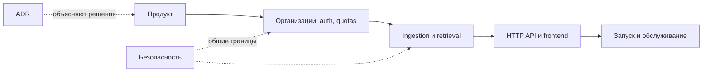

# Документация Docwise

Здесь собраны продуктовая спецификация, устройство системы и рабочие инструкции.
Код, миграции и тесты — источники истины; если текст расходится с реализацией, сначала сверяйтесь с ними.

## Маршруты чтения

| Если вы… | Читайте по порядку |
| --- | --- |
| Знакомитесь с проектом | [README и демо](../README.md) → [архитектура](product/architecture.md) → [поиск и чат](pipeline/retrieval.md) → [evaluation](product/evaluation.md) → [каталог экспериментов](../reports/README.md) |
| Хотите запустить код | [быстрый старт](development/getting-started.md) → [конфигурация](development/configuration.md) → [API](engineering/api.md) |
| Разбираетесь в доступах | [tenancy](platform/tenancy.md) → [auth и ACL](platform/auth.md) → [безопасность](security/overview.md) |
| Обслуживаете deployment | [operations](operations/operations.md) → [публичное демо](operations/public-demo.md) → [технический долг](maintenance/technical-debt.md) |

## Карта системы

## Каталог

| Раздел | Основное содержание |
| --- | --- |
| Product | [Архитектура](product/architecture.md), SRS, интерфейс, NFR, evaluation |
| Platform | [Tenancy](platform/tenancy.md), модель данных, auth, billing, retention |
| Pipeline | [Ingestion](pipeline/ingestion.md), [retrieval и чат](pipeline/retrieval.md) |
| Engineering | [API contract](engineering/api.md), ADR и соглашения Python |
| Development | [Быстрый старт](development/getting-started.md), проверки и environment variables |
| Operations | [Runbook](operations/operations.md), публичное демо, backup/restore и диагностика |
| Security | [Trust boundaries](security/overview.md) и ограничения защиты |
| Maintenance | [Техдолг](maintenance/technical-debt.md), обзор репозитория и аудит документации |
| Отчёты и эксперименты | [Каталог `reports/`](../reports/README.md): baseline/candidate, MIRACL, Top-K, диагностика отказов и нагрузочные замеры |
| [portfolio/screenshots/](portfolio/screenshots/README.md) | Скриншоты и инструкция обновления |

## Три границы, которые важно помнить

- `organization_id` берётся из аутентифицированной сессии или доверенной записи БД.
- И `access_roles`, и tenant-фильтр применяются в SQL до RRF, rerank и LLM.
- PostgreSQL RLS — дополнительная защита только при runtime-роли `docwise_rls`; superuser обходит RLS.

Подробнее: [tenancy](platform/tenancy.md), [retrieval](pipeline/retrieval.md), [security](security/overview.md).

## Как поддерживать эти документы

Обновляйте одну каноническую страницу по теме и ссылайтесь на неё из остальных. Проверяйте утверждения
по коду, миграциям, тестам и Compose. Различайте **реализовано**, **проверено в runtime** и **планируется**.
Порядок сверки и известные исключения: [аудит документации](maintenance/documentation-audit.md).
