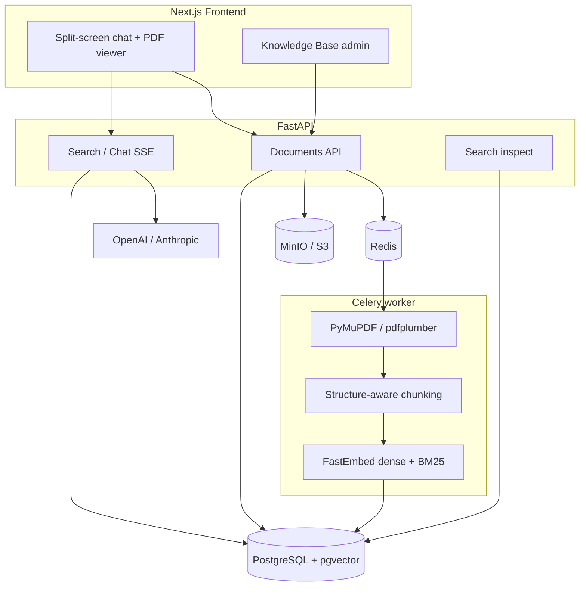

# Архитектура Docwise

Продуктовые требования: [srs.md](srs.md). Отклонения от черновика ТЗ: [decisions.md](decisions.md).

## 1. Проблема

Корпоративный корпус документов (PDF/DOCX: регламенты, политики, NDA, финансы, договоры) плохо ищется и опасно отдаётся в LLM.

| Боль | Почему наивный подход ломается |
| --- | --- |
| Семантика вопроса | Keyword-поиск не понимает формулировку |
| Структура PDF | Нарезка по N символам рвёт таблицы и заголовки |
| Утечка ACL | Общий чат без фильтра векторов отдаёт стажёру финансы C-level |
| Доверие | Без точной страницы в оригинале ответ модели нельзя проверить |

Docwise закрывает это связкой: **RBAC на retrieval**, **structure-aware chunking**, **hybrid search + rerank**, **цитаты в PDF-вьюере**.

Происхождение: тот же каркас, что [ChainWise](../../chainwise/README.md) (auth, Celery, SSE). Векторы — **pgvector** в Postgres, не Qdrant. Отличие продукта — корпус PDF с ACL, а не чат по одному Solidity-файлу. Как переносить код: [reuse-from-chainwise.md](reuse-from-chainwise.md).

## 2. Компоненты

| Компонент | Ответственность |
| --- | --- |
| Next.js | Чат, сноски, встроенный PDF, админка базы знаний |
| FastAPI | Auth, загрузка, статусы, SSE-чат, inspect, отдача файла |
| Celery | Тяжёлый парсинг, чанкинг, эмбеддинги, upsert чанков в Postgres |
| PostgreSQL + pgvector | Пользователи, документы, сессии, аудит, dense-векторы чанков |
| MinIO | Байты оригинальных файлов |
| Redis | Брокер Celery и кеш |

## 3. Поток A — загрузка документа

1. Пользователь с правом управления KB загружает PDF и выбирает `access_roles[]`.
2. API считает SHA-256, сохраняет объект в MinIO, строку в `documents` со статусом `pending`.
3. Ставится задача `process_document(doc_id)`.
4. Воркер: извлечение по страницам → чанки секции/страницы → dense (+ BM25/FTS) → upsert в `document_chunks` (с копией ACL) → `status = ready` либо `failed`.

## 4. Поток B — вопрос в чат

1. Клиент шлёт `POST /api/v1/chat/stream` (cookie-сессия).
2. Из сессии берутся `role` и `departments`; в SQL добавляется `access_roles && allowed_roles`.
3. Dense Top-25 + BM25 Top-25 → RRF → Top-15 → cross-encoder → порог 0.25 → Top-4.
4. Первым SSE-событием уходят цитаты, затем токены ответа, затем метрики.
5. UI открывает PDF на странице сноски и подсвечивает фрагмент.

Данные, к которым нет прав, **физически не попадают** в промпт.

## 5. Поток C — inspect

1. Admin при включённом `ENABLE_SEARCH_INSPECT` шлёт `POST /api/v1/search/inspect`.
2. Тот же hybrid retrieval и SQL ACL, что у чата (роли из сессии). Флаг выкл → `404`; не admin → `403`.
3. Ответ: списки dense / sparse / rrf / reranked со скорами и превью. Чанки вне ACL отсутствуют.
4. Строка в `rag_audit_logs` (UUID чанков после реранкера, без текста).

## 6. Границы и вне скоупа (v1)

В скоупе: PDF (приоритет), DOCX по возможности; роли и отделы; один тенант; английские/русские корпоративные документы.

Вне скоупа v1: полноценный мультитеннант, SSO/SAML, онлайн-редактирование файлов, агенты с tool-calling за пределы корпуса, обучение собственных эмбеддингов. Не тащить из ChainWise: Slither, solc, Etherscan, XGBoost risk score, генератор PDF-отчётов.
