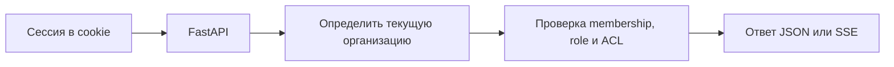

# HTTP API

**Базовый префикс:** `/api/v1` · **формат:** JSON · **ID:** строки UUID.

OpenAPI доступен на `/docs` только вне рабочей среды. Эта страница — краткий контракт, записанный вручную;
если он расходится со схемами FastAPI, исправлять нужно оба источника.

## Общие правила

- В API v1 для входа используются cookie `dw_access` и `dw_refresh`, действующие только для текущего узла; схема Bearer не поддерживается.
- `organization_id` определяется текущей сессией. Поля организации и ACL из тела запроса не задают полномочия.
- HTTP-ошибка имеет форму `{ "error": { "code", "message", "details?" } }`.
- После начала SSE ошибки чата передаются как `type: error`; трассировка стека и внутренние пути не возвращаются.
- При `COOKIE_SAMESITE=none` запросы, меняющие данные, должны пройти проверку Origin/CSRF.

## Маршруты

| Группа | Контракт |
| --- | --- |
| Состояние сервиса | [`GET /`, `/health`, `/ready`](api/overview.md) |
| Вход и сессии | [`/auth/*`](../platform/auth.md) |
| Документы | [Загрузка, список, состояние, ACL, оригинал, удаление](api/documents.md) |
| Чат | [SSE, сессии, обратная связь](api/chat.md) |
| Диагностика | [Этапы поиска](api/inspect.md) |
| Организации | [Участники, приглашения, смена организации](api/organizations.md) |
| Оплата, SSO и домен | [Маршруты планов и доступных возможностей](api/organizations.md) |

## Канонические документы

| Тема | Подробности |
| --- | --- |
| Ошибки и готовность сервиса | [api/overview.md](api/overview.md) |
| Документы | [api/documents.md](api/documents.md) |
| Чат и SSE | [api/chat.md](api/chat.md) |
| Диагностика поиска | [api/inspect.md](api/inspect.md) |
| Организации, оплата, SSO и домен | [api/organizations.md](api/organizations.md) |

Вход и ACL описаны в [platform/auth.md](../platform/auth.md), изоляция организаций — в
[platform/tenancy.md](../platform/tenancy.md). Этот краткий контракт обновляйте вместе с маршрутом и схемой.
