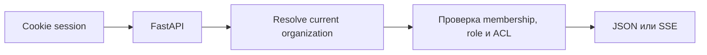

# HTTP API

**Base prefix:** `/api/v1` · **формат:** JSON · **ID:** UUID strings.

OpenAPI доступен на `/docs` только вне production. Этот каталог — краткий ручной контракт;
если он расходится со схемами FastAPI, исправлять нужно оба источника.

## Общие правила

- Auth в API v1 — host-only cookies `dw_access` / `dw_refresh`; Bearer не поддерживается.
- `organization_id` определяется текущей сессией. Поля tenant и ACL из request body не задают полномочия.
- HTTP-ошибка имеет форму `{ "error": { "code", "message", "details?" } }`.
- После начала SSE ошибки чата передаются как `type: error`; stack trace и внутренние пути не возвращаются.
- Для `COOKIE_SAMESITE=none` mutating requests должны пройти Origin/CSRF проверку.

## Маршруты

| Группа | Контракт |
| --- | --- |
| Health | [`GET /`, `/health`, `/ready`](api/overview.md) |
| Auth | [`/auth/*`](../platform/auth.md) |
| Documents | [Upload, list, status, ACL, raw, delete](api/documents.md) |
| Chat | [SSE, sessions, feedback](api/chat.md) |
| Inspect | [Search pipeline stages](api/inspect.md) |
| Organizations | [Members, invites, switch](api/organizations.md) |
| Billing, SSO, domain | [Plan endpoints and entitlements](api/organizations.md) |

## Канонические документы

| Тема | Подробности |
| --- | --- |
| Ошибки и health | [api/overview.md](api/overview.md) |
| Документы | [api/documents.md](api/documents.md) |
| Чат и SSE | [api/chat.md](api/chat.md) |
| Inspect | [api/inspect.md](api/inspect.md) |
| Organizations, billing, SSO, domain | [api/organizations.md](api/organizations.md) |

Auth/ACL описаны в [platform/auth.md](../platform/auth.md), tenant boundaries — в
[platform/tenancy.md](../platform/tenancy.md). Ручной API contract обновляется вместе с route/schema.
