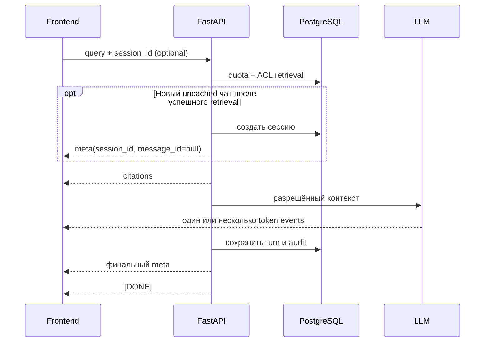

# Chat API и SSE

## Запрос

```http
POST /api/v1/chat/stream
Content-Type: application/json
```

```json
{
  "query": "What is the daily travel reimbursement cap?",
  "session_id": null
}
```

Cookie session обязательна. `RATE_LIMIT_CHAT_PER_MINUTE` ограничивает запросы пользователя.
При исчерпанной token quota SSE error уходит до retrieval. Второй активный stream для той же существующей
сессии отклоняется до SSE с `409 resource.conflict`; разные сессии независимы.

Поля `organization_id`, `org_id`, `access_roles` и `document_ids` из body игнорируются как источник прав.
Retrieval использует SQL ACL текущей membership.

## Порядок событий

Формат: `data: <json>\n\n`, завершается `data: [DONE]`.



Для нового uncached чата порядок — ранний `meta` → `citations` → `token` events → финальный `meta` → `[DONE]`.
Ранний meta позволяет показать сессию до готового ответа. При ошибке до успешного retrieval новая сессия не создаётся.
У existing session и cache hit раннего meta нет.

Финальное событие:

```json
{"type":"meta","cached":false,"tokens_used":640,"session_id":"...","message_id":"..."}
```

| Event | Поля/назначение |
| --- | --- |
| `meta` (ранний) | `session_id`, `message_id: null`; только новый uncached чат |
| `citations` | `citations[]`: doc ID/title, page/section, snippet |
| `token` | `content` — очередной fragment ответа |
| `meta` (финальный) | `cached`, usage, `session_id`, `message_id` |
| `error` | Без внутренних stack и названий недоступных файлов |
| `[DONE]` | Конец stream |

Полная логика фильтров, retrieval и cache: [pipeline/retrieval.md](../../pipeline/retrieval.md).

## История сессий и feedback

```http
GET    /api/v1/chat/sessions?limit=20&offset=0
GET    /api/v1/chat/sessions/{id}
DELETE /api/v1/chat/sessions/{id}
POST   /api/v1/chat/feedback
```

- Список и detail показывают сессии только текущего пользователя и текущей org.
- `DELETE` удаляет сессию и messages через cascade; audit `session_id` обнуляется.
- Feedback body: `{ "message_id": "<uuid>", "rating": 1, "comment": "optional" }`.
- Оценить можно собственное assistant message. Комментарий обрезается до 2000 символов и живёт по audit retention policy.

Пагинация: `limit` 1–100 (default 20), `offset` от 0. Отсутствующая/чужая сессия возвращает одинаковый `404`.
