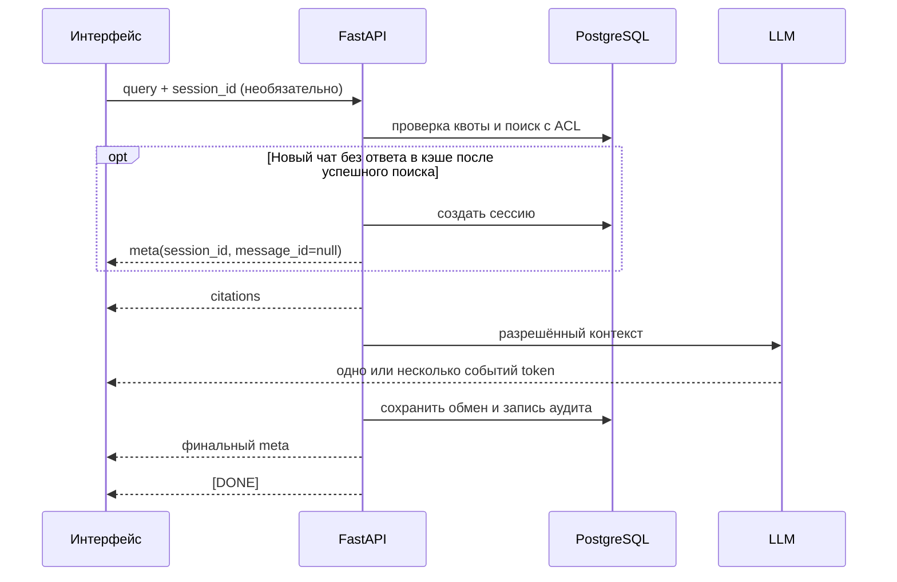

# API чата и SSE

## Запрос

```http
POST /api/v1/chat/stream
Content-Type: application/json
```

```json
{
  "query": "What is the daily travel reimbursement cap?",
  "session_id": null
}
```

Сессия на основе cookie обязательна. `RATE_LIMIT_CHAT_PER_MINUTE` ограничивает частоту запросов пользователя.
Если исчерпана квота токенов, ошибка SSE отправляется до начала поиска. Второй активный поток для той же существующей
сессии отклоняется до начала SSE с `409 resource.conflict`; запросы к разным сессиям выполняются независимо.

Поля `organization_id`, `org_id`, `access_roles` и `document_ids` из тела запроса не задают права.
Поиск применяет SQL-фильтр ACL текущего членства в организации.

## Порядок событий

Формат: `data: <json>\n\n`, завершается `data: [DONE]`.



Для нового чата без ответа в кэше порядок такой: ранний `meta` → `citations` → события `token` → финальный `meta` → `[DONE]`.
Ранний `meta` позволяет показать сессию до готовности ответа. При ошибке до успешного поиска новая сессия не создаётся.
Для существующей сессии и при попадании в кэш раннего `meta` нет.

Финальное событие:

```json
{"type":"meta","cached":false,"tokens_used":640,"session_id":"...","message_id":"..."}
```

| Событие | Поля и назначение |
| --- | --- |
| `meta` (ранний) | `session_id`, `message_id: null`; только новый чат без ответа в кэше |
| `citations` | `citations[]`: ID и название документа, страница или раздел, фрагмент текста |
| `token` | `content` — очередная часть ответа |
| `meta` (финальный) | `cached`, сведения о расходе токенов, `session_id`, `message_id` |
| `error` | Без внутренней трассировки и названий недоступных файлов |
| `[DONE]` | Завершение потока |

Полная логика фильтрации, поиска и кэширования: [pipeline/retrieval.md](../../pipeline/retrieval.md).

## История сессий и обратная связь

```http
GET    /api/v1/chat/sessions?limit=20&offset=0
GET    /api/v1/chat/sessions/{id}
DELETE /api/v1/chat/sessions/{id}
POST   /api/v1/chat/feedback
```

- Список и подробная запись показывают сессии только текущего пользователя и текущей организации.
- `DELETE` удаляет сессию и сообщения каскадно; в аудите `session_id` обнуляется.
- Тело запроса обратной связи: `{ "message_id": "<uuid>", "rating": 1, "comment": "optional" }`.
- Пользователь может оценить только собственное сообщение ассистента. Комментарий обрезается до 2000 символов и хранится в течение срока хранения аудита.

Постраничная выдача: `limit` от 1 до 100 (по умолчанию 20), `offset` от 0. Для отсутствующей и чужой сессии возвращается одинаковый `404`.
