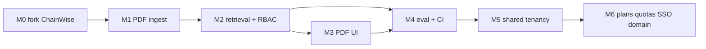
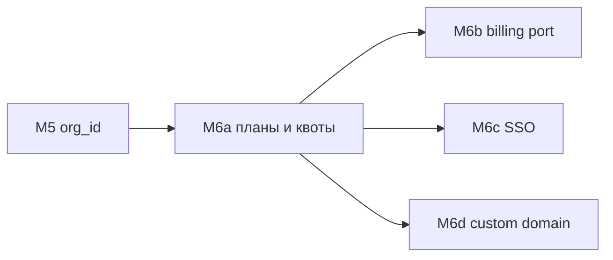

# Roadmap

Ориентир v1: **1–2 недели** после M0, потому что каркас уже в `../chainwise`. Не начинать с пустого Compose. Карта файлов: [reuse-from-chainwise.md](reuse-from-chainwise.md). Продукт: [srs.md](srs.md). Отклонения: [decisions.md](decisions.md).

**Как отмечать.** Закрытый пункт — `- [x]` в том же изменении, что и код. Критерий вехи не ставить, пока не выполнен целиком. Приёмка продукта — в конце файла и в [srs.md](srs.md) §6.

| Веха | Статус | Ориентир |
| --- | --- | --- |
| [M0 Скелет](#milestone-0--скелет-из-chainwise) | готово | 0.5–1 день |
| [M1 PDF ingest](#milestone-1--pdf-ingest) | готово | 2–3 дня |
| [M2 Retrieval + RBAC + SSE](#milestone-2--corpus-retrieval--rbac--sse) | готово | 3–4 дня |
| [M3 Split-screen UI](#milestone-3--split-screen-ui) | готово | 2–3 дня |
| [M4 Eval, CI, портфолио](#milestone-4--eval-ci-портфолио) | готово | 1–2 дня |
| [M5 Shared tenancy](#milestone-5--shared-tenancy-b2b-saas) | готово | после v1 |
| [M6 Commercial SaaS](#milestone-6--commercial-saas) | не начато | после M5 |

M3 и M4 после M2 можно вести параллельно, но клик по цитате и eval оба требуют живого retrieval. Shared SaaS ([M5](#milestone-5--shared-tenancy-b2b-saas)) оборачивает внутреннюю ACL в `org_id`. Коммерческая оболочка ([M6](#milestone-6--commercial-saas)): планы, квоты, SSO, custom domain; биллинг за портом (`dev` по умолчанию).

---

## Milestone 0 — Скелет из ChainWise

**Критерий:** `make up` поднимает postgres, redis, minio, backend, worker, frontend. Логин/регистрация работают (cookies, UUID `id`). `/ready` показывает `pgvector: ok`.

### Каркас

- [x] Скопировать `backend/` без slither / solc / risk / etherscan
- [x] Скопировать `frontend/` (ui + auth + api client)
- [x] `docker-compose.yml`, `Makefile`, GitHub Actions
- [x] Выкинуть сервис `slither`, пути `SOLCX_*` / `RISK_MODEL_*` / Qdrant
- [x] Добавить MinIO
- [x] Образ Postgres `pgvector/pgvector:pg15`, миграция `CREATE EXTENSION vector`
- [x] Переименовать куки `cw_*` → `dw_*`, приложение → Docwise
- [x] Sync SQLAlchemy Session (не asyncpg)
- [x] UUID PK на `users` (и заложить UUID на остальные сущности)
- [x] Роли `admin` \| `manager` \| `employee` + `departments[]`, CHECK на `role`

### Сессия и здоровье

- [x] Cookie-only auth: login/register/google/refresh отдают `UserResponse`, без `access_token` в JSON
- [x] `Authorization: Bearer` игнорируется
- [x] CSRF при `COOKIE_SAMESITE=none` (`Origin` / `X-Requested-With: Docwise`)
- [x] Refresh Redis fail-closed; rate limit login/register/google по IP
- [x] Google требует `email_verified`; первый пользователь в пустой БД — `admin`
- [x] `GET /health` — liveness; `GET /ready` — postgres, pgvector, redis, minio
- [x] OpenAPI `/docs` выключен в `production`

**Критерий вехи:** [x] стек поднимается, логин работает, `/ready` с `pgvector: ok`

---

## Milestone 1 — PDF ingest

Спеки: [ingestion.md](ingestion.md), [data-model.md](data-model.md), [api.md](api.md). Не парсить PDF в upload-handler.

**Критерий:** upload → `ready`, чанки с `page_number` и `access_roles`.

### Данные и хранение

- [x] Модель `documents`: UUID PK, `title`, `file_path`, `file_hash`, `file_size_bytes`, `total_pages`, `access_roles[]`, `status` (`pending` \| `processing` \| `ready` \| `failed`), `last_error`
- [x] Модель `document_chunks`: UUID PK, UUID `document_id`, стабильный `chunk_id`, `page_number`, `section_title`, `is_table`, `access_roles[]` (копия с документа), `content`, `token_count`, `embedding vector(384)`, `doc_title`, bbox/highlight JSONB
- [x] Индексы: `file_hash`, `status`, GIN `access_roles`, HNSW на `embedding`
- [x] Alembic-миграция таблиц (не `create_all` в рантайме)
- [x] MinIO bucket `documents`; байты только через API, без публичных вечных URL

### API документов

- [x] `POST /api/v1/documents/upload` — multipart PDF + `access_roles`, `201` + `pending`, enqueue Celery
- [x] SHA-256 байтов; дубликат `file_hash` → `409` (без тела существующей записи, [ADR-011](decisions.md))
- [x] `GET /api/v1/documents` — пагинация, фильтр `status`, только ACL пользователя
- [x] `GET /api/v1/documents/{id}/status` — статус + `last_error`; нет прав / нет записи → `404`
- [x] `GET /api/v1/documents/{id}/raw` — `application/pdf`, тот же ACL, `404` без утечки названия
- [x] `DELETE /api/v1/documents/{id}` — каскад Postgres (документ + чанки) + MinIO; только manage KB
- [x] Upload и delete: `require_admin`
- [x] Rate limit upload (`RATE_LIMIT_UPLOAD_PER_MINUTE`); лимит размера (~50 MB), только PDF в v1

### Celery

- [x] Задача `ingestion.process_document(document_id: UUID-str)` вместо stub
- [x] Redis lock `indexing_lock:{document_id}`; повтор задачи идемпотентен
- [x] Статусы `pending → processing → ready | failed`; на ошибке `last_error`, индекс полный или удалён (нет «полуготового» `ready`)
- [x] Скачать объект из MinIO по `file_path`

### Парсер и чанкинг

- [x] `pdf_parser`: PyMuPDF по физическим страницам (1-based в API)
- [x] Таблицы через pdfplumber → GitHub-flavored Markdown, `is_table`
- [x] Координаты блоков в payload, если доступны (подсветка в M3)
- [x] Чанк не пересекает границу страницы; резать по секциям внутри страницы
- [x] 400–600 токенов, overlap 50 только внутри той же страницы/секции
- [x] Мета-заголовок перед эмбеддингом: `[Document: … | Section: … | Page: N]`
- [x] `embed_text` vs `content` для UI — одно правило, сниппет в цитатах без служебной строки
- [x] Не портировать `semantic_splitter.py`

### Эмбеддинги

- [x] FastEmbed `BAAI/bge-small-en-v1.5`, `vector(384)` cosine
- [x] Перед insert удалять строки `document_chunks` по `document_id`
- [x] Скопировать `access_roles` документа на каждый чанк
- [x] Смена ACL файла обновляет документ **и** все его чанки (или полный re-upsert)

### Тесты M1

- [x] Фикстурный PDF с таблицей и заголовками
- [x] Один `page_number` на чанк; таблица в Markdown; `access_roles` совпадают с документом
- [x] Re-ingest того же `document_id` / `file_hash` не плодит дубли чанков
- [x] `/raw` и list не отдают чужой файл (404, не 403 с title)

**Критерий вехи:** [x] upload → `ready`, точки с `page_number` и `access_roles`

---

## Milestone 2 — Corpus retrieval + RBAC + SSE

Спеки: [retrieval.md](retrieval.md), [auth.md](auth.md), [api.md](api.md). Запрещено `SELECT` всего корпуса в RAM (путь ChainWise `scroll_contract_chunks`).

**Критерий:** вопрос находит страницу; пользователь без роли не видит чанк в inspect; чужой ACL не протекает через LLM cache.

### Retrieval

- [x] Вырезать Solidity-эвристики, overview-аудит, interface stubs, findings-in-context
- [x] Dense Top-25: `embedding <=> query`, SQL `access_roles && allowed_roles`
- [x] Sparse/FTS Top-25 с тем же ACL (или BM25 только по dense-кандидатам, пока нет отдельного sparse-индекса — [ADR-005](decisions.md))
- [x] Порт `bm25_scores` + `reciprocal_rank_fusion` (`k=60`) → Top-15
- [x] Cross-encoder `BAAI/bge-reranker-base`: порог 0.25 → Top-4
- [x] Пустой список после порога → отказ, без вызова «творчества» LLM
- [x] `allowed_roles` = `{role} ∪ departments ∪ {all}`; роли не из тела запроса

### Чат и SSE

- [x] `POST /api/v1/chat/stream` — cookie session, rate limit chat
- [x] SSE JSON-конверты ChainWise: `citations` → `token` → `meta` → `[DONE]`; ошибки `type: error`
- [x] Цитаты `{doc_id: UUID, doc_title, page, snippet}` до первого токена
- [x] Каждый факт в ответе цитируем; иначе отказ фиксированной фразой
- [x] `session_id` пустой → создать `chat_sessions`; история не обходит ACL
- [x] `GET /api/v1/chat/sessions` (+ детали сессии)
- [x] `POST /api/v1/chat/feedback` — `+1/-1` только на свои сообщения
- [x] LLM cache key включает канонический набор `allowed_roles` (или кэш не шарить)

### Inspect и аудит

- [x] `POST /api/v1/search/inspect` — списки dense / sparse / rrf / reranked; тот же SQL ACL
- [x] Флаг `ENABLE_SEARCH_INSPECT`; в production по умолчанию выкл
- [x] Таблица `rag_audit_logs`: query, user, chunk ids, latency_ms, tokens_used, feedback
- [x] В аудит не писать полный текст restricted-чанков, если лог доступен тому же пользователю через API

### Тесты M2

- [x] Порт `test_rag_engine.py`: BM25 и RRF `k=60` без GPU / без живого LLM
- [x] Пользователь, чей `allowed_roles` не пересекается с чанком, отсутствует в fused / reranked / промпте
- [x] Inspect и chat не подтверждают существование чужого файла
- [x] Кэш, прогретый под admin, не отдаёт HR-чанки employee

**Критерий вехи:** [x] страница находится; ACL держит inspect и cache

---

## Milestone 3 — Split-screen UI

Спека: [frontend.md](frontend.md). База — ChainWise chat + auth; code-viewer не тащить.

**Критерий:** end-to-end клик по цитате открывает нужную страницу.

### Чат

- [x] Маршруты `/` или `/chat`, `/chat/[sessionId]`, `/documents`, `/login`
- [x] Split-pane: сессии (можно скрыть) / чат с min-width / PDF (можно скрыть)
- [x] SSE-ридер: `citations | token | meta | error | done`
- [x] Сноски-теги `Doc.pdf (стр. N)`, не `file.sol:L10-20` и не сырой `[^n]`
- [x] Стрим токенов без ожидания полного ответа; ошибка чата — тост, не развал страницы
- [x] Список сессий; пустое правое состояние — плейсхолдер «выберите цитату»

### PDF viewer

- [x] Встроенный viewer (`pdfjs-dist` / `@react-pdf-viewer/core`)
- [x] Файл с `GET /api/v1/documents/{id}/raw` (cookies)
- [x] Клик по сноске: нужный файл → страница → подсветка bbox/текста, скролл в вид
- [x] Пока PDF грузится, ответ в чате читать можно

### Админка KB

- [x] Таблица: название, размер, страницы, теги доступа, статус; `last_error` при failed
- [x] Drag-and-drop upload + чекбоксы ролей (`HR`, `Finance`, `General`/`all`, …)
- [x] Поллинг `GET .../status` со шагами parse → chunk → embed
- [x] Удаление с подтверждением; только manage KB
- [x] Не показывать документы вне ACL

### Тесты / проверка M3

- [x] Ручной проход: вопрос → сноска → верная страница (браузер)
- [x] Employee не видит HR-файл в списке и не открывает `/raw`

**Критерий вехи:** [x] клик по цитате открывает нужную страницу

---

## Milestone 4 — Eval, CI, портфолио

Спеки: [evaluation.md](evaluation.md), [nfr.md](nfr.md). Unit CI без GPU и без живого LLM.

**Критерий:** зелёный CI; нулевые утечки ACL на негативных кейсах eval.

### Eval

- [x] `eval/golden_dataset.json` ≥ 30 вопросов: `question`, `ground_truth_answer`, `target_doc_id`, желательно `target_page`, `must_not_doc_ids`
- [x] `eval/run_eval.py` гоняет **реальный** retrieval+generation под роль eval-пользователя
- [x] `reports/rag_benchmark.md`: Faithfulness, Context Precision, Answer Relevance
- [x] ACL-негативы: ноль утечек `must_not_doc_ids`
- [x] Eval не в default CI (нужен ключ LLM и проиндексированные фикстуры)

Первый прогон 2026-09-10 (employee, 35 кейсов): Faithfulness 1.000, Context Precision 0.976, ACL 0 утечек. Answer Relevance 0.789 — два miss после порога реранкера, не RBAC. Отчёт: [rag_benchmark.md](../reports/rag_benchmark.md).

### CI и качество репо

- [x] GitHub Actions: ruff или flake8 + pytest (парсер, RRF, ACL)
- [x] Frontend `tsc --noEmit` в CI
- [x] Нет coverage-хуков на `pragma_parser` / `risk_scorer`
- [x] CI зелёный на `main` / PR

### Портфолио

- [x] Английский README: схема, why not naive RAG, стек, как поднять demo
- [x] В README — ссылка на метрики eval и коротко про SQL-RBAC
- [x] Demo-скрипт или раздел: тестовые пользователи employee vs hr, два PDF с разным ACL

**Критерий вехи:** [x] зелёный CI; нулевые ACL-утечки в eval

---

## Приёмка продукта v1

Канонический список — [srs.md](srs.md) §6. Закрывать вместе с этим файлом.

- [x] Upload сложного PDF с таблицей → `ready`, чанки с одной `page_number`, таблица в Markdown
- [x] Вопрос находит верную страницу; клик в UI открывает её
- [x] Пользователь без роли не видит чанк в inspect, chat и `/raw`
- [x] Нехватка контекста → отказ «в документах нет информации», без выдуманных фактов
- [x] Повторный ingest того же `document_id` не плодит дубли в `document_chunks`
- [x] Ragas-прогон пишет `reports/rag_benchmark.md`; ACL-негативы — ноль утечек
- [x] CI: lint + pytest (парсер, RRF) без GPU и без живого LLM в unit-тестах

Shared SaaS — не часть приёмки v1; критерии M5. Коммерческая оболочка (планы, SSO, домен) — критерии M6.

---

## Milestone 5 — Shared tenancy (B2B SaaS)

Спека: [tenancy.md](tenancy.md), [auth.md](auth.md), [data-model.md](data-model.md), [api.md](api.md), [ADR-012](decisions.md). Не подменять `org_id` тегом в `access_roles`. Не класть двух клиентов на схему M0–M4.

**Критерий:** две организации в одном Postgres; employee A не видит документ B с тегом `all` в list, `/raw`, chat, inspect и LLM-кэше.

### Данные

- [x] Таблицы `organizations`, `organization_memberships` (role + departments на членстве)
- [x] `organization_id` NOT NULL на `documents`, `document_chunks`, `chat_sessions`, `rag_audit_logs`
- [x] Unique `(organization_id, file_hash)` вместо глобального unique `file_hash`
- [x] Миграция существующих строк в одну bootstrap-org; `users.role` / `departments` переносятся на membership
- [x] Чанк копирует `organization_id` документа при ingest и при PATCH ACL (org не меняется)

### Auth и API

- [x] Register создаёт user + org + membership `admin` (`organization_name`)
- [x] Инвайты org-admin; существующий email получает membership, не вторую «глобальную» роль
- [x] Access-токен / сессия несут текущий `org_id`; `POST /auth/switch-organization` только для своего membership
- [x] `org_id` / `organization_id` в теле chat/search/upload игнорируются как источник прав
- [x] `require_admin` — admin текущей org; нет platform-admin с чтением чужих корпусов
- [x] MinIO-ключи с префиксом `orgs/{organization_id}/`
- [x] LLM cache: `llm_cache:{version}:{org_id}:{roles_hash}:{question_hash}`

### Retrieval

- [x] Каждый dense и sparse/FTS: `organization_id = :current_org AND access_roles && allowed_roles`
- [x] `all` = все члены этой org, не все залогиненные в SaaS
- [x] 409 дубля hash не подтверждает файл другой org; 404 на чужой raw неотличим от «нет файла»

### UI и тесты

- [x] Имя текущей org в шапке; инвайты для org-admin; не слать org id в теле чата
- [x] Pytest: два тенанта, одинаковые теги `all` / `hr` — ноль пересечений в list, raw, fused, reranked, промпте, кэше
- [x] Eval: `must_not_doc_ids` другой org — ноль утечек

**Критерий вехи:** [x] кросс-орг утечек нет, включая `access_roles = ['all']`

---

## Milestone 6 — Commercial SaaS

Спеки: [billing.md](billing.md), [tenancy.md](tenancy.md), [auth.md](auth.md), [data-model.md](data-model.md), [api.md](api.md), [ADR-013](decisions.md)–[ADR-015](decisions.md). План и квоты — колонки org, не клиент и не промпт. SSO и hostname не подменяют SQL `organization_id`. Срезы можно мержить по отдельности; критерий вехи — все четыре.

**Критерий:** две org на одном Compose (`BILLING_PROVIDER=dev`): Acme Starter упирается в страницы → `402` на upload; Globex Enterprise SSO не открывает Acme (в т.ч. `all`); хост Acme не принимает сессию Globex.

### M6a — Планы и квоты

- [x] `organizations.plan` (`starter` \| `team` \| `enterprise`), период, `billing_status`; новая org — `starter`
- [x] Квоты seats / indexed pages / chat tokens за период из конфига плана ([billing.md](billing.md))
- [x] Upload: текущие страницы ≥ капа → `402`, без Celery; ingest сверх капа → `failed`, без `ready`
- [x] Chat: токены периода ≥ капа → отказ **до** retrieval (SSE `type: error`)
- [x] Инвайт / JIT: seats ≥ капа → `402`
- [x] `429` остаётся антиабьюзом; entitlement SSO/домена — `403`; свою квоту не маскировать под `404`
- [x] Org-admin: `GET /billing/usage` + `GET /billing/subscription`; employee не видит чужой usage и не узнаёт чужие файлы из `402`

### M6b — Порт биллинга (`dev` / `stripe`)

- [ ] `BILLING_PROVIDER=dev` \| `stripe`; Compose и не-`production` — `dev`; квоты не вызывают провайдера
- [ ] Dev: org-admin меняет план / `past_due` / отмену; UI-бейдж Dev billing; `POST /billing/dev/simulate` только текущая org, иначе `404`
- [ ] `past_due` / cancel → `organizations.status = suspended` (вход в org как в M5)
- [ ] Адаптер Stripe в коде допустим; живой `api.stripe.com` не критерий; без ключей при `stripe` — billing в `/ready` не `ok`
- [ ] Таблица `billing_events` (идемпотентность `provider` + `external_id`); вебхук не читает корпус

### M6c — SSO / SAML

- [ ] Коннектор принадлежит одной org; org из URL/коннектора (`/auth/sso/{slug}/…`), не из assertion и не из тела
- [ ] SP-initiated + ACS; успех → те же `dw_*` cookies; Bearer по-прежнему игнорируется
- [ ] JIT — только membership **этой** org; роли других org не трогать; без JIT нужен инвайт
- [ ] `sso_enforced`: пароль и Google не сажают в эту org; `switch-organization` без свежего SSO → отказ
- [ ] Маппинг групп IdP → `role` / `departments` таблицей org-admin; не писать группы в `access_roles` документов
- [ ] Email без verified-эквивалента — отказ. Compose: `SSO_PROVIDER=dev` (фикстурная assertion), не живой Okta
- [ ] Entitlement: план без SSO → `403` на коннектор, не «неверный IdP»

### M6d — Custom domain

- [ ] Платформенный хост `{slug}.localhost` / `{slug}.docwise.app`; опционально verified CNAME
- [ ] Cookie **host-only** (без `Domain=.docwise.app` / родителя)
- [ ] `Host` → org совпадает с `org_id` сессии; хост пинит, не заменяет SQL-фильтр
- [ ] На хосте Acme нельзя `switch-organization` в Globex
- [ ] Неподтверждённый hostname не биндится; один hostname — одна org; CORS/CSRF allowlist из проверенного домена
- [ ] Entitlement Enterprise; Compose без Let's Encrypt (`/etc/hosts`)

### UI и тесты M6

- [ ] Настройки org-admin: план, usage, SSO, домен; employee — отказ квоты без панели биллинга
- [ ] Pytest: две org, `dev`-провайдер — `402` только у упёршейся; SSO Globex не попадает в fused/reranked/промпт/кэш Acme
- [ ] Pytest: cookie/host Acme не открывает raw Globex; simulate billing чужой org → `404`
- [ ] Живой Stripe и живой IdP в default CI не нужны

**Критерий вехи:** [ ] квоты `402`, SSO и hostname не пересекают org, включая `access_roles = ['all']`

---

## Вне скоупа (позже M6)

Не открывать, пока не закрыт критерий M6:

- консоль оператора платформы (чтение чужих корпусов запрещено и там, пока нет явного break-glass в SRS)
- Postgres RLS как defense-in-depth (не замена `org_id` в запросах)
- SCIM / directory sync; маппинг групп IdP сразу в `access_roles` документов
- боевой эквайринг как критерий (ЮKassa, Stripe live); адаптер Stripe в коде — опция M6b
- онлайн-редактирование файлов
- агенты с tool-calling за пределы корпуса
- обучение своих эмбеддингов
- DOCX как обязательный формат (желателен, не блокер)
- из ChainWise: Slither, solc, Etherscan, XGBoost risk, PDF-отчёт аудита, Qdrant
