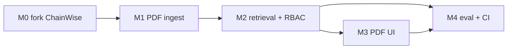

# План реализации (Milestones)

Ориентир: **1–2 недели**, потому что каркас уже есть в `../chainwise`. Не начинать с пустого Compose — форк и вырезание Solidity дешевле, чем писать auth/SSE заново. Детали файлов: [reuse-from-chainwise.md](reuse-from-chainwise.md).

## Milestone 0 — Скелет из ChainWise (0.5–1 день)

- Скопировать `backend/` (без slither/solc/risk/etherscan), `frontend/` (ui + auth + api client), `docker-compose.yml`, `Makefile`, CI.
- Выкинуть сервис `slither`, пути `SOLCX_*` / `RISK_MODEL_*`. Добавить MinIO.
- Переименовать куки `cw_*` → `dw_*`, приложение ChainWise → Docwise.
- Sync SQLAlchemy оставить. `/health` — liveness; зависимости — `/ready` (без slither/Qdrant).

**Критерий:** `make up` поднимает postgres, redis, minio, backend, worker, frontend. Логин/регистрация работают (cookies, UUID `id`). `/ready` показывает `pgvector: ok`.

## Milestone 1 — PDF ingest (2–3 дня)

- Модель `documents` (+ `file_hash`, `access_roles`, `last_error`) вместо `contracts`.
- Celery: lock `indexing_lock:{document_id}`, статусы `pending → processing → ready|failed`.
- `pdf_parser` (PyMuPDF + pdfplumber таблицы) и page-bounded chunker.
- Таблица `document_chunks` с `vector(384)`, модель `bge-small-en-v1.5`, delete-by-`document_id`.
- Тест PDF с таблицей; идемпотентный re-ingest по `file_hash`.

**Критерий:** upload → `ready`, точки с `page_number` и `access_roles`.

## Milestone 2 — Corpus retrieval + RBAC + SSE (3–4 дня)

- Вырезать из RAG Solidity-эвристики и `scroll` всего документа.
- Dense (+ FTS/BM25 по кандидатам) с `access_roles && allowed_roles`.
- RRF из ChainWise, добавить reranker Top-4.
- Чат: существующий SSE-каркас, цитаты `{doc_id, page}`; cache key с ролями.
- `POST /search/inspect`, `rag_audit_logs`.

**Критерий:** вопрос находит страницу; пользователь без роли не видит чанк в inspect; чужой ACL не протекает через LLM cache.

## Milestone 3 — Split-screen UI (2–3 дня)

- Чат ChainWise + PDF viewer вместо source viewer.
- Клик по сноске → файл + страница.
- Админка: drag-and-drop, чекбоксы HR/Finance/General, поллинг статуса (шаги parse/chunk/embed).

**Критерий:** end-to-end клик по цитате открывает нужную страницу.

## Milestone 4 — Eval, CI, портфолио (1–2 дня)

- Ragas `eval/run_eval.py`, `reports/rag_benchmark.md`.
- CI: ruff/flake8 + pytest (парсер + RRF). Без cov на `pragma_parser`.
- Английский README: схема, why not naive RAG, метрики, demo.

**Критерий:** зелёный CI; нулевые утечки ACL на негативных кейсах eval. Приёмка продукта: чеклист в [srs.md](srs.md).

## Порядок

