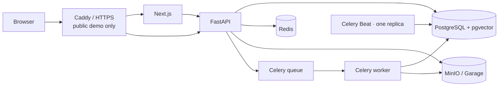

# Эксплуатация

Репозиторий поддерживает local/self-host pilot. Для публичного интервью-демо есть отдельный
[Compose overlay](public-demo.md). Он добавляет Caddy/TLS, но не превращает single-VPS профиль в HA production.
Kubernetes, secret manager и автоматическое point-in-time recovery не входят в репозиторий.

## Сервисы и трафик



| Сервис | Назначение | Local host port | Проверка |
| --- | --- | --- | --- |
| `postgres` | Данные, pgvector и FTS | `127.0.0.1:5432` | `pg_isready` |
| `redis` | Queue, sessions, limits, locks и cache | `127.0.0.1:6379` | `redis-cli ping` |
| `minio` | Оригиналы документов | `127.0.0.1:9000`, console `9001` | `/ready` проверяет bucket |
| `backend` | FastAPI | `127.0.0.1:8001` → `8000` | `/ready` |
| `celery-worker` | Ingestion и storage cleanup | не публикуется | Celery ping |
| `celery-beat` | Retention и периодические задачи | не публикуется | один scheduler; alert check |
| `frontend` | Next.js | `127.0.0.1:3001` → `3000` | public-profile healthcheck |
| `db-migrate` | RLS role/grants и Alembic upgrade | не публикуется | завершение до API/worker |

В public demo `minio` заменяется на одноузловой Garage; внутренние ports закрыты, наружу смотрит Caddy.

## Запуск и readiness

```bash
make deps
make up
curl -fsS http://localhost:8001/ready | python3 -m json.tool
```

`/health` проверяет только процесс. `/ready` проверяет PostgreSQL/pgvector, Redis, S3 и billing adapter;
при деградации возвращает `503`.

Единственный `db-migrate` создаёт/проверяет `docwise_rls`, выдаёт grants и применяет миграции.
Ошибка migration job блокирует API и worker. Вне этих Compose profiles миграции и non-superuser role
должны быть настроены отдельным deployment process.

## Конфигурация и ограничения профиля

- Base Compose — development: backend работает с `--reload` и bind mount.
- Host ports base Compose привязаны к loopback; public-demo ports сервисов внутри закрыты.
- Images собираются с подготовленными локально dependencies/models; build context без сети.
- Compose defaults — не production secrets; замените `SECRET_KEY` и storage/database credentials.
- Frontend получает `API_BASE_URL` при runtime; `NEXT_PUBLIC_*` встраиваются на build.
- API, worker и Beat используют `SET LOCAL ROLE docwise_rls`; superuser без этой роли обходит RLS.

Переменные: [configuration.md](../development/configuration.md). Публичный profile и Caddy:
[public-demo.md](public-demo.md).

## Миграции

```bash
make migrate
```

Текущий Alembic head находится в `backend/alembic/versions/`. Миграции автоматически не откатываются;
blue/green strategy не настроена. Перед изменением версии сохраните backup и проверьте его на совместимом коде.

## Логи и проверки

```bash
make logs
make logs-frontend
docker compose logs celery-worker
docker compose logs celery-beat
make check-pilot-alerts
```

Backend пишет JSON logs с redaction; Sentry включается через `SENTRY_DSN`. Prometheus, OpenTelemetry,
централизованные dashboards и долговременное хранение логов не настроены.

`check-pilot-alerts` проверяет `/ready`, worker, failed/stale docs, storage deletion backlog, retention heartbeat
и latency. Redis `LLEN celery` — эвристика, зависит от routing конфигурации.

## Ingestion worker

Текущая задача — `ingestion.process_document`; retry до трёх раз с backoff только для transient infrastructure errors.
Parser/format/quota failures terminal. Soft/hard task limits — 20/25 минут, prefetch — 1.

После изменения `backend/app/services/ingestion/` или `backend/worker/`:

```bash
make restart-worker
```

При сбое проверьте логи worker, `status`/`ingestion_stage`, Redis/S3, локальные models и quota.
Полная обработка не атомарна: статусы и storage side effects могут пережить retry отдельно от chunks.

Потерянные задачи после Redis outage восстанавливаются сначала в dry-run:

```bash
make requeue-stale-ingestion
```

Проверьте вывод; только потом применяйте:

```bash
make requeue-stale-ingestion APPLY=1
```

По умолчанию выбираются `pending` и `processing`, не обновлявшиеся ≥60 минут; одна выборка ограничена 500 IDs.
`--stale-minutes` не может быть меньше 30 минут. `failed` требует явный UUID и `--include-failed`.
Инструмент не печатает документы и в dry-run не меняет БД.

## Backup

```bash
make backup-pilot
```

Скрипт останавливает backend, worker и Beat на время согласованного снимка, затем сохраняет PostgreSQL dump,
MinIO mirror, Alembic revision и SHA-256 manifest в `backups/<timestamp>/`. Ранее работавшие сервисы запускаются
и при ошибке. Каталог backup исключён из Git.

Redis не включён: теряются queue, active refresh sessions, locks, limits и LLM cache. Off-site replication,
автоматическое расписание, PITR, encryption policy и согласованные RPO/RTO не заданы.

## Restore

```bash
make restore-pilot BACKUP_DIR=backups/pilot-latest
```

До остановки writers скрипт проверяет manifest, checksums и migration revision. Затем восстанавливает PostgreSQL,
синхронизирует MinIO с удалением лишних объектов, запускает Compose и ждёт `/ready`.
После restore он показывает dry-run кандидатов ingestion recovery; повторная постановка — отдельная команда.

Restore разрушителен для целевого проекта. `make restore-drill` требует `RESTORE_DRILL_CONFIRM=YES`, делает
backup источника и восстанавливает его в отдельный Compose project с отдельными volumes и loopback port `18001`.
Он проверяет `/ready` и наличие готовых документов, затем удаляет только временные volumes. Команда на время
backup останавливает writers источника, поэтому её запускают в согласованное окно. При ошибке target project
остаётся для диагностики. Backup validation не заменяет регулярный полный restore drill; off-site копия,
RPO/RTO и расписание drills пока необходимо определить и проверять отдельно.

## Согласование объектов storage

```bash
make reconcile-minio                 # dry-run
make reconcile-minio DELETE=1        # удалить только orphan objects
```

Перед `DELETE=1` сделайте backup. Скрипт учитывает `documents.file_path` и pending outbox; отсутствующий объект не восстанавливает.

## Rollback

Автоматического rollback нет. Для релиза, где миграция необратима, требуется согласованный backup/restore plan.

1. Остановить writers.
2. Сохранить PostgreSQL и object storage.
3. Вернуть совместимую версию образа.
4. При несовместимой схеме восстановить backup.
5. Проверить `/ready`, login, upload/ingestion и ACL retrieval.

Это общий порядок, не проверенный production runbook: конкретные действия зависят от migration и версии backup.
