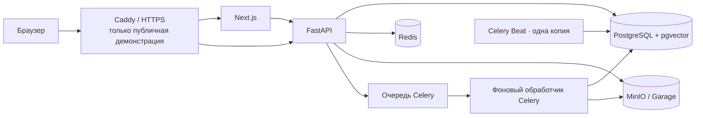

# Эксплуатация

Репозиторий поддерживает локальный запуск и самостоятельное развёртывание пилотной среды. Для публичной
демонстрации на интервью предусмотрена отдельная [конфигурация Compose](public-demo.md). Она добавляет Caddy/TLS,
но не превращает профиль на одном VPS в отказоустойчивую производственную среду. Kubernetes, менеджер секретов
и автоматическое восстановление на момент времени в репозиторий не входят.

## Сервисы и трафик



| Сервис | Назначение | Порт узла для локального доступа | Проверка |
| --- | --- | --- | --- |
| `postgres` | Данные, pgvector и FTS | `127.0.0.1:5432` | `pg_isready` |
| `redis` | Очередь, сессии, ограничения, блокировки и кэш | `127.0.0.1:6379` | `redis-cli ping` |
| `minio` | Оригиналы документов | `127.0.0.1:9000`, console `9001` | `/ready` проверяет bucket |
| `backend` | FastAPI | `127.0.0.1:8001` → `8000` | `/ready` |
| `celery-worker` | Обработка документов и очистка хранилища | не публикуется | Проверка Celery |
| `celery-beat` | Очистка по сроку хранения и периодические задачи | не публикуется | один планировщик; проверка оповещений |
| `frontend` | Next.js | `127.0.0.1:3001` → `3000` | проверка работоспособности публичного профиля |
| `db-migrate` | Настройка роли и разрешений RLS, обновление Alembic | не публикуется | завершение до запуска API и фонового обработчика |

В публичной демонстрации `minio` заменяется на одноузловой Garage; внутренние порты закрыты,
внешний трафик принимает Caddy.

## Запуск и проверка готовности

```bash
make deps
make up
curl -fsS http://localhost:8001/ready | python3 -m json.tool
```

`/health` проверяет только процесс. `/ready` проверяет PostgreSQL/pgvector, Redis, S3 и обработчик оплаты;
при деградации возвращает `503`.

Единственная задача `db-migrate` создаёт или проверяет `docwise_rls`, выдаёт разрешения и применяет миграции.
Ошибка этой задачи блокирует API и фоновый обработчик. За пределами этих профилей Compose миграции и роль
без прав суперпользователя нужно настраивать отдельным процессом развёртывания.

## Конфигурация и ограничения профиля

- Базовый Compose-профиль предназначен для разработки: серверная часть работает с `--reload` и привязкой каталога.
- Порты узла в базовой конфигурации привязаны к loopback; во внутренней сети публичного профиля порты служб закрыты.
- Образы собираются с зависимостями и моделями, подготовленными локально; во время сборки сеть не используется.
- Значения Compose по умолчанию не являются секретами для производственной среды; замените `SECRET_KEY` и реквизиты доступа к хранилищу и базе данных.
- Клиентская часть получает `API_BASE_URL` при запуске; значения `NEXT_PUBLIC_*` встраиваются при сборке.
- API, фоновый обработчик и Beat используют `SET LOCAL ROLE docwise_rls`; суперпользователь без этой роли обходит RLS.

Переменные: [configuration.md](../development/configuration.md). Публичный профиль и Caddy:
[public-demo.md](public-demo.md).

## Миграции

```bash
make migrate
```

Текущая версия Alembic находится в `backend/alembic/versions/`. Миграции автоматически не откатываются;
стратегия blue/green не настроена. Перед сменой версии сохраните резервную копию и проверьте её на совместимой версии кода.

## Логи и проверки

```bash
make logs
make logs-frontend
docker compose logs celery-worker
docker compose logs celery-beat
make check-pilot-alerts
curl -fsS http://localhost:8001/metrics
```

Серверная часть записывает JSON-журналы с маскировкой данных; Sentry включается через `SENTRY_DSN`. `GET /metrics`
возвращает число HTTP-запросов и гистограмму задержки с ограниченным набором меток по методу, шаблону маршрута
и статусу; содержимое запросов, идентификаторы организаций и исходные пути URL не включаются. Маршрут доступен
на loopback в базовом профиле Compose; публичный Caddy не проксирует `/metrics`. Сервер и конфигурация сбора Prometheus,
общие панели мониторинга, трассировки OpenTelemetry и долговременное хранение журналов не настроены.

`check-pilot-alerts` проверяет `/ready`, фоновый обработчик, документы с ошибками или устаревшим состоянием,
очередь удаления объектов, отметку очистки по сроку хранения и задержку. Redis-команда `LLEN celery` — эвристика,
её результат зависит от конфигурации маршрутизации.

## Фоновый обработчик документов

Текущая задача — `ingestion.process_document`; повторяется до трёх раз с увеличением паузы только после временных
сбоев инфраструктуры. Ошибки разбора, формата и квоты окончательные. Мягкий и жёсткий лимиты задачи — 20/25 минут,
предварительная выборка — 1.

После изменения `backend/app/services/ingestion/` или `backend/worker/`:

```bash
make restart-worker
```

При сбое проверьте журналы фонового обработчика, `status`/`ingestion_stage`, Redis/S3, локальные модели и квоту.
Весь процесс обработки не атомарен: статусы и изменения в хранилище могут сохраняться отдельно от фрагментов при повторе.

Потерянные после сбоя Redis задачи сначала восстанавливаются в режиме предварительного просмотра:

```bash
make requeue-stale-ingestion
```

Проверьте вывод и только после этого выполняйте постановку задач:

```bash
make requeue-stale-ingestion APPLY=1
```

По умолчанию выбираются `pending` и `processing`, не обновлявшиеся не менее 60 минут; одна выборка ограничена 500 ID.
`--stale-minutes` не может быть меньше 30 минут. Для `failed` нужно явно указать UUID и `--include-failed`.
Инструмент не выводит документы и в режиме предварительного просмотра не меняет БД.

## Резервное копирование

```bash
make backup-pilot
```

Скрипт останавливает серверную часть, фоновый обработчик и Beat на время согласованного снимка, затем сохраняет
дамп PostgreSQL, копию MinIO, версию Alembic и манифест SHA-256 в `backups/<timestamp>/`. Ранее работавшие службы
запускаются снова даже при ошибке. Каталог резервных копий исключён из Git.

Redis не включён: теряются очередь, действующие сессии обновления, блокировки, ограничения и кэш языковой модели.
Не настроены внешняя репликация, автоматическое расписание, PITR, политика шифрования и согласованные RPO/RTO.

## Восстановление

```bash
make restore-pilot BACKUP_DIR=backups/pilot-latest
```

До остановки процессов записи скрипт проверяет манифест, контрольные суммы и версию миграции. Затем восстанавливает PostgreSQL,
синхронизирует MinIO, удаляя лишние объекты, запускает Compose и ждёт `/ready`.
После восстановления он показывает кандидатов на повторную обработку документов в режиме предварительного просмотра;
повторная постановка задач выполняется отдельной командой.

Восстановление разрушительно для целевого проекта. `make restore-drill` требует `RESTORE_DRILL_CONFIRM=YES`, создаёт
резервную копию источника и восстанавливает её в отдельный проект Compose с отдельными томами и портом loopback `18001`.
Команда проверяет `/ready` и наличие готовых документов, затем удаляет только временные тома. Во время создания
резервной копии она останавливает процессы записи источника, поэтому запускать её следует в согласованное окно.
При ошибке целевой проект остаётся для диагностики. Проверка резервной копии не заменяет регулярное полное тестовое
восстановление; внешнюю копию, RPO/RTO и расписание проверок восстановления ещё нужно определить и проверять отдельно.

## Сверка объектов хранилища

```bash
make reconcile-minio                 # предварительный просмотр
make reconcile-minio DELETE=1        # удалить только объекты-сироты
```

Перед `DELETE=1` сделайте резервную копию. Скрипт учитывает `documents.file_path` и ожидающие записи очереди;
отсутствующий объект он не восстанавливает.

## Откат

Автоматического отката нет. Для выпуска с необратимой миграцией нужен согласованный план резервного копирования и восстановления.

1. Остановить процессы записи.
2. Сохранить PostgreSQL и объектное хранилище.
3. Вернуть совместимую версию образа.
4. При несовместимой схеме восстановить резервную копию.
5. Проверить `/ready`, вход, загрузку и обработку документов, а также поиск с ACL.

Это общий порядок, а не проверенная эксплуатационная инструкция для производственной среды: конкретные действия зависят от миграции и версии резервной копии.
