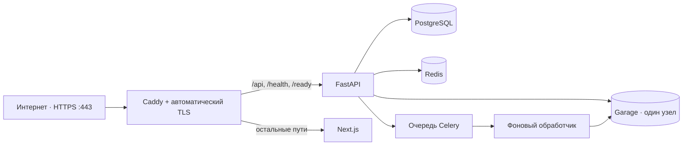

# Публичное демо

**Статус на 2026-11-05: публичное демо Docwise приостановлено и недоступно.** Контейнеры
`docwise-public-demo-*` остановлены, HTTPS для `docwise.wvzl.site` сейчас завершается ошибкой TLS.
Инструкции ниже описывают подготовку и запуск, но не подтверждают активное развёртывание. Не изменяйте
отдельный project `labtrack-demo-*`.

Публичная конфигурация Docwise использует Caddy/TLS и отдельный проект Compose; базовый
`docker-compose.yml` остаётся профилем для локальной разработки.



## Границы и требования

- A-запись домена в DNS должна указывать на VPS; входящие TCP-порты `80` и `443` должны быть открыты.
- На этой VPS нет `make`; скрипты подготовки нужно запускать отдельно.
- Интерфейс и ответы серверной части работают без ключа языковой модели, но для генерации нужны `OPENAI_API_KEY`
  и `OPENAI_MODEL`, совместимая с `chat/completions`.
- Демонстрация рассчитана только на синтетические данные. Если профиль запущен, посетители используют общие
  тестовые учётные записи; администратор может изменять корпус.
- SSO отключён (`SSO_PROVIDER=disabled`); billing — `dev`.
- Garage работает на одном узле без репликации; профиль предназначен для демонстрации, а не для производственной эксплуатации с высокой доступностью.

Не размещайте здесь настоящие документы или данные клиентов. Для другого развёртывания в производственной среде отдельно
нужно определить сетевые правила, секреты, резервное копирование, мониторинг и порядок восстановления.

## Подготовка

Создайте `.env` из `.env.example`. Задайте уникальные `SECRET_KEY`, `POSTGRES_PASSWORD` и S3 credentials;
не выводите и не коммитьте секреты. Задайте LLM key/model, если нужен чат.

Для подготовки входных данных сборки на текущей VPS:

```bash
bash backend/scripts/prepare-venv.sh
bash frontend/scripts/prepare-deps.sh
```

Подготовка серверной части требует виртуального окружения Python 3.12 и загружает зависимости и модели в `backend/.models`.
Скрипт клиентской части создаёт `frontend/node_modules`. Для другой ОС или узла используйте инструкции
[локальной разработки](../development/getting-started.md).

Если на VPS уже работает другая точка входа на портах `80/443`, сначала согласуйте общий прокси или другие порты;
Caddy этого профиля занимает оба порта.

## Запуск

Из корневого каталога клона:

```bash
python3 ops/public-demo/prepare-garage-config.py
docker compose -p docwise-public-demo \
  -f docker-compose.yml -f docker-compose.public-demo.yml \
  up -d --build
```

Compose создаёт закрытый файл конфигурации Garage с правами `0600`, если его ещё нет. В нём хранятся случайные
секреты администратора и RPC; файл не добавляется в Git. Дополнительная конфигурация закрывает порты узла PostgreSQL,
Redis, хранилища, API и клиентской части; наружу открыт только Caddy.

| Путь | Назначение |
| --- | --- |
| `/api/*`, `/health`, `/ready` | FastAPI |
| `/` и пути клиентской части | Next.js |
| `POST /api/v1/auth/register` | Caddy возвращает `404` |

Caddy очищает клиентские заголовки `X-Forwarded-*`; поэтому `RATE_LIMIT_TRUST_X_FORWARDED_FOR=true` безопасно
использовать, только если порт API закрыт и Caddy является единственной внешней точкой входа. При сбое Redis
ограничение частоты запросов отклоняет обращение с `503`.

Garage поддерживает используемый API S3, но не проверку политик бакета; дополнительная конфигурация отключает эту
проверку готовности. Доступ к объектам ограничен отдельными реквизитами доступа и проверкой прав в API.

## Роль для миграций и фоновые задачи

Единственная задача `db-migrate` создаёт или проверяет `docwise_rls` и выдаёт разрешения, затем применяет миграции Alembic.
API, фоновый обработчик и Beat ждут успешного завершения этой задачи и используют `SET LOCAL ROLE`.
Загрузчик тестовых данных обходит RLS только для собственной сессии с тестовыми данными.

В профиле работает одна копия Celery Beat — она запускает очистку журнала аудита по сроку хранения и задачи обслуживания.
`celery-worker` настроен на один параллельный процесс.

Для скриптов резервного копирования и восстановления задайте `COMPOSE_FILE` с обоими файлами Compose и
`COMPOSE_PROJECT_NAME=docwise-public-demo`. Вспомогательному средству S3 требуются `MC_ENDPOINT=http://minio:3900`
и реквизиты из `.env`; для проверки оповещений задайте `API_URL=https://<DOCWISE_DOMAIN>`.

## Проверка и демонстрационный набор документов

После самостоятельного запуска публичного профиля Docwise и настройки DNS/TLS проверьте готовность:

```bash
curl -fsS https://docwise.wvzl.site/ready
docker compose -p docwise-public-demo \
  -f docker-compose.yml -f docker-compose.public-demo.yml \
  exec backend python /eval/seed_demo.py
```

Чтобы вернуть публичную тестовую организацию в исходное состояние для демонстрации, выполните:

```bash
docker compose -p docwise-public-demo \
  -f docker-compose.yml -f docker-compose.public-demo.yml \
  exec backend python /eval/seed_demo.py --reset --confirm-reset
```

Команда удаляет сессии чата и записи аудита RAG только для организации со slug `demo`, удаляет загруженные пользователями
документы этой организации через очередь удаления из хранилища, а затем повторно загружает 12 заданных синтетических PDF
и три тестовые учётные записи. Документы, сессии и записи аудита других организаций не затрагиваются; строки документов
с фиксированными тестовыми данными остаются на месте. Как и при обычной загрузке тестовых данных, три зарезервированные
учётные записи имеют членство только в `Demo`, чтобы вход по паролю выбирал нужную организацию. Ожидающую очистку
хранилища Celery выполняет асинхронно. Команда удаляет историю демонстрации и пользовательские загрузки; требуются оба
явных флага.

При запущенном профиле тестовые учётные записи и пароли видны посетителям в интерфейсе и README. Регистрация закрыта;
тестовая учётная запись администратора может загружать и удалять документы.
При необходимости повторно загрузите тестовый корпус после демонстрации.

Чтобы просмотреть задачи потерянной очереди Celery перед восстановлением:

```bash
docker compose -p docwise-public-demo \
  -f docker-compose.yml -f docker-compose.public-demo.yml \
  exec backend python -m scripts.requeue_stale_ingestion
```

После проверки списка добавьте `--apply` к команде, чтобы повторно поставить задачи в очередь.

## Обновление и управление

После изменения модели или реквизитов доступа к языковой модели пересоздайте нужные процессы:

```bash
docker compose -p docwise-public-demo \
  -f docker-compose.yml -f docker-compose.public-demo.yml \
  up -d --build --force-recreate backend celery-worker celery-beat
```

Общие команды всегда используют одно имя проекта и оба файла Compose:

```bash
docker compose -p docwise-public-demo -f docker-compose.yml -f docker-compose.public-demo.yml ps
docker compose -p docwise-public-demo -f docker-compose.yml -f docker-compose.public-demo.yml logs --tail=100
docker compose -p docwise-public-demo -f docker-compose.yml -f docker-compose.public-demo.yml down
```

`down` сохраняет тома. `down -v` удалит данные PostgreSQL, Garage и Caddy.
