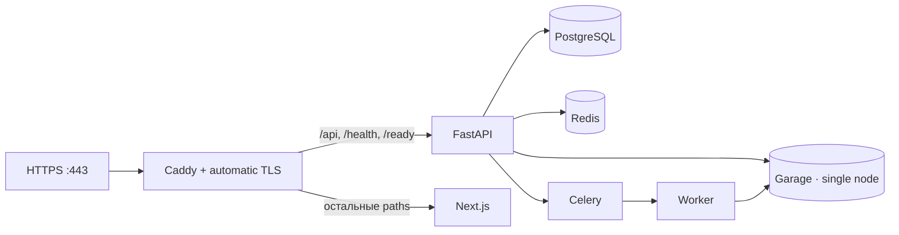

# Публичное демо

Публичный профиль Docwise доступен по [docwise.wvzl.site](https://docwise.wvzl.site).
Он использует Caddy/TLS и отдельный Compose project; базовый `docker-compose.yml` остаётся local/dev профилем.



## Границы и требования

- DNS A-запись домена должна указывать на VPS; входящий TCP `80`/`443` должен быть открыт.
- На этой VPS `make` отсутствует; scripts подготовки запускайте отдельно.
- Backend UI/answer работают без LLM key, но генерация требует `OPENAI_API_KEY` и `OPENAI_MODEL`, совместимую с `chat/completions`.
- Демо только для synthetic data. Посетители используют общие demo accounts; admin может изменять corpus.
- SSO отключён (`SSO_PROVIDER=disabled`); billing — `dev`.
- Garage одноузловой без репликации; профиль предназначен для показа, не для HA production.

Не размещайте тут реальные документы или данные клиентов. Для другого production deployment нужны отдельные
network, secrets, backup, monitoring и recovery decisions.

## Подготовка

Создайте `.env` из `.env.example`. Задайте уникальные `SECRET_KEY`, `POSTGRES_PASSWORD` и S3 credentials;
не выводите и не коммитьте секреты. Задайте LLM key/model, если нужен чат.

Для подготовки build inputs на текущей VPS:

```bash
bash backend/scripts/prepare-venv.sh
bash frontend/scripts/prepare-deps.sh
```

Backend подготовка требует Python 3.12 venv, скачивает dependencies и модели в `backend/.models`.
Frontend script создаёт `frontend/node_modules`. Для другой ОС/хоста используйте инструкции
[локальной разработки](../development/getting-started.md).

Если на VPS уже работает другой ingress на ports `80/443`, сначала согласуйте общий proxy или другие ports;
Caddy из этого профиля занимает оба порта.

## Запуск

Из корня checkout:

```bash
python3 ops/public-demo/prepare-garage-config.py
docker compose -p docwise-public-demo \
  -f docker-compose.yml -f docker-compose.public-demo.yml \
  up -d --build
```

Compose создаёт private Garage config mode `0600`, если он ещё не существует. Он содержит random admin/RPC secrets
и остаётся вне Git. Overlay закрывает host ports PostgreSQL, Redis, storage, API и frontend; наружу выставлен Caddy.

| Path | Назначение |
| --- | --- |
| `/api/*`, `/health`, `/ready` | FastAPI |
| `/` и frontend paths | Next.js |
| `POST /api/v1/auth/register` | Caddy возвращает `404` |

Caddy очищает клиентские `X-Forwarded-*` headers; поэтому `RATE_LIMIT_TRUST_X_FORWARDED_FOR=true` безопасен
только при закрытом API port и единственном ingress через Caddy. Rate limiting fail-closed: Redis error даёт `503`.

Garage поддерживает используемый S3 API, но не bucket-policy checks; overlay отключает эту readiness проверку.
Доступ к objects ограничен отдельными credentials и API авторизацией.

## Migration role и фоновые задачи

Единственный `db-migrate` создаёт/проверяет `docwise_rls` и grants, затем применяет Alembic migrations.
API, worker и Beat ждут успешного завершения этого service и используют `SET LOCAL ROLE`.
Demo seeder запускает RLS bypass только для своей fixture-сессии.

В профиле одна Celery Beat replica — она запускает audit retention и maintenance tasks.
`celery-worker` настроен с concurrency 1.

Для backup/recovery scripts задавайте `COMPOSE_FILE` с обоими Compose файлами и
`COMPOSE_PROJECT_NAME=docwise-public-demo`. S3 helper требует `MC_ENDPOINT=http://minio:3900` и credentials
из `.env`; для alert check задайте `API_URL=https://<DOCWISE_DOMAIN>`.

## Проверка и demo corpus

```bash
curl -fsS https://docwise.wvzl.site/ready
docker compose -p docwise-public-demo \
  -f docker-compose.yml -f docker-compose.public-demo.yml \
  exec backend python /eval/seed_demo.py
```

To return the public synthetic Demo org to its interview starting state, run:

```bash
docker compose -p docwise-public-demo \
  -f docker-compose.yml -f docker-compose.public-demo.yml \
  exec backend python /eval/seed_demo.py --reset --confirm-reset
```

This removes chat sessions and RAG audit rows only for organization slug `demo`, deletes user-uploaded documents
from that organization through the storage-deletion outbox, and then reseeds the 12 fixed synthetic PDFs and
three demo accounts. Other organizations' documents, sessions and audit rows are untouched, and the fixed
fixture document rows remain in place. As in normal seeding, the three reserved demo accounts keep memberships
only in `Demo` so password login resolves to the demo tenant. Pending storage cleanup is completed asynchronously
by Celery. This command is destructive to demo history and uploads; the two explicit flags are required.

Demo accounts и пароли видны посетителям в UI/README. Регистрация закрыта; admin demo account может загружать и удалять документы.
При необходимости пересейте corpus после демонстрации.

Для dry-run recovery потерянной Celery queue:

```bash
docker compose -p docwise-public-demo \
  -f docker-compose.yml -f docker-compose.public-demo.yml \
  exec backend python -m scripts.requeue_stale_ingestion
```

После проверки списка добавьте `--apply` к этой команде, чтобы поставить задачи в очередь.

## Обновление и управление

После изменения модели или LLM credentials пересоздайте нужные процессы:

```bash
docker compose -p docwise-public-demo \
  -f docker-compose.yml -f docker-compose.public-demo.yml \
  up -d --build --force-recreate backend celery-worker celery-beat
```

Общие команды всегда используют один project name и оба compose files:

```bash
docker compose -p docwise-public-demo -f docker-compose.yml -f docker-compose.public-demo.yml ps
docker compose -p docwise-public-demo -f docker-compose.yml -f docker-compose.public-demo.yml logs --tail=100
docker compose -p docwise-public-demo -f docker-compose.yml -f docker-compose.public-demo.yml down
```

`down` сохраняет volumes. `down -v` удалит PostgreSQL, Garage и Caddy state.
