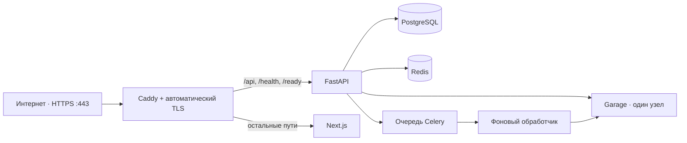

# Публичная демонстрация

**Статус на 2026-11-06: НЕ ПРОВЕРЕНА.** В этом аудите не запускались Docker/Compose, проверки внешнего адреса,
DNS или TLS. Предыдущая запись от 2026-11-05 сообщала об ошибке TLS для `docwise.wvzl.site`; это наблюдение
не перепроверялось и не подтверждает текущее состояние.

Публичная конфигурация Docwise использует Caddy/TLS и отдельный проект Compose. Базовый `docker-compose.yml`
остаётся профилем разработки. Поток запросов:



## Результаты статического аудита

### Compose, порты и зависимости

Все команды публичного профиля должны указывать `-p docwise-public-demo` и оба Compose-файла. Сервисы не задают
`container_name`, внешнюю сеть или именованные тома; сеть и тома получают префикс проекта Compose. Это отделяет
контейнеры, сеть, БД, хранилище и сертификаты Docwise от других проектов Compose. Имя проекта не резервирует порты
узла: Caddy публикует TCP `80`, TCP/UDP `443`; второй обратный прокси или другое демо на тех же портах вызовет конфликт.

| Сервис | Доступ с хоста | Проверка готовности / зависимость |
| --- | --- | --- |
| Caddy | `80/tcp`, `443/tcp`, `443/udp` | Ожидает `backend` и `frontend` в состоянии `healthy`; собственной проверки готовности нет |
| Backend | Публикации нет | `/ready` проверяет PostgreSQL, Redis, pgvector, Garage и поле `billing`; ждёт миграцию, Redis и готовность Garage |
| PostgreSQL, Redis, Garage | Публикаций нет | У Garage есть проверка готовности; backend и worker ждут её успешного завершения |
| Celery worker, Beat | Публикаций нет | Worker ждёт миграцию, Redis и Garage; Beat ждёт миграцию, PostgreSQL и Redis |
| Frontend | Публикации нет | Проверка готовности запрашивает локальную страницу Next.js |

Дополнительный профиль удаляет у внутренних сервисов порты узла из базового Compose. Порты Garage S3 `3900`, RPC `3901`
и API администратора `3903` не опубликованы. API администратора привязан к интерфейсам контейнера, поэтому доступен в
сети этого проекта Compose и доверенному узлу Docker, но не опубликован как внешний порт. Узел Docker и пользователи с
доступом к Docker остаются доверенными администраторами.

Caddy публикует `/api/*`, `/health` и `/ready`; остальные пути идут во frontend. `/health` и `/ready` доступны публично.
`/ready` сообщает состояние зависимостей и окружение, но не возвращает учётные данные. API, frontend и хранилище не имеют
отдельных опубликованных портов. `/docs` отключён в production; Caddy не проксирует `/metrics`. Маршрут
`/api/v1/search/inspect` доступен через общий прокси API, но публичный профиль отключает его через
`ENABLE_SEARCH_INSPECT=false`; это важно, поскольку учётная запись demo-администратора доступна посетителям.
Garage работает на одном узле без репликации и не проверяет политики бакета; доступ к объектам обеспечивают закрытая сеть,
реквизиты S3 и проверки прав в API.

Публичный профиль использует Compose-функцию `!override`, поэтому нужен Docker Compose версии **2.24.4 или новее**.
Перед запуском конфигурацию можно проверить командой `ops/public-demo/check-config.sh`; она вызывает только
`docker compose config --quiet` и не запускает сервисы.

### TLS и обратный прокси

Файлы не позволяют подтвердить причину прежней TLS-ошибки. До запуска проверьте следующие возможные причины:

- A- и AAAA-записи домена указывают на нужный VPS; устаревшая AAAA-запись может направлять клиентов на другой адрес.
- Входящие TCP `80` и `443` достигают VPS. Caddy использует эти порты для автоматического HTTPS; UDP `443` нужен для
  HTTP/3, но не заменяет TCP `443`.
- Другой обратный прокси или проект не занял порты узла `80/443`. Изоляция Compose не решает конфликт этих портов.
- `DOCWISE_DOMAIN` согласован с DNS, Caddy и адресом, который открывают пользователи.
- VPS может обращаться к центрам сертификации; системные часы корректны; каталог `caddy_data` сохранён.
- Если перед Caddy есть внешний прокси/CDN, текущая конфигурация не объявляет его доверенным. Не включайте внешний
  прокси без отдельной настройки доверенных прокси и проверки цепочки `X-Forwarded-*`.

Caddy автоматически получает и обновляет сертификаты при корректном публичном DNS и доступных challenge-портах;
подробности приведены в документации [Automatic HTTPS](https://caddyserver.com/docs/automatic-https) и
[устранения неполадок Caddy](https://caddyserver.com/docs/troubleshooting). Caddy по умолчанию очищает недоверенные
входящие `X-Forwarded-*`; при наличии прокси перед Caddy нужно отдельно определить доверенную цепочку заголовков
([reverse_proxy](https://caddyserver.com/docs/caddyfile/directives/reverse_proxy)).

Профиль включает `RATE_LIMIT_TRUST_X_FORWARDED_FOR=true`; это безопасно, пока Caddy остаётся единственной внешней
точкой входа, а API-порт не опубликован. При недоступном Redis ограничение частоты запросов возвращает `503`.

### Регистрация, учётные записи и синтетические данные

- Caddy возвращает `404` для `POST /api/v1/auth/register`; SSO в профиле отключён. Внешний трафик должен проходить
  только через этот Caddy. Прямое подключение к API в профиле не опубликовано.
- Публичные кнопки входа используют зарезервированные демо-учётные записи. Эти учётные записи и их реквизиты доступа являются
  публичными; не используйте их за пределами синтетической организации `Demo`.
- `eval/corpus.py` создаёт организацию со slug `demo`; у трёх зарезервированных аккаунтов оставляется членство только
  в этой организации. Сброс данных затрагивает только `demo`, очищает её чаты, аудит и пользовательские загрузки,
  сохраняет 12 синтетических тестовых документов и повторно их индексирует. Удаление объектов из Garage выполняется
  Celery асинхронно.
- Отдельный проект Compose изолирует данные Docwise от других проектов на том же узле Docker. Тесты проверяют роли
  сотрудника/HR, состав тестового каталога и область сброса.
- `db-migrate` создаёт роль `docwise_rls` и завершает миграции до запуска backend, worker и Beat. Эти процессы используют
  `DOCWISE_RLS_SESSION_ROLE=docwise_rls`; не считайте RLS защитой, если runtime-подключение использует суперпользователя
  без этой роли. Загрузчик начальных данных обходит RLS только для собственной сессии.
- В проекте работает одна копия Celery Beat; worker запускается с параллельностью `1`.
- Приложение не проверяет, что содержимое пользовательской загрузки синтетическое. Демо-администратор может загружать и удалять
  документы. Разрешайте загрузку только синтетического материала и не загружайте пользовательские документы.

Сброс ниже удалит чаты, события аудита и пользовательские загрузки **всех посетителей** организации `Demo`; он не
затрагивает другие организации и сохраняет тестовые документы. Запускайте его только если согласована очистка демо.

## Подготовка и запуск

1. На узле развертывания подготовьте `.env` из `.env.example`, задайте уникальные значения для `SECRET_KEY`,
   `POSTGRES_PASSWORD`, ключа доступа и секрета S3. Для чата задайте `OPENAI_API_KEY` и `OPENAI_MODEL`. Установите реальный
   `DOCWISE_DOMAIN`. Не печатайте `.env`, не включайте его в Git и не отправляйте секреты в логи.
2. Выполните `docker compose version` и убедитесь, что версия не ниже `2.24.4`. Проверьте DNS и наличие свободных портов
   узла `80/443`; убедитесь, что другой проект не использует их.
3. При отсутствии локальных зависимостей подготовьте их из корня клона:

   ```bash
   bash backend/scripts/prepare-venv.sh
   bash frontend/scripts/prepare-deps.sh
   ```

   Подготовка backend требует Python 3.12 и загружает модели в `backend/.models`.
4. Создайте приватную конфигурацию Garage и проверьте объединённую конфигурацию Compose:

   ```bash
   python3 ops/public-demo/prepare-garage-config.py
   ops/public-demo/check-config.sh
   ```

   Генератор создаёт файл с правами `0600`; файл не добавляется в Git. Проверка Compose завершится ошибкой, если не
   заданы обязательные значения, включая `POSTGRES_PASSWORD`.
5. После подтверждения владельцем узла, что порты свободны и DNS настроен, запустите отдельный проект:

   ```bash
   docker compose -p docwise-public-demo \
     -f docker-compose.yml -f docker-compose.public-demo.yml \
     up -d --build
   ```

6. Проверьте состояние контейнеров и `/ready`, затем выполните сквозной сценарий ниже. Запуск не считается подтверждённым
   до успешной внешней проверки по HTTPS. После готовности однократно заполните каталог и создайте тестовые учётные записи:

   ```bash
   docker compose -p docwise-public-demo \
     -f docker-compose.yml -f docker-compose.public-demo.yml \
     exec backend python /eval/seed_demo.py
   ```

Для проверки без вывода конфигурации используйте `ops/public-demo/check-config.sh`. Не используйте `docker compose config`
без `--quiet` в терминале или логе: развёрнутая конфигурация содержит учётные данные.

## Сквозная проверка

**Результат аудита 2026-11-06: НЕ ВЫПОЛНЕНА.** Для проверки нужно развернуть демо и открыть к нему внешний доступ.
Для загрузки используйте только PDF с вымышленными данными, например создайте и экспортируйте следующий текст в PDF:

```text
Docwise synthetic smoke fixture
Fixture ID: SYNTH-DEMO-01
Project codename: LANTERN-47
Storage color: violet
This page contains fictional test data only.
```

1. Откройте `https://<DOCWISE_DOMAIN>` и проверьте действующий TLS-сертификат и загрузку страницы.
2. Войдите кнопкой «Администратор». Загрузите синтетический PDF; дождитесь состояния документа `ready`.
3. Задайте вопрос «What is the project codename?». Проверьте ответ `LANTERN-47` и наличие ссылки-цитаты на загруженный PDF.
4. Нажмите ссылку-цитату. Убедитесь, что открывается нужный документ и страница с подсветкой цитаты.
5. Выйдите из Администратора, войдите как Сотрудник и задайте вопрос о зарплатной вилке из HR-документа.
   Ожидается отказ без цитаты из документа HR и без признаков содержимого закрытого текстового фрагмента.
6. Выйдите из учётной записи Сотрудника. Убедитесь, что защищённая страница больше не отображает активную сессию.
7. При согласованной очистке выполните сброс данных; иначе оставьте их владельцу демо.

Сценарии Playwright с подменённым API проверяют клиентскую часть и не заменяют эту внешнюю сквозную проверку.

Сброс тестовых данных очищает чаты, аудит и пользовательские загрузки всех посетителей `Demo`, но сохраняет 12
синтетических тестовых документов. Выполняйте только при согласованной очистке:

```bash
docker compose -p docwise-public-demo \
  -f docker-compose.yml -f docker-compose.public-demo.yml \
  exec backend python /eval/seed_demo.py --reset --confirm-reset
```

## Проверка, остановка и диагностика

Общие команды всегда адресуют только проект Docwise и оба Compose-файла:

```bash
docker compose -p docwise-public-demo -f docker-compose.yml -f docker-compose.public-demo.yml ps
docker compose -p docwise-public-demo -f docker-compose.yml -f docker-compose.public-demo.yml logs --tail=100 caddy backend frontend celery-worker
curl -fsS "https://$DOCWISE_DOMAIN/ready"
```

`/ready` возвращает `200` только когда БД, Redis, pgvector, Garage и billing готовы; при проблеме вернёт `503` с
именами зависимостей и состояниями. Не прикладывайте необработанные логи к тикетам: сначала удалите учётные данные,
персональные данные и содержимое пользовательских документов.

Для диагностики TLS используйте локально на узле:

```bash
export DOCWISE_DOMAIN="${DOCWISE_DOMAIN:?Set DOCWISE_DOMAIN in the shell}"
dig +short A "$DOCWISE_DOMAIN"
dig +short AAAA "$DOCWISE_DOMAIN"
sudo ss -ltnup '( sport = :80 or sport = :443 )'
openssl s_client -connect "$DOCWISE_DOMAIN:443" -servername "$DOCWISE_DOMAIN" </dev/null
curl -fsS "https://$DOCWISE_DOMAIN/ready"
docker compose -p docwise-public-demo -f docker-compose.yml -f docker-compose.public-demo.yml logs --tail=200 caddy
```

Если соединение не устанавливается — сначала проверьте DNS, межсетевой экран, маршрутизацию и занятые порты узла. Если TCP-соединение
есть, но сертификат не выдаётся — проверьте домен, доступность TCP `80/443`, системное время, исходящий доступ VPS и
сообщения Caddy. Данные TLS хранятся в `caddy_data`; не удаляйте том ради повторной выдачи сертификата без понимания
последствий. Эти команды в рамках текущего аудита не выполнялись.

Чтобы просмотреть кандидатов на повторную обработку после сбоя очереди, выполните проверку без изменений:

```bash
docker compose -p docwise-public-demo \
  -f docker-compose.yml -f docker-compose.public-demo.yml \
  exec backend python -m scripts.requeue_stale_ingestion
```

Проверьте выведенный список; добавляйте `--apply` только для подтверждённых документов.

Остановка без удаления данных:

```bash
docker compose -p docwise-public-demo -f docker-compose.yml -f docker-compose.public-demo.yml down
```

Обычный `down` удаляет контейнеры и сеть проекта, сохраняя тома PostgreSQL, Garage и Caddy. Не запускайте `down -v`
на публичной среде: он удалит БД, документы и состояние сертификатов. Не затрагивайте проекты с другими именами.

## Резервное копирование и восстановление

Скрипты `ops/backup-pilot.sh` и `ops/restore-pilot.sh` используют `COMPOSE_FILE` и `COMPOSE_PROJECT_NAME` из окружения.
Для публичного профиля задайте оба файла и имя `docwise-public-demo`. Garage использует конечную точку S3
`http://minio:3900`; для `mc` задайте `MC_ACCESS_KEY`, `MC_SECRET_KEY` и бакет согласно настройкам S3 из `.env`.
Не передавайте значения секретов в аргументах команд и не публикуйте их.

Пример безопасной установки контекста и резервного копирования:

```bash
set +x
set -a
source .env
set +a
export COMPOSE_FILE=docker-compose.yml:docker-compose.public-demo.yml
export COMPOSE_PROJECT_NAME=docwise-public-demo
export MC_ENDPOINT=http://minio:3900
export MC_ACCESS_KEY="${MC_ACCESS_KEY:?Set MC_ACCESS_KEY in .env}"
export MC_SECRET_KEY="${MC_SECRET_KEY:?Set MC_SECRET_KEY in .env}"
bash ops/backup-pilot.sh
```

Резервное копирование приостанавливает backend, worker и Beat для согласованного снимка БД и объектов, затем возобновляет
только те процессы, которые работали до начала. Копия включает PostgreSQL и бакет Garage, но не Redis, сессии Redis,
очереди Celery, кэш LLM и сертификаты Caddy. Манифест записывает выбранный проект Compose и ревизию Alembic.
Резервные копии создаются без шифрования; ограничьте доступ к каталогу `backups/` и шифруйте копию перед переносом за
пределы доверенного узла. Код загрузки принимает произвольные документы, поэтому резервная копия может содержать данные,
которые не являются синтетическими. Скрипты не печатают реквизиты доступа `mc`, но передают их в аргументах команды
вспомогательного контейнера; пользователь с доступом к списку процессов или Docker на общем узле потенциально может
их увидеть. Запускайте резервное копирование только на доверенном узле и не включайте трассировку shell.

Восстановление требует окна обслуживания и уничтожает текущее содержимое БД и бакета. Сначала сохраните текущее состояние,
проверьте контрольные суммы и ревизию, затем выберите резервную копию:

```bash
set +x
set -a
source .env
set +a
export COMPOSE_FILE=docker-compose.yml:docker-compose.public-demo.yml
export COMPOSE_PROJECT_NAME=docwise-public-demo
export MC_ENDPOINT=http://minio:3900
export MC_ACCESS_KEY="${MC_ACCESS_KEY:?Set MC_ACCESS_KEY in .env}"
export MC_SECRET_KEY="${MC_SECRET_KEY:?Set MC_SECRET_KEY in .env}"
BACKUP_DIR=backups/pilot-latest
grep -E '^(created_utc|compose_project|alembic_revision)=' "$BACKUP_DIR/manifest.txt"
bash ops/restore-pilot.sh "$BACKUP_DIR"
```

Перед остановкой сервисов скрипт сверяет `compose_project` в манифесте с `COMPOSE_PROJECT_NAME` и отказывает при
несовпадении. Резервные копии без поля `compose_project` также отклоняются; после обновления создайте новую копию
нужного проекта перед восстановлением. Межпроектное восстановление разрешено только проверочному `restore-drill.sh`,
который использует временный проект `docwise-restore-drill-*` с отдельными томами и `--wipe-volumes`.

Для Garage установите `MC_ACCESS_KEY`/`MC_SECRET_KEY` из `.env` в текущей оболочке без `set -x`. Не указывайте
`--wipe-volumes` на публичной среде; он предназначен только для проверочного восстановления в изолированном проекте и
удаляет тома выбранного проекта Compose. Проверьте `/ready`, интерфейс, документы и повторную обработку отложенных задач.
По умолчанию скрипт проверяет `/ready` изнутри закрытого backend-контейнера; `RESTORE_READY_URL` можно задать для
проверочного восстановления, которому нужен адрес с узла.

## Обновление и откат

При смене модели или реквизитов доступа к LLM пересоздайте backend и фоновые процессы:

```bash
docker compose -p docwise-public-demo \
  -f docker-compose.yml -f docker-compose.public-demo.yml \
  up -d --build --force-recreate backend celery-worker celery-beat
```

До обновления создайте резервную копию из контекста нужного проекта и сохраните ревизию развёрнутого кода/Compose. При ошибке
приложения сначала остановите входящий трафик через согласованный внешний прокси или остановите только Caddy, затем
верните предыдущую ревизию кода/Compose и пересоздайте тот же проект, сохранив `.env` и тома:

```bash
PREVIOUS_KNOWN_GOOD_COMMIT=previous-known-good-commit
docker compose -p docwise-public-demo \
  -f docker-compose.yml -f docker-compose.public-demo.yml \
  stop caddy
git switch --detach "$PREVIOUS_KNOWN_GOOD_COMMIT"
docker compose -p docwise-public-demo \
  -f docker-compose.yml -f docker-compose.public-demo.yml \
  up -d --build
```

Проверьте `/ready` и сквозной сценарий. Не удаляйте тома для отката кода. Если миграция сделала схему несовместимой,
используйте проверенную резервную копию перед обновлением и процедуру восстановления в согласованное окно. Восстановление
БД и бакета заменит данные, созданные после снимка. Откат DNS/TLS не входит в эту процедуру и требует отдельного
разрешения владельца домена.
