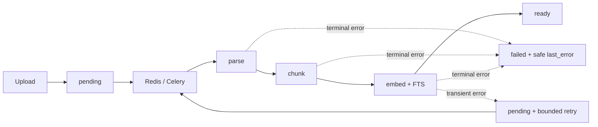
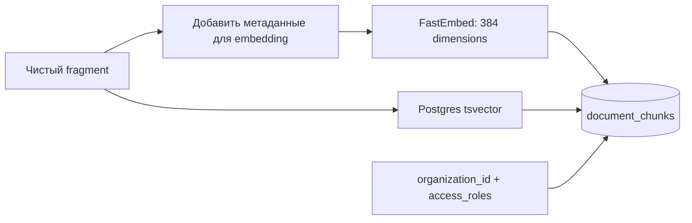

# Обработка документов (ingestion)

Загрузка ставит задачу `ingestion.process_document(document_id)` в Celery. API не извлекает текст и не
строит embeddings внутри HTTP-запроса.

## Поток и состояния



`GET /api/v1/documents/{id}/status` показывает `pending → processing → ready | failed` и текущую стадию
`parse → chunk → embed`.

## Извлечение текста

| Формат | Разбиение | Цитата |
| --- | --- | --- |
| PDF | По физическим страницам, номера с 1; таблицы извлекаются в Markdown | Страница PDF |
| DOCX | По логическим секциям; `page_number = 0` | Заголовок/секция, без выдуманного номера страницы |

Worker находит `organization_id` в записи документа. Значение из Celery args не задаёт tenant.
Геометрия текста сохраняется, когда доступна, для подсветки в PDF viewer.

## Chunking

- Chunk не пересекает физическую страницу PDF или логическую секцию DOCX.
- Предпочтительное место разрыва — заголовок раздела.
- Целевой размер — 400–600 tokens; overlap до 50 tokens только внутри той же страницы/секции.
- Большая таблица разбивается по строкам с повтором Markdown header.

Перед embedding строится служебный header:

```text
[Document: HR_Policy.pdf | Section: Expenses | Page: 12]
{content}
```

Header влияет на embedding, но не хранится в `document_chunks.content` и не передаётся reranker/LLM.
Для ответа и citation используется исходный текст chunk.

## Embedding и запись



Текущая модель — `BAAI/bge-small-en-v1.5`; индекс использует cosine similarity и Postgres FTS/GIN.
В `document_chunks` сохраняются document/org IDs, page/section, table flag, ACL, content, token count,
vector и FTS данные. Sparse search — PostgreSQL FTS, не BM25 endpoint.

## Повторный запуск и ошибки

- Redis lock `indexing_lock:{document_id}` хранит owner token; старый worker не может удалить lock нового запуска.
- Retry ограничен transient storage, database, Redis и embedding ошибками; до трёх повторов с backoff.
- Ошибки формата, parser и quota — terminal и оставляют статус `failed`.
- Перед transient retry worker чистит partial chunks, возвращает документ в `pending` и записывает безопасную общую ошибку.
- Замена chunks выполняется одной DB-транзакцией. Статусы и S3 side effects фиксируются отдельно, поэтому весь pipeline не атомарен.

Удаление документа использует `storage_deletions` outbox; cleanup S3 можно повторить после сбоя.

## Восстановление очереди после потери Redis

Redis queue не входит в pilot backup. Сначала просмотрите кандидатов в dry-run:

```bash
make requeue-stale-ingestion
```

После проверки IDs выполните повторную постановку:

```bash
make requeue-stale-ingestion APPLY=1
```

По умолчанию выбираются старые `pending` и `processing` документы; для `failed` требуется явный ID.
Инструмент выводит статусы и document IDs, ограничивает одну выборку и не печатает содержимое файлов.
Операционные шаги: [operations.md](../operations/operations.md#ingestion-worker).

## Проверка качества parser

Тестовый fixture проверяет границы страниц, Markdown-таблицы, передачу `organization_id`/`access_roles`
и отсутствие дубликатов chunks после повторного `ingestion.process_document`.
