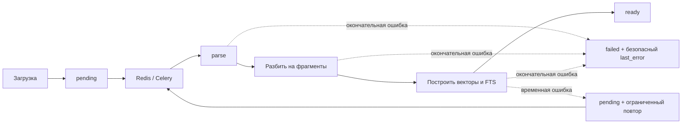
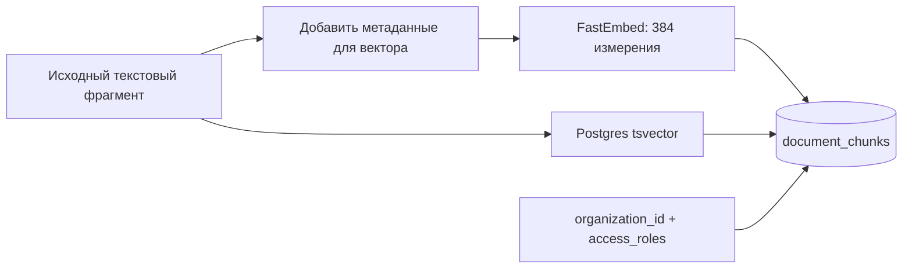

# Обработка документов (ingestion)

Загрузка ставит задачу `ingestion.process_document(document_id)` в Celery. API не извлекает текст и не
строит векторные представления внутри HTTP-запроса.

## Поток и состояния



`GET /api/v1/documents/{id}/status` показывает `pending → processing → ready | failed` и текущую стадию
`parse → chunk → embed`.

## Извлечение текста

| Формат | Разбиение | Цитата |
| --- | --- | --- |
| PDF | По физическим страницам, номера с 1; таблицы извлекаются в Markdown | Страница PDF |
| DOCX | По логическим секциям; `page_number = 0` | Заголовок/секция, без выдуманного номера страницы |

Фоновый обработчик получает `organization_id` из записи документа. Значение из аргументов Celery не задаёт организацию.
Геометрия текста сохраняется, если доступна, чтобы выделять фрагменты в просмотрщике PDF.

## Разбиение текста на фрагменты

- Текстовый фрагмент не пересекает физическую страницу PDF или логическую секцию DOCX.
- Предпочтительное место разрыва — заголовок раздела.
- Целевой размер — 400–600 токенов; перекрытие — до 50 токенов, только внутри той же страницы или секции.
- Большая таблица разбивается по строкам, заголовок Markdown повторяется.

Перед построением векторного представления формируется служебный заголовок:

```text
[Document: HR_Policy.pdf | Section: Expenses | Page: 12]
{content}
```

Служебный заголовок влияет на векторное представление, но не хранится в `document_chunks.content`
и не передаётся повторному ранжированию или языковой модели. Для ответа и цитирования используется
исходный текст фрагмента.

## Построение векторного представления и запись



Текущая модель — `BAAI/bge-small-en-v1.5`; индекс использует косинусное сходство и Postgres FTS/GIN.
В `document_chunks` сохраняются идентификаторы документа и организации, страница или раздел, признак таблицы,
ACL, текст, число токенов, вектор и данные FTS. Поиск по редким словам выполняется через PostgreSQL FTS;
отдельного маршрута BM25 нет.

## Повторный запуск и ошибки

- Redis хранит маркер владельца блокировки `indexing_lock:{document_id}`; прежний фоновый обработчик не может снять блокировку нового запуска.
- Повтор ограничен временными ошибками хранилища, базы данных, Redis и построения векторов; не более трёх попыток с увеличением паузы.
- Ошибки формата, разбора и квоты являются окончательными и оставляют статус `failed`.
- Перед повтором после временной ошибки фоновый обработчик удаляет частичные фрагменты, возвращает документ в `pending` и записывает безопасное общее описание ошибки.
- Замена фрагментов выполняется одной транзакцией БД. Статусы и побочные изменения в S3 фиксируются отдельно, поэтому весь процесс обработки не атомарен.

При удалении документа используется очередь `storage_deletions`; очистку S3 можно повторить после сбоя.

## Восстановление очереди после потери Redis

Очередь Redis не входит в резервную копию пилотной среды. Сначала просмотрите документы-кандидаты в режиме предварительного просмотра:

```bash
make requeue-stale-ingestion
```

После проверки идентификаторов поставьте задачи в очередь повторно:

```bash
make requeue-stale-ingestion APPLY=1
```

По умолчанию выбираются давно не обновлявшиеся документы `pending` и `processing`; для `failed` требуется явно указать ID.
Инструмент выводит статусы и идентификаторы документов, ограничивает размер одной выборки и не показывает содержимое файлов.
Операционные шаги: [эксплуатация фонового обработчика](../operations/operations.md#фоновый-обработчик-документов).

## Проверка качества разбора документов

Тестовые данные проверяют границы страниц, таблицы Markdown, передачу `organization_id`/`access_roles`
и отсутствие дубликатов текстовых фрагментов после повторной задачи `ingestion.process_document`.
