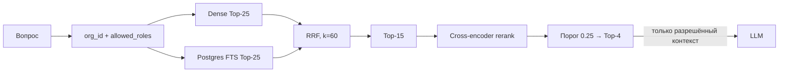
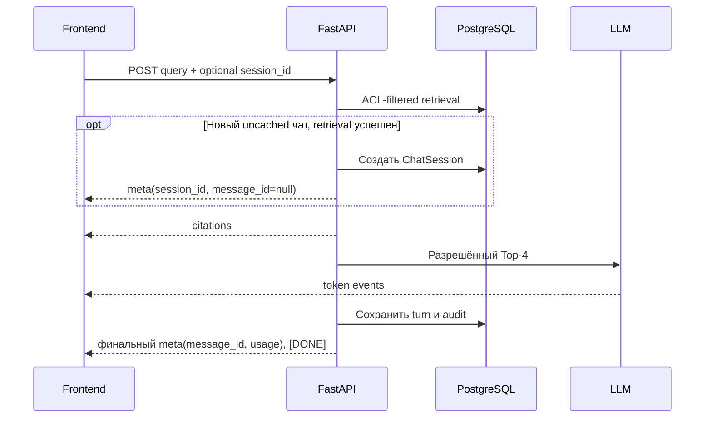

# Поиск и генерация ответа

Retrieval соединяет внутренний ACL с hybrid search: система сначала ограничивает доступные chunks в SQL,
и только затем объединяет результаты, rerank-ит их и вызывает LLM.

## Поток поиска

| Этап | Что делает |
| --- | --- |
| ACL | Ограничивает обе SQL-ветки по текущей организации и `access_roles && allowed_roles` |
| Dense | Возвращает до 25 близких embeddings из pgvector |
| FTS | Независимо возвращает до 25 совпадений PostgreSQL full-text search |
| RRF | Объединяет ранги dense и FTS, не смешивая score разных шкал (`k=60`) |
| Rerank | Пересчитывает релевантность cross-encoder для пула до 15 кандидатов |
| Top-4 | После threshold (default `0.25`) максимум четыре chunks попадают в prompt |

Значения задаются константами и настройками в `backend/app/services/retrieval/`; RLS-границы и
tenant scope — в [tenancy](../platform/tenancy.md). Если после threshold не осталось chunks,
система возвращает фиксированный отказ без вызова LLM.

## Контекст для LLM и цитаты

- Dense/FTS используют embedding text с заголовком документа и страницы/раздела.
- Rerank и prompt получают исходный `content`, без служебного заголовка.
- Prompt содержит только Top-4 после ACL и rerank.
- Язык ответа задаётся языком последнего вопроса пользователя, независимо от языка истории чата и retrieved excerpts; старые ответы не переиспользуются после смены prompt/cache version.
- Цитата ссылается на страницу PDF или раздел DOCX; фиктивный номер страницы для DOCX не добавляется.
- Audit хранит query, IDs chunks после rerank, latency и usage, но не текст chunks.

Подготовка текста, границы страниц и формат embedding описаны в [ingestion](ingestion.md).

## SSE чата

`POST /api/v1/chat/stream` отдаёт JSON events в строках `data: ...\n\n`.

| Событие | Содержание |
| --- | --- |
| Ранний `meta` | Только для нового uncached чата после успешного retrieval: `session_id`, `message_id: null` |
| `citations` | Источники, доступные текущему пользователю |
| `token` | Фрагмент ответа; может приходить несколько раз |
| Финальный `meta` | `session_id`, `message_id`, `cached`, usage и стоимость, если известны |
| `error` | Без stack trace, чужих имён документов и текста недоступных chunks |
| `[DONE]` | Завершение потока |

Порядок в новом uncached потоке: **ранний `meta` → citations → tokens → финальный `meta` → `[DONE]`**.
У существующей сессии и cache hit раннего `meta` нет. При cache hit ответ сохраняется до отправки citations/token.
Для новых сессий UI может обновить URL и список чатов ещё до генерации ответа.

## Кэш

Ключ ответа включает версию, `organization_id`, поколение индекса и канонический набор `allowed_roles`.
Это запрещает использовать ответ другой организации или пользователя с иным ACL. ACL change, удаление
документа и завершение ingestion обновляют поколение индекса; см. [data model](../platform/data-model.md).

## Inspect

Org-admin может посмотреть списки `dense`, `sparse`, `rrf` и `reranked` через
`POST /api/v1/search/inspect`. Inspect повторно использует те же tenant и ACL-фильтры: роль admin
не даёт доступа к HR chunks без `hr`. Подробный HTTP-контракт — [engineering/api.md](../engineering/api.md).
