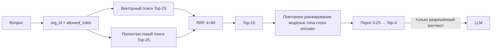
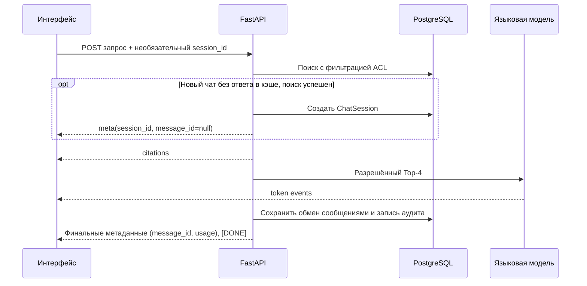

# Поиск и генерация ответа

Поиск с генерацией ответа учитывает внутренний ACL: система сначала ограничивает доступные фрагменты в SQL,
а затем объединяет результаты, повторно ранжирует их и вызывает языковую модель.

## Поток поиска

| Этап | Что делает |
| --- | --- |
| ACL | Ограничивает обе ветки SQL текущей организацией и условием `access_roles && allowed_roles` |
| Векторный поиск | Возвращает до 25 близких векторных представлений из pgvector |
| Полнотекстовый поиск (FTS) | Независимо возвращает до 25 совпадений PostgreSQL |
| RRF | Объединяет ранги векторного и полнотекстового поиска (FTS), не смешивая оценки из разных шкал (`k=60`) |
| Повторное ранжирование | Пересчитывает релевантность кандидатов с помощью модели типа `cross-encoder`; в пуле не более 15 кандидатов |
| Top-4 | После порога (значение по умолчанию `0.25`) в запрос к модели попадает не более четырёх фрагментов |

Значения задаются константами и настройками в `backend/app/services/retrieval/`; RLS-границы и
область организации — в [документе об изоляции организаций](../platform/tenancy.md). Если после порога
не осталось фрагментов, система возвращает фиксированный отказ без вызова языковой модели.

## Контекст для LLM и цитаты

- Векторный и полнотекстовый поиск используют текст для представления с заголовком документа и страницы или раздела.
- Повторное ранжирование и запрос к модели используют исходное поле `content`, без служебного заголовка.
- Запрос к модели содержит только четыре фрагмента, прошедших проверку ACL и повторное ранжирование.
- Язык ответа определяется языком последнего вопроса пользователя, независимо от языка истории чата и найденных выдержек; после смены версии запроса или кэша старые ответы не используются.
- Цитата ссылается на страницу PDF или раздел DOCX; для DOCX не добавляется вымышленный номер страницы.
- Журнал аудита хранит запрос, идентификаторы фрагментов после повторного ранжирования, задержку и сведения об использовании, но не текст фрагментов.

Подготовка текста, границы страниц и формат векторного представления описаны в [документе об обработке](ingestion.md).

## SSE чата

`POST /api/v1/chat/stream` передаёт события JSON строками `data: ...\n\n`.

| Событие | Содержание |
| --- | --- |
| Ранний `meta` | Только для нового чата без ответа в кэше после успешного поиска: `session_id`, `message_id: null` |
| `citations` | Источники, доступные текущему пользователю |
| `token` | Часть ответа; событие может прийти несколько раз |
| Финальный `meta` | `session_id`, `message_id`, `cached`, сведения об использовании и стоимость, если известны |
| `error` | Без трассировки стека, имён чужих документов и текста недоступных фрагментов |
| `[DONE]` | Завершение потока |

Порядок в новом потоке без ответа в кэше: **ранний `meta` → citations → token → финальный `meta` → `[DONE]`**.
Для существующей сессии и при попадании в кэш раннего `meta` нет. При попадании в кэш ответ сохраняется до отправки citations и token.
Для новых сессий интерфейс может обновить URL и список чатов ещё до генерации ответа.

## Кэш

Ключ ответа включает версию, `organization_id`, поколение индекса и нормализованный набор `allowed_roles`.
Это не позволяет использовать ответ другой организации или пользователя с иным ACL. Изменение ACL,
удаление документа и завершение обработки обновляют поколение индекса; см. [модель данных](../platform/data-model.md).

## Диагностика поиска

Администратор организации может посмотреть списки `dense`, `sparse`, `rrf` и `reranked` через
`POST /api/v1/search/inspect`. Диагностика использует те же фильтры организации и ACL: роль admin
не даёт доступа к фрагментам HR без `hr`. Подробный HTTP-контракт — [описание API](../engineering/api.md).
