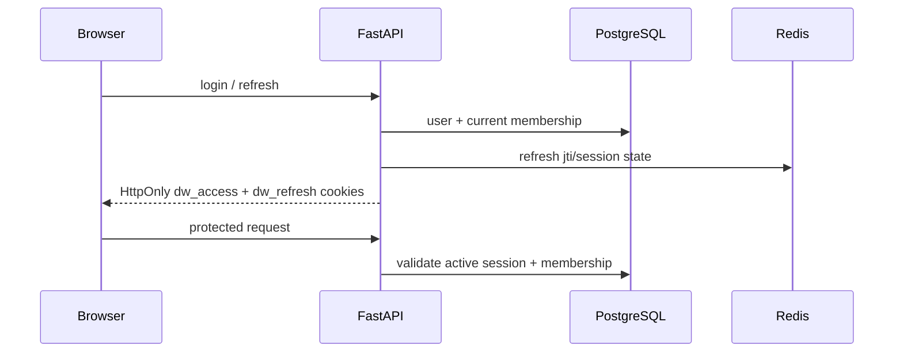

# Аутентификация и ACL

Основной клиентский механизм — cookie session. Организация берётся из текущей сессии; роль и отделы читаются
из `organization_memberships`. Другие границы — в [tenancy](tenancy.md) и [security](../security/overview.md).

## Сессия и обновление токена



- `dw_access` действует 15 минут; `dw_refresh` — 7 дней.
- JWT включает `sub`, текущий `org_id`, `typ`, `exp`; refresh token также имеет `jti`.
- Роль и отделы не являются источником полномочий из JWT: они повторно читаются из БД.
- Login/register/Google возвращают user JSON и ставят cookies; access token в JSON не возвращается.
- Bearer auth в v1 не поддерживается.
- Logout отзывает текущую сессию; смена/сброс пароля отзывает сессии пользователя.
- `/health` и `/ready` публичны; остальные protected API требуют cookie session, кроме публичных auth/SSO/webhook routes.

## CSRF, Origin и hostname

При `COOKIE_SAMESITE=none` mutating API requests требуют разрешённый `Origin`/`Referer` либо
`X-Requested-With: Docwise`. CORS допускает настроенный origin и проверенный hostname организации.
Cookies host-only, без parent `Domain`.

Если `Host` закреплён за tenant, он должен совпадать с `org_id` сессии. Непроверенный hostname не закрепляет org.

## Роли и действия

| Роль membership | Права |
| --- | --- |
| `admin` | Knowledge Base, invites, billing, SSO, domain, Inspect при включённом флаге |
| `manager` | Upload/delete/ACL для Knowledge Base; не управляет пользователями и billing |
| `employee` | Чтение разрешённых документов, chat и свои сессии |

`admin` и `manager` также имеют `departments[]` — например, `hr` и `finance`.
UI может скрывать кнопки, но API всегда проверяет права повторно.

## Разрешённые document roles

```text
allowed_roles = {membership.role} ∪ departments ∪ {"all"}
```

Каждая document list/raw/status и обе поисковые ветки используют текущую организацию и пересечение ролей:

```sql
WHERE organization_id = :current_org
  AND access_roles && :allowed_roles
```

Org-admin не обходит внутреннюю ACL: HR-only документ требует `hr` в membership role или departments.
При изменении тегов обновляются `documents.access_roles` и все chunks этого документа.

## SSO: проектное решение и runtime

Идеальная модель: connector принадлежит одной org, его slug определяет tenant; assertion не может назначить org.
JIT-membership, если включена, создаёт membership только в этой org.

**Что доступно сейчас:** `SSO_PROVIDER=dev` включает development fixture и не выполняет настоящий SAML/OIDC обмен.
Публичный demo задаёт `SSO_PROVIDER=disabled`; login/ACS там возвращают `404`. Производственного IdP adapter нет.
Google login — отдельный consumer OIDC-вариант, не замена корпоративному SSO.

SSO и plan gates: [billing](billing.md), [ADR-014](../engineering/decisions.md#adr-014-sso-org-from-connector-not-assertion).
