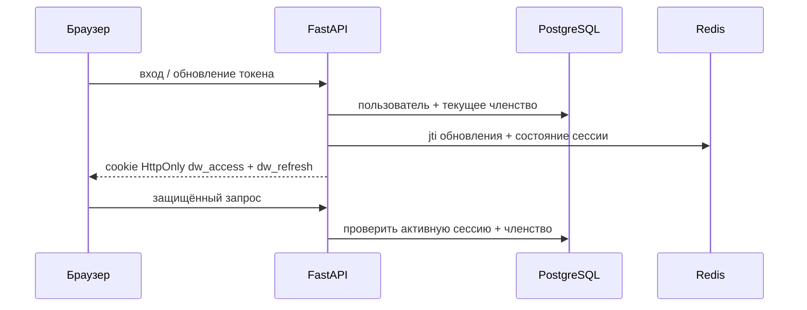

# Аутентификация и ACL

Основной механизм входа — сессия на основе cookie. Организация берётся из текущей сессии; роль и отделы читаются
из `organization_memberships`. Другие границы описаны в [изоляции организаций](tenancy.md) и [обзоре безопасности](../security/overview.md).

## Сессия и обновление токена



- `dw_access` действует 15 минут; `dw_refresh` — 7 дней.
- JWT включает `sub`, текущий `org_id`, `typ`, `exp`; токен обновления также содержит `jti`.
- Роль и отделы не являются источником полномочий из JWT: они повторно читаются из БД.
- Маршруты `login`, `register` и входа через Google возвращают JSON с пользователем и устанавливают cookie; токен доступа в JSON не возвращается.
- Авторизация по схеме Bearer в версии v1 не поддерживается.
- Выход отзывает текущую сессию; смена или сброс пароля отзывает сессии пользователя.
- `/health` и `/ready` доступны без входа; остальные защищённые маршруты API требуют сессию на основе cookie, кроме открытых маршрутов входа, SSO и вебхуков.

## CSRF, источник запроса и имя узла организации

При `COOKIE_SAMESITE=none` запросы API, меняющие данные, требуют разрешённый `Origin` или `Referer`, либо
`X-Requested-With: Docwise`. CORS допускает настроенный источник запроса и проверенное имя узла организации.
Cookie действуют только для текущего узла; общий родительский атрибут `Domain` не задаётся.

Если `Host` закреплён за организацией, он должен совпадать с `org_id` сессии. Непроверенное имя узла не закрепляет организацию.

## Роли и действия

| Роль участника организации | Права |
| --- | --- |
| `admin` | База знаний, приглашения, оплата, SSO, домен, диагностика при включённом флаге |
| `manager` | Загрузка и удаление документов, изменение ACL базы знаний; не управляет пользователями и оплатой |
| `employee` | Чтение разрешённых документов, чат и собственные сессии |

У участников с ролями `admin` и `manager` также есть `departments[]` — например, `hr` и `finance`.
Интерфейс может скрывать кнопки, но API всегда повторно проверяет права.

## Разрешённые роли доступа к документам

```text
allowed_roles = {membership.role} ∪ departments ∪ {"all"}
```

В списке документов, при чтении оригинала и состояния, а также в обеих ветках поиска используются текущая организация и пересечение ролей:

```sql
WHERE organization_id = :current_org
  AND access_roles && :allowed_roles
```

Администратор организации не обходит внутренний ACL: для документа только для HR участник должен иметь `hr` в роли или отделах.
При изменении тегов обновляются `documents.access_roles` и все текстовые фрагменты документа.

## SSO: проектное решение и текущая реализация

Целевая модель: соединение SSO принадлежит одной организации, его `slug` определяет организацию;
ответ провайдера удостоверений не может выбрать организацию. Если включено JIT-членство,
новый участник добавляется только в эту организацию.

**Текущая реализация:** `SSO_PROVIDER=dev` включает локальные тестовые данные и не выполняет настоящий обмен SAML/OIDC.
Публичный профиль задаёт `SSO_PROVIDER=disabled`; маршруты login/ACS отвечают `404`. Подключения к производственному
провайдеру удостоверений нет. Вход через Google — отдельный пользовательский вариант OIDC, а не замена корпоративному SSO.

SSO и ограничения тарифных планов: [тарифные планы](billing.md), [ADR-014](../engineering/decisions.md#adr-014-sso-организацию-определяет-подключение-а-не-ответ-провайдера).
