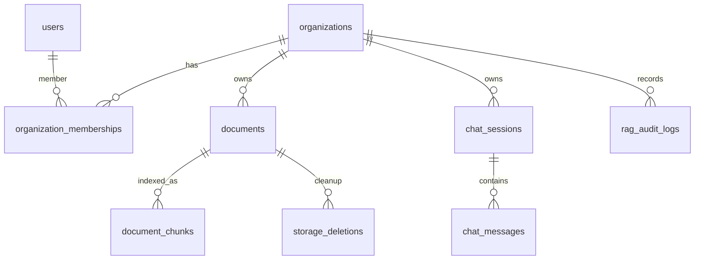

# Модель данных

Два слоя данных находятся в PostgreSQL: пользователи, организации, документы и чат, а также индекс фрагментов
с pgvector. Организацию изолирует `organization_id` ([tenancy.md](tenancy.md)); ACL фрагмента копирует
`documents.access_roles`, а его `organization_id` — организацию документа. Основные ключи — **UUID**
(`gen_random_uuid()` / SQLAlchemy `uuid4`). Роли и фильтрация описаны в [auth.md](auth.md).

Пользователь может состоять в нескольких организациях. Роль и отделы хранятся в
`organization_memberships`; миграция Alembic `007` перенесла туда прежние `users.role` и
`users.departments`.

## Связи верхнего уровня

Детали колонок ниже сгруппированы по таблицам; точные типы и constraints определяют Alembic migrations.

## PostgreSQL

### `organizations`

| Field | Type | Notes |
| --- | --- | --- |
| `id` | UUID PK | |
| `name` | String | Display company name |
| `slug` | String unique | Stable URL key (`{slug}.localhost`); not ACL |
| `status` | `active` \| `suspended` | Suspended — login to this org rejected; also billing `past_due` / cancel |
| `plan` | `starter` \| `team` \| `enterprise` | New org — `starter`. Not source of `org_id` |
| `billing_status` | `active` \| `past_due` \| `canceled` | `past_due`/`canceled` → `status = suspended` |
| `current_period_start` / `current_period_end` | DateTime nullable | Token quota window |
| `sso_enforced` | Boolean | default false |
| `llm_index_generation` | Integer | Corpus generation for LLM cache; bump on PATCH ACL / DELETE / ready ingest |
| `stripe_customer_id` / `stripe_subscription_id` | String nullable | Stripe adapter only; not JWT |
| `created_at` | DateTime | |

### `organization_memberships`

| Field | Type | Notes |
| --- | --- | --- |
| `id` | UUID PK | |
| `organization_id` | UUID FK → organizations | Cascade on org delete (dedicated procedure, not accidental DELETE) |
| `user_id` | UUID FK → users | |
| `role` | `admin` \| `manager` \| `employee` | CHECK; **not** on `users` |
| `departments` | `ARRAY(String)` | e.g. `['engineering', 'hr']` |
| `created_at` | DateTime | |

Unique `(organization_id, user_id)`. `allowed_roles` for search = `{membership.role}` ∪ `membership.departments` ∪ `{all}` — this org only.

### `organization_invites`

| Field | Type | Notes |
| --- | --- | --- |
| `id` | UUID PK | |
| `organization_id` | UUID FK | |
| `email` | String | Normalized lower-case |
| `role` | `admin` \| `manager` \| `employee` | Future membership role |
| `departments` | `ARRAY(String)` | |
| `token_hash` | String unique | SHA-256 of token; raw token shown to org-admin once |
| `invited_by_user_id` | UUID FK nullable | |
| `expires_at` | DateTime | Default 14 days |
| `accepted_at` | DateTime nullable | |
| `created_at` | DateTime | |

Unique pending `(organization_id, email) WHERE accepted_at IS NULL`. Existing user on invite gets membership immediately, no token. Invite over plan seats quota → `402`.

### `organization_sso_connections`

One connector per org. Org for ACS — FK, not IdP attribute.

| Field | Type | Notes |
| --- | --- | --- |
| `id` | UUID PK | |
| `organization_id` | UUID FK unique | |
| `protocol` | `saml` \| `oidc` | |
| `idp_entity_id` / metadata | Text / JSONB | IdP cert, ACS URL from slug |
| `attribute_map` | JSONB | IdP groups → `role` / `departments` |
| `jit_enabled` | Boolean | default false |
| `created_at`, `updated_at` | DateTime | |

### `organization_domains`

| Field | Type | Notes |
| --- | --- | --- |
| `id` | UUID PK | |
| `organization_id` | UUID FK | |
| `hostname` | String unique | lower-case; `{slug}.localhost` or customer CNAME |
| `kind` | `platform` \| `custom` | |
| `verified_at` | DateTime nullable | custom without verify does not pin Host |
| `created_at` | DateTime | |

Unverified custom does not participate in resolve. Hostname unique globally.

### `billing_events`

Webhook and `dev/simulate` idempotency.

| Field | Type | Notes |
| --- | --- | --- |
| `id` | UUID PK | |
| `organization_id` | UUID FK | always event’s org; simulate foreign org creates no row |
| `provider` | `dev` \| `stripe` | |
| `external_id` | String | unique with `provider` |
| `event_type` | String | |
| `payload` | JSONB | no chunk text, no PDF |
| `processed_at` | DateTime | |

### `users`

| Field | Type | Notes |
| --- | --- | --- |
| `id` | UUID PK | `gen_random_uuid()` |
| `email` | String unique | Login |
| `hashed_password` | String nullable | Empty for Google-only / SSO-only |
| `google_id` | String unique nullable | `sub` from ID token |
| `is_active` | Boolean | |
| `created_at` | DateTime | |

Membership roles: `admin` | `manager` | `employee` plus `departments[]` **on organization membership** (not to be confused with document `access_roles`).  
`allowed_roles` for search filter = `{role}` ∪ `departments` ∪ `{all}` for current org (assembly — [retrieval](../pipeline/retrieval.md)). Email unique globally: one person — multiple orgs.

### `documents`

| Field | Type | Notes |
| --- | --- | --- |
| `id` | UUID PK | |
| `organization_id` | UUID FK → organizations | NOT NULL. Source — session on upload, not body |
| `title` | String | UI name |
| `file_path` | String | MinIO key (`orgs/{org_id}/…`) |
| `file_hash` | String | SHA-256; unique **with** `organization_id` |
| `file_size_bytes` | Integer | |
| `total_pages` | Integer | Quota reserve on upload (`page_count`); ingest may refine |
| `access_roles` | `ARRAY(String)` | e.g. `['admin', 'hr']` — inside org, not company id |
| `status` | Enum `pending` \| `processing` \| `ready` \| `failed` | Ingest in progress — `processing` |
| `last_error` | Text nullable | Last ingest error text |
| `ingestion_stage` | String nullable | `parse` \| `chunk` \| `embed`; for `GET .../status` polling |
| `created_at`, `updated_at` | DateTime | |

Indexes: unique `(organization_id, file_hash)`, unique `(id, organization_id)` (composite FK target for chunks), `status`, `(organization_id)`, GIN on `access_roles`.

### `chat_sessions`

| Field | Type | Notes |
| --- | --- | --- |
| `id` | UUID PK | |
| `organization_id` | UUID FK | Copied at creation; sessions do not cross org |
| `user_id` | UUID FK → users | |
| `title` | String nullable | May fill from first question |
| `created_at`, `updated_at` | DateTime | |

### `chat_messages`

| Field | Type | Notes |
| --- | --- | --- |
| `id` | UUID PK | |
| `session_id` | UUID FK → chat_sessions | Cascade |
| `role` | Enum `user` \| `assistant` | |
| `content` | Text | |
| `sources` | JSONB | Citations: `doc_id` (UUID), `title`, `page` (PDF), `section` (DOCX), `snippet` |
| `created_at` | DateTime | |

### `rag_audit_logs`

| Field | Type | Notes |
| --- | --- | --- |
| `id` | UUID PK | |
| `organization_id` | UUID FK | Same org as retrieval |
| `user_id` | UUID FK | |
| `session_id` / `message_id` | UUID nullable | Chat link |
| `query` | Text | |
| `retrieved_chunk_ids` | JSONB, list of UUID strings | PK `document_chunks.id` after reranker; not `chunk_id`, not text |
| `latency_ms` | Integer | |
| `tokens_used` | Integer nullable | Chat; inspect — null |
| `feedback` | SmallInt nullable | `1` / `-1` via `POST /chat/feedback`; own assistant messages only |
| `feedback_comment` | String(2000) nullable | Optional comment submitted with feedback; same audit retention |
| `created_at` | DateTime | Indexed for scheduled retention purge |

Written by chat and inspect. Inspect: `session_id` / `message_id` null. No `content` / `snippet` columns. Non-UUID in `retrieved_chunk_ids` dropped. Do not write full chunk text (including restricted) if log may be visible to same user via API.

### `storage_deletions`

Durable outbox for object cleanup after a document and its chunks are removed.

| Field | Type | Notes |
| --- | --- | --- |
| `id` | UUID PK | Cleanup request identity |
| `object_key` | String(1024) | Trusted key copied from the deleted document row; never returned to a user |
| `created_at` | DateTime | Bounded worker processes oldest first |
| `attempts` | Integer | Incremented when storage deletion fails |
| `last_attempt_at` | DateTime nullable | Operational age/attempt information |

The outbox row is inserted in the same PostgreSQL transaction as the document delete. Celery
Beat retries MinIO deletion every five minutes; the operation is idempotent.

## Postgres: `document_chunks` table

`vector` extension. Dense: `embedding vector(384)`, cosine (`BAAI/bge-small-en-v1.5`). HNSW index. ACL, `document_id` and `organization_id` — regular columns + GIN on `access_roles` + btree/hash on `organization_id`.

Sparse: `search_vector` column (`tsvector`, `to_tsvector('simple', content)`, GIN). Every search: `organization_id = :current_org` **and** GIN ACL. Dense Top-25 and FTS Top-25 independent, then RRF.

| Field | Type | Notes |
| --- | --- | --- |
| `id` | UUID PK | stable chunk key in API |
| `document_id` | UUID | FK only as pair with `organization_id` |
| `organization_id` | UUID | Copy from document. Sole document FK: `(document_id, organization_id) → documents(id, organization_id)` |
| `chunk_id` | String unique | stable re-upsert key (`{document_id}:{page}:{n}`) |
| `page_number` | Integer | |
| `section_title` | String nullable | |
| `is_table` | Boolean | |
| `access_roles` | `ARRAY(String)` | copy from document |
| `content` | Text | fragment **without** meta header `[Document: …]` (header only in `embed_text` before FastEmbed) |
| `search_vector` | `tsvector` generated | `to_tsvector('simple', content)`, GIN; not written from app |
| `token_count` | Integer | |
| `embedding` | `vector(384)` | cosine |
| `doc_title` | String nullable | for citations |
| `bbox` / `highlight_rects` | JSONB nullable | viewer highlight |

On reindex delete rows by `document_id`, then insert fresh. Chunk `organization_id` always equals document (composite FK, not app-only).

## MinIO

Bucket `documents` — private (no anonymous `s3:GetObject`). `documents.file_path` — object key. Prefix `orgs/{organization_id}/…`. Bytes served only via API (`GET /documents/{id}/raw`). Public URLs and eternal pre-signed links forbidden.

## ACL consistency

`documents.access_roles` — source of truth for **inner** ACL. `documents.organization_id` — source of truth for tenant. Both chunk columns must match document. Role change: `PATCH /api/v1/documents/{id}` updates document **and** all its chunks (no re-embed). `organization_id` not accepted from client. Search never trusts roles and org sent in request body.
