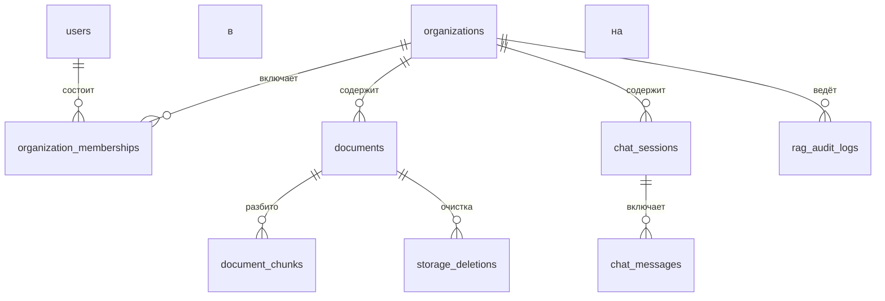

# Модель данных

Данные PostgreSQL состоят из двух частей: пользователей, организаций, документов и чата, а также индекса текстовых фрагментов
на pgvector. Организацию изолирует `organization_id` ([tenancy.md](tenancy.md)); ACL фрагмента копирует
`documents.access_roles`, а его `organization_id` указывает на организацию документа. Основные ключи — **UUID**
(`gen_random_uuid()` / SQLAlchemy `uuid4`). Роли и фильтрация описаны в [auth.md](auth.md).

Пользователь может состоять в нескольких организациях. Роль и отделы хранятся в
`organization_memberships`; миграция Alembic `007` перенесла туда прежние поля `users.role` и
`users.departments`.

## Связи верхнего уровня

Детали колонок ниже сгруппированы по таблицам; точные типы и constraints определяют Alembic migrations.

## PostgreSQL

### `organizations`

| Поле | Тип | Примечание |
| --- | --- | --- |
| `id` | UUID PK | |
| `name` | String | Отображаемое название организации |
| `slug` | String unique | Постоянная часть URL (`{slug}.localhost`); не является ACL |
| `status` | `active` \| `suspended` | Вход в организацию со статусом `suspended` запрещён; также учитываются состояния оплаты `past_due` и `cancel` |
| `plan` | `starter` \| `team` \| `enterprise` | Для новой организации задаётся `starter`; поле не определяет `org_id` |
| `billing_status` | `active` \| `past_due` \| `canceled` | `past_due` или `canceled` → `status = suspended` |
| `current_period_start` / `current_period_end` | DateTime nullable | Период расчёта квоты токенов |
| `sso_enforced` | Boolean | По умолчанию `false` |
| `llm_index_generation` | Integer | Поколение индекса для кэша LLM; увеличивается при `PATCH` ACL, `DELETE` или завершении индексации |
| `stripe_customer_id` / `stripe_subscription_id` | String nullable | Используются только Stripe; в JWT не входят |
| `created_at` | DateTime | |

### `organization_memberships`

| Поле | Тип | Примечание |
| --- | --- | --- |
| `id` | UUID PK | |
| `organization_id` | UUID FK → organizations | Каскадное удаление организации выполняется отдельной процедурой, а не случайным `DELETE` |
| `user_id` | UUID FK → users | |
| `role` | `admin` \| `manager` \| `employee` | Ограничение `CHECK`; поле находится не в `users` |
| `departments` | `ARRAY(String)` | Например, `['engineering', 'hr']` |
| `created_at` | DateTime | |

Уникальная пара `(organization_id, user_id)`. Для поиска `allowed_roles` = `{membership.role}` ∪ `membership.departments` ∪ `{all}` — только для этой организации.

### `organization_invites`

| Поле | Тип | Примечание |
| --- | --- | --- |
| `id` | UUID PK | |
| `organization_id` | UUID FK | |
| `email` | String | Приводится к нижнему регистру |
| `role` | `admin` \| `manager` \| `employee` | Роль нового участника |
| `departments` | `ARRAY(String)` | |
| `token_hash` | String unique | SHA-256 токена; исходный токен один раз показывается администратору организации |
| `invited_by_user_id` | UUID FK nullable | |
| `expires_at` | DateTime | Срок действия по умолчанию — 14 дней |
| `accepted_at` | DateTime nullable | |
| `created_at` | DateTime | |

Уникальное незавершённое приглашение: `(organization_id, email) WHERE accepted_at IS NULL`. Если приглашённый пользователь уже существует, членство добавляется сразу и токен не создаётся. Превышение квоты участников → `402`.

### `organization_sso_connections`

Одно подключение SSO на организацию. Организация для ACS определяется внешним ключом, а не атрибутом поставщика удостоверений.

| Поле | Тип | Примечание |
| --- | --- | --- |
| `id` | UUID PK | |
| `organization_id` | UUID FK unique | |
| `protocol` | `saml` \| `oidc` | |
| `idp_entity_id` / metadata | Text / JSONB | Сертификат провайдера удостоверений; ACS URL формируется из `slug` |
| `attribute_map` | JSONB | Группы провайдера удостоверений → `role` / `departments` |
| `jit_enabled` | Boolean | По умолчанию `false` |
| `created_at`, `updated_at` | DateTime | |

### `organization_domains`

| Поле | Тип | Примечание |
| --- | --- | --- |
| `id` | UUID PK | |
| `organization_id` | UUID FK | |
| `hostname` | String unique | Нижний регистр; `{slug}.localhost` или CNAME клиента |
| `kind` | `platform` \| `custom` | |
| `verified_at` | DateTime nullable | Непроверенный собственный домен не закрепляет `Host` |
| `created_at` | DateTime | |

Непроверенный собственный домен не участвует в определении организации. Имя узла уникально для всей системы.

### `billing_events`

Идемпотентность вебхука и маршрута `dev/simulate`.

| Поле | Тип | Примечание |
| --- | --- | --- |
| `id` | UUID PK | |
| `organization_id` | UUID FK | Всегда организация события; симуляция для чужой организации не создаёт запись |
| `provider` | `dev` \| `stripe` | |
| `external_id` | String | Уникален вместе с `provider` |
| `event_type` | String | |
| `payload` | JSONB | Не содержит текст фрагментов или PDF |
| `processed_at` | DateTime | |

### `users`

| Поле | Тип | Примечание |
| --- | --- | --- |
| `id` | UUID PK | `gen_random_uuid()` |
| `email` | String unique | Используется для входа |
| `hashed_password` | String nullable | Пустое значение для входа только через Google или SSO |
| `google_id` | String unique nullable | `sub` из ID-токена |
| `is_active` | Boolean | |
| `created_at` | DateTime | |

Роли участника: `admin` | `manager` | `employee`, а также `departments[]` **в членстве организации** (не путать с `access_roles` документа).
Для фильтра поиска `allowed_roles` = `{role}` ∪ `departments` ∪ `{all}` текущей организации (сборка описана в разделе [поиска](../pipeline/retrieval.md)). Адрес электронной почты уникален глобально: один человек может состоять в нескольких организациях.

### `documents`

| Поле | Тип | Примечание |
| --- | --- | --- |
| `id` | UUID PK | |
| `organization_id` | UUID FK → organizations | NOT NULL. Источник — сессия при загрузке, не тело запроса |
| `title` | String | Название в интерфейсе |
| `file_path` | String | Ключ MinIO (`orgs/{org_id}/…`) |
| `file_hash` | String | SHA-256; уникален **вместе с** `organization_id` |
| `file_size_bytes` | Integer | |
| `total_pages` | Integer | Резерв квоты при загрузке (`page_count`); обработка может уточнить значение |
| `access_roles` | `ARRAY(String)` | Например, `['admin', 'hr']` — роли внутри организации, не ID компании |
| `status` | Enum `pending` \| `processing` \| `ready` \| `failed` | Во время индексации используется `processing` |
| `last_error` | Text nullable | Текст последней ошибки обработки |
| `ingestion_stage` | String nullable | `parse` \| `chunk` \| `embed`; используется при опросе `GET .../status` |
| `created_at`, `updated_at` | DateTime | |

Индексы: уникальные `(organization_id, file_hash)` и `(id, organization_id)` (составная цель внешнего ключа фрагментов),
`status`, `(organization_id)`, GIN по `access_roles`.

### `chat_sessions`

| Поле | Тип | Примечание |
| --- | --- | --- |
| `id` | UUID PK | |
| `organization_id` | UUID FK | Копируется при создании; сессия принадлежит одной организации |
| `user_id` | UUID FK → users | |
| `title` | String nullable | Может быть заполнено по первому вопросу |
| `created_at`, `updated_at` | DateTime | |

### `chat_messages`

| Поле | Тип | Примечание |
| --- | --- | --- |
| `id` | UUID PK | |
| `session_id` | UUID FK → chat_sessions | Cascade |
| `role` | Enum `user` \| `assistant` | |
| `content` | Text | |
| `sources` | JSONB | Цитаты: `doc_id` (UUID), `title`, `page` (PDF), `section` (DOCX), `snippet` |
| `created_at` | DateTime | |

### `rag_audit_logs`

| Поле | Тип | Примечание |
| --- | --- | --- |
| `id` | UUID PK | |
| `organization_id` | UUID FK | Та же организация, что и у результатов поиска |
| `user_id` | UUID FK | |
| `session_id` / `message_id` | UUID nullable | Связь с чатом |
| `query` | Text | |
| `retrieved_chunk_ids` | JSONB, список строк UUID | Первичные ключи `document_chunks.id` после повторного ранжирования; не `chunk_id` и не текст |
| `latency_ms` | Integer | |
| `tokens_used` | Integer nullable | Для чата; для `inspect` — `null` |
| `feedback` | SmallInt nullable | `1` или `-1` через `POST /chat/feedback`; только для собственных сообщений ассистента |
| `feedback_comment` | String(2000) nullable | Необязательный комментарий; хранится столько же, сколько остальные записи аудита |
| `created_at` | DateTime | Индексирован для плановой очистки по сроку хранения |

Записи создаются чатом и `inspect`. Для `inspect` значения `session_id` и `message_id` равны `null`.
Столбцов `content` и `snippet` нет. Значения в `retrieved_chunk_ids`, не являющиеся UUID, отбрасываются.
Не записывайте полный текст фрагмента, в том числе закрытого, если пользователь может увидеть журнал через API.

### `storage_deletions`

Надёжная очередь отложенного удаления объектов после удаления документа и его фрагментов.

| Поле | Тип | Примечание |
| --- | --- | --- |
| `id` | UUID PK | Идентификатор запроса на удаление |
| `object_key` | String(1024) | Доверенный ключ из удалённой записи документа; пользователю не возвращается |
| `created_at` | DateTime | Фоновый обработчик ограничивает размер выборки и начинает со старых записей |
| `attempts` | Integer | Увеличивается при ошибке удаления из хранилища |
| `last_attempt_at` | DateTime nullable | Время и число попыток для диагностики |

Запись в очередь удаления добавляется в ту же транзакцию PostgreSQL, что и удаление документа. Celery Beat
повторяет удаление из MinIO каждые пять минут; операция идемпотентна.

## Таблица `document_chunks` в PostgreSQL

Расширение `vector`. Векторный поиск: `embedding vector(384)`, косинусное сходство (`BAAI/bge-small-en-v1.5`), индекс HNSW.
ACL, `document_id` и `organization_id` хранятся в обычных столбцах; для `access_roles` создан индекс GIN,
для `organization_id` — индекс btree/hash.

Полнотекстовый поиск: столбец `search_vector` (`tsvector`, `to_tsvector('simple', content)`, индекс GIN).
Каждый поиск фильтрует по `organization_id = :current_org` **и** ACL через GIN. Независимо выбираются 25 результатов
векторного поиска и 25 результатов FTS, затем они объединяются через RRF.

| Поле | Тип | Примечание |
| --- | --- | --- |
| `id` | UUID PK | Стабильный ID фрагмента в API |
| `document_id` | UUID | Внешний ключ используется только вместе с `organization_id` |
| `organization_id` | UUID | Копируется из документа. Единственный внешний ключ на документ: `(document_id, organization_id) → documents(id, organization_id)` |
| `chunk_id` | String unique | Стабильный ключ повторной загрузки (`{document_id}:{page}:{n}`) |
| `page_number` | Integer | |
| `section_title` | String nullable | |
| `is_table` | Boolean | |
| `access_roles` | `ARRAY(String)` | Копируется из документа |
| `content` | Text | Текстовый фрагмент **без** заголовка `[Document: …]` (заголовок используется только в `embed_text` перед FastEmbed) |
| `search_vector` | `tsvector` generated | `to_tsvector('simple', content)`, GIN; приложение не записывает значение напрямую |
| `token_count` | Integer | |
| `embedding` | `vector(384)` | Косинусное сходство |
| `doc_title` | String nullable | Для цитат |
| `bbox` / `highlight_rects` | JSONB nullable | Область для подсветки в просмотрщике |

При повторной индексации строки сначала удаляются по `document_id`, затем создаются заново. `organization_id` фрагмента
всегда совпадает с организацией документа; это обеспечивает составной внешний ключ, а не только проверка приложения.

## MinIO

Бакет `documents` закрыт: анонимный `s3:GetObject` запрещён. `documents.file_path` — ключ объекта с префиксом
`orgs/{organization_id}/…`. Файлы выдаются только через API (`GET /documents/{id}/raw`). Публичные URL и бессрочные
подписанные ссылки запрещены.

## Согласованность ACL

`documents.access_roles` — источник истины для **внутреннего** ACL. `documents.organization_id` — источник истины для
организации. Оба поля фрагмента должны совпадать с документом. При смене ролей `PATCH /api/v1/documents/{id}` обновляет
документ **и** все его фрагменты без повторного создания векторов. Клиент не может передать `organization_id`;
поиск не доверяет ролям и организации из тела запроса.
