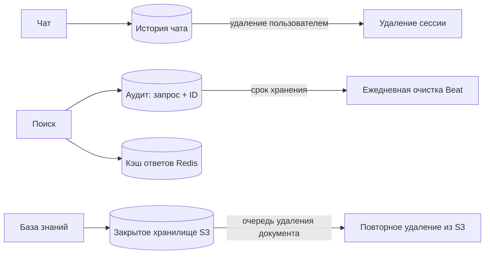

# Хранение и удаление данных

Это краткое описание правил хранения для пилотных установок, а не юридическая гарантия. Договор и настройки организации
могут требовать другого срока; в таком случае нужно обновить конфигурацию, задачу очистки и уведомления пользователя.

## Что хранится

| Данные | Текущее поведение | Удаление |
| --- | --- | --- |
| `rag_audit_logs` | 90 дней по умолчанию (`AUDIT_LOG_RETENTION_DAYS`, минимум 1) | Один планировщик Beat ежедневно удаляет просроченные строки пачками |
| История чата | Пока существует сессия чата | Пользователь удаляет сессию; сообщения удаляются каскадно |
| База знаний | Принадлежит организации | Администратор или управляющий удаляет документ; очередь повторяет удаление из S3 |
| Кэш ответов модели | TTL Redis — 24 часа | Автоматическое истечение; изменения ACL или индекса сбрасывают поколение кэша |

Аудит содержит поисковый запрос, ID фрагментов, расход токенов и необязательный комментарий, но не сами тексты фрагментов.

## Удаление пользователя и организации

- Для удаления отдельного членства пока нет пользовательского API; может потребоваться процедура оператора.
- Удаление глобальной записи `users` удаляет сессии чата и связанные записи журнала аудита этого пользователя.
- Перед удалением организации нужно выполнить экспорт или резервное копирование; сначала очищаются связанные записи журнала аудита и документы.
- Закрытые инструкции для операторов пилотной среды не входят в открытый репозиторий: [PRIVATE.md](../PRIVATE.md).

## Сведения для эксплуатации

Задачу очистки запускает один Celery Beat ежедневно в 03:15 UTC; за один пакет удаляется до 1000 записей аудита.
Не запускайте несколько экземпляров Beat без отдельной координации.

Удаление документа в одной транзакции удаляет строки PostgreSQL и добавляет запись `storage_deletions`.
Удаление объекта S3 выполняется позже; пока ожидается повторная попытка, документ недоступен через API, но закрытый объект
может ещё оставаться в хранилище. Проверка очереди: `make check-pilot-alerts`.

Смена модели векторных представлений или повторная индексация не удаляет историю журнала аудита.
Каноническое решение: [ADR-017](../engineering/decisions.md#adr-017-срок-хранения-и-удаление-данных-политика-пилотной-среды-ес).
