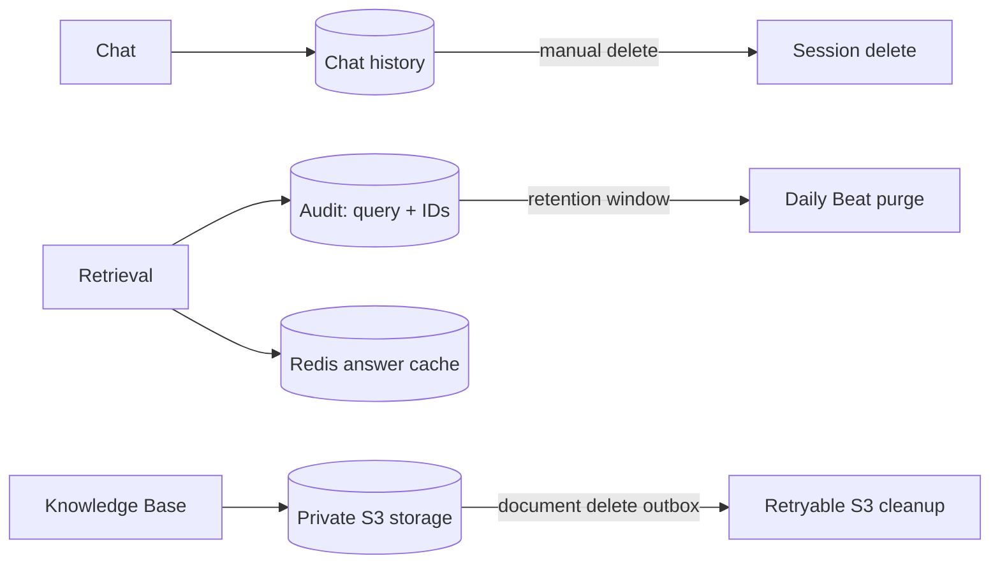

# Хранение и удаление данных

Это policy summary для пилотов, не юридическая гарантия. Контракт и настройки организации могут требовать другой срок;
при таком изменении нужно обновить конфигурацию, задачу очистки и уведомления пользователя.

## Что хранится

| Данные | Текущее поведение | Удаление |
| --- | --- | --- |
| `rag_audit_logs` | 90 дней по умолчанию (`AUDIT_LOG_RETENTION_DAYS`, минимум 1) | Один Beat ежедневно удаляет просроченные строки пачками |
| Chat history | Пока существует chat session | Пользователь удаляет сессию; messages удаляются cascade |
| Knowledge Base | Контролирует организация | Admin/manager удаляет документ; outbox повторяет S3 cleanup |
| LLM answer cache | Redis TTL 24 часа | Автоматический expiry; изменения ACL/index инвалидируют generation |

Audit содержит query, IDs chunks, usage и optional feedback comment, но не body chunks.

## Удаление пользователя и организации

- Удаление одной membership сейчас не имеет пользовательского API; доступ может потребовать операторской процедуры.
- Удаление global `users` удаляет chat sessions и связанные audit rows этого пользователя.
- Перед удалением organization требуется экспорт/backup; сначала очищаются зависимые audit data и corpus.
- Private pilot runbooks не входят в публичный репозиторий: [PRIVATE.md](../PRIVATE.md).

## Операционные детали

Retention job запускает один Celery Beat в 03:15 UTC, по 1000 audit rows за batch.
Не масштабируйте Beat больше чем в одну replica без отдельной координации.

Удаление документа атомарно удаляет строки PostgreSQL и записывает `storage_deletions` row.
S3 cleanup выполняется позже; пока он ожидает retry, документ недоступен через API, но приватный объект может ещё оставаться в storage.
Проверка backlog: `make check-pilot-alerts`.

Смена embedding model или reindex не удаляет audit history.
Каноническое решение: [ADR-017](../engineering/decisions.md#adr-017-data-retention-and-erasure-eu-pilot-policy).
