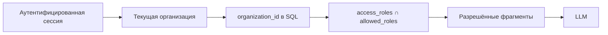

# Изоляция организаций

Docwise — многопользовательский B2B-сервис: несколько организаций используют один экземпляр приложения и общие службы.
Частное облако или локальная установка могут использовать тот же код для одной организации.

## Два слоя доступа



1. **Внешняя граница:** `organization_id` скрывает данные других организаций.
2. **Внутренняя граница:** `access_roles` разделяет документы внутри организации.

`admin`, `hr` и `all` — роли/теги, не идентификаторы клиентов. `all` значит все участники **этой** организации.
Обе проверки выполняются в SQL до объединения результатов, повторного ранжирования и передачи контекста языковой модели.

```sql
WHERE organization_id = :current_org
  AND access_roles && :allowed_roles
```

`current_org` берётся из сессии или доверенной записи БД; тело запроса клиента не выбирает организацию.

## Модель пользователя

| Сущность | Назначение |
| --- | --- |
| `users` | Глобальная учётная запись; адрес электронной почты уникален |
| `organizations` | Организация, `slug`, тарифный план и состояние |
| `organization_memberships` | Связь пользователя с организацией; роль и `departments[]` в этой организации |

Один пользователь может быть администратором одной организации и сотрудником другой. `require_admin` означает
администратора текущей организации, а не оператора платформы. Роли и сессии cookie описаны в [auth.md](auth.md),
таблицы — в [data-model.md](data-model.md).

## Где применяются организация и ACL

| Поверхность | Ограничение |
| --- | --- |
| Список документов, состояние и оригинал | `organization_id` и `access_roles` документа |
| Векторный и полнотекстовый поиск, чат, диагностика | Оба условия до объединения результатов и генерации ответа |
| Сессии чата | Текущие `organization_id` и `user_id` |
| Аудит и оплата | Текущая организация |
| Кэш ответов модели | `organization_id`, поколение индекса, канонический `allowed_roles` |
| Проверка дубликатов файлов | Уникальная пара `(organization_id, file_hash)` |
| MinIO/S3 | Префикс организации; bucket закрыт |
| SSO | Организация определяется по `slug` подключения SSO |
| Проверенное имя узла | Дополнительное условие; должно совпадать с организацией сессии |

API не раскрывает сведения о чужой записи или файле через `404`, конфликт или ошибку с именем файла.

## Регистрация, приглашения и имя узла

- Регистрация без приглашения создаёт пользователя, организацию и членство с ролью `admin`.
- Приглашение добавляет пользователя в существующую организацию; новая организация повторно не создаётся.
- Собственное имя узла может закрепить запрос за организацией только после проверки.
- Имя узла дополняет SQL-фильтр, но не заменяет его.
- На узле одной организации запрещено переключаться на другую организацию.

## PostgreSQL RLS

RLS включена только для corpus-таблиц `documents` и `document_chunks`. Политика использует GUC
`app.organization_id`; API и фоновый обработчик задают контекст после определения организации.
У `chat_messages` нет `organization_id`, поэтому сессии и журнал аудита защищаются явными SQL-фильтрами сервиса.

**Условие для среды выполнения:** суперпользователь PostgreSQL обходит RLS, даже при `FORCE ROW LEVEL SECURITY`.
Базовый и публичный профили Compose передают `DOCWISE_RLS_SESSION_ROLE=docwise_rls`; отдельная задача `db-migrate`
создаёт или проверяет роль и разрешения до запуска API, фонового обработчика и Beat. Транзакция среды выполнения
использует `SET LOCAL ROLE`. При развёртывании вне этих профилей Compose роль нужно настроить отдельно.

RLS остаётся дополнительной защитой: она не учитывает внутренний ACL `access_roles` и не заменяет фильтры приложения.
Подробнее: [обзор безопасности](../security/overview.md) и [развёртывание через Compose](../operations/operations.md).

## Не входит в текущий объём работ

Консоль оператора платформы с доступом ко всем документам клиентов и SCIM не реализованы.
