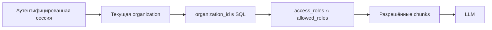

# Организации и tenant isolation

Docwise — shared B2B SaaS: несколько организаций используют один deployment и общие сервисы.
Private cloud/on-prem может использовать тот же код для одной организации.

## Два слоя доступа



1. **Внешняя граница:** `organization_id` скрывает данные других компаний.
2. **Внутренняя граница:** `access_roles` разделяет документы внутри организации.

`admin`, `hr` и `all` — роли/теги, не идентификаторы клиентов. `all` значит все участники **этой** организации.
Обе проверки выполняются в SQL до RRF, rerank и LLM.

```sql
WHERE organization_id = :current_org
  AND access_roles && :allowed_roles
```

`current_org` берётся из сессии/доверенной записи БД; клиентский request body не выбирает tenant.

## Модель пользователя

| Сущность | Назначение |
| --- | --- |
| `users` | Глобальная identity; email уникален |
| `organizations` | Компания, slug, plan и состояние |
| `organization_memberships` | Связь user↔org; роль и `departments[]` для этой организации |

Один user может быть admin в одной org и employee в другой. `require_admin` означает admin текущей организации,
не platform operator. Роли и cookie session: [auth.md](auth.md); таблицы: [data-model.md](data-model.md).

## Где применяется tenant и ACL

| Поверхность | Ограничение |
| --- | --- |
| Document list/status/raw | `organization_id` + document `access_roles` |
| Dense и FTS search, chat, inspect | Оба предиката до fusion и генерации |
| Chat sessions | Текущие `organization_id` и `user_id` |
| Audit и billing | Текущая organization |
| LLM cache | `organization_id`, index generation, canonical `allowed_roles` |
| Duplicate file check | Unique `(organization_id, file_hash)` |
| MinIO/S3 | Organization prefix; bucket не публичный |
| SSO | Организация определяется connector slug |
| Verified hostname | Дополнительный pin; обязан совпадать с org сессии |

Чужая запись или файл не подтверждаются через `404`, conflict или ошибку с filename.

## Регистрация, приглашения и hostname

- Регистрация без invite создаёт user, organization и membership `admin`.
- Invite добавляет пользователя к существующей org; повторная регистрация новой организации не происходит.
- Custom hostname может закрепить запрос за organization только после проверки.
- Hostname дополняет SQL-фильтр; он никогда не заменяет его.
- На host одной организации запрещён switch в другую organization.

## PostgreSQL RLS

RLS включена только для corpus-таблиц `documents` и `document_chunks`. Политика использует GUC
`app.organization_id`; API и worker задают контекст после определения организации.
У `chat_messages` нет `organization_id`, поэтому сессии и audit защищаются явными SQL-фильтрами сервиса.

**Runtime prerequisite:** PostgreSQL superuser обходит RLS, даже при `FORCE ROW LEVEL SECURITY`.
Base и public-demo Compose передают `DOCWISE_RLS_SESSION_ROLE=docwise_rls`; выделенный `db-migrate`
создаёт/проверяет роль и grants до запуска API, worker и Beat. Runtime transaction использует
`SET LOCAL ROLE`. При deployment вне этих Compose профилей роль нужно настроить отдельно.

RLS остаётся дополнительной защитой: она не содержит внутренний `access_roles` ACL и не заменяет application filters.
Подробнее: [security overview](../security/overview.md) и [Compose deployment](../operations/operations.md).

## Не входит в scope

Platform operator console с доступом ко всем клиентским корпусам и SCIM не реализованы.
