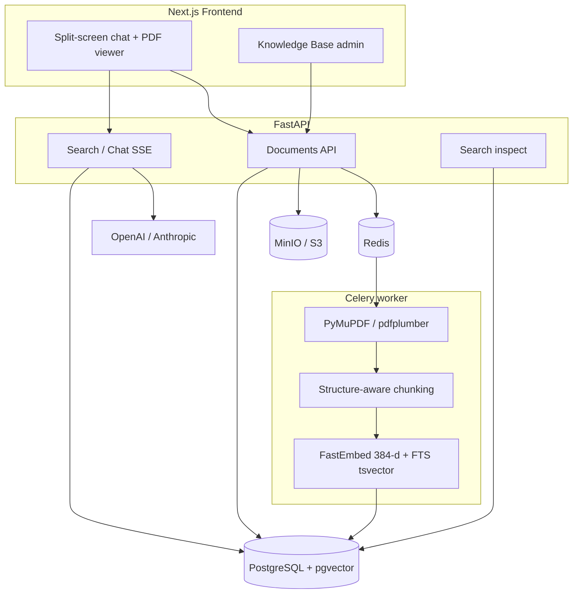

# Архитектура Docwise

Продуктовые требования: [srs.md](srs.md). Отклонения от черновика ТЗ: [decisions.md](../engineering/decisions.md).

## 1. Проблема

Корпоративный корпус документов (PDF/DOCX: регламенты, политики, NDA, финансы, договоры) плохо ищется и опасно отдаётся в LLM.

| Боль | Почему наивный подход ломается |
| --- | --- |
| Семантика вопроса | Keyword-поиск не понимает формулировку |
| Структура PDF | Нарезка по N символам рвёт таблицы и заголовки |
| Утечка ACL | Общий чат без фильтра векторов отдаёт стажёру финансы C-level |
| Доверие | Без точной страницы в оригинале ответ модели нельзя проверить |

Docwise закрывает это связкой: **изоляция организаций (`org_id`)**, **RBAC на retrieval**, **structure-aware chunking**, **hybrid search + rerank**, **цитаты в PDF-вьюере**. Целевой деплой — shared B2B SaaS ([tenancy.md](../platform/tenancy.md)).

Векторы — **pgvector** в Postgres (cosine HNSW) плюс независимый FTS; файлы — MinIO. Продукт — **корпусный** RAG с ACL на каждый запрос, не чат по одному загруженному файлу.

## 2. Компоненты

| Компонент | Ответственность |
| --- | --- |
| Next.js | Чат, сноски, встроенный PDF, админка базы знаний |
| FastAPI | Auth, текущая org в сессии, загрузка, статусы, SSE-чат, inspect, отдача файла |
| Celery | Тяжёлый парсинг, чанкинг, эмбеддинги, upsert чанков в Postgres |
| PostgreSQL + pgvector | Пользователи, организации и memberships (M5), документы, сессии, аудит, dense-векторы чанков |
| MinIO | Байты оригинальных файлов |
| Redis | Брокер Celery и кеш |

## 3. Поток A — загрузка документа

1. Org-admin текущей организации загружает PDF и выбирает `access_roles[]` (внутренние теги, не id компании).
2. API считает SHA-256, проверяет unique `(org_id, file_hash)`, сохраняет объект в MinIO с префиксом org, строку в `documents` (`pending`, `org_id` сессии).
3. Ставится задача `process_document(doc_id)`.
4. Воркер: извлечение по страницам → чанки секции/страницы → dense-эмбеддинг; FTS (`search_vector`) считается в Postgres → upsert в `document_chunks` (копия `org_id` и ACL документа) → `status = ready` либо `failed`.

## 4. Поток B — вопрос в чат

1. Клиент шлёт `POST /api/v1/chat/stream` (cookie-сессия).
2. Из сессии берутся `org_id`, роль и отделы членства. SQL: `org_id = :current_org AND access_roles && allowed_roles`.
3. Dense Top-25 + FTS Top-25 (независимо, тот же org + ACL) → RRF → Top-15 → cross-encoder → порог 0.25 → Top-4.
4. Первым SSE-событием уходят цитаты, затем токены ответа, затем метрики.
5. UI открывает PDF на странице сноски и подсвечивает фрагмент.

Данные, к которым нет прав (чужая org или своя ACL), **физически не попадают** в промпт. Кэш LLM ключуется ещё и `org_id`.

## 5. Поток C — inspect

1. Org-admin при включённом `ENABLE_SEARCH_INSPECT` шлёт `POST /api/v1/search/inspect`.
2. Тот же hybrid retrieval: `org_id` сессии + SQL ACL (роли из membership). Флаг выкл → `404`; не org-admin → `403`.
3. Ответ: списки dense / sparse / rrf / reranked со скорами и превью. Чанки вне org или ACL отсутствуют.
4. Строка в `rag_audit_logs` (UUID чанков после реранкера, без текста; с `organization_id`).

## 6. Границы

В скоупе продукта: PDF (приоритет), DOCX по возможности; роли и отделы **внутри** org; shared SaaS с `org_id` ([M5](milestones.md#milestone-5--shared-tenancy-b2b-saas)); английские/русские корпоративные документы.

Shared SaaS: много организаций на одном деплое. Изоляция — SQL `organization_id` плюс внутренняя ACL. После M5 — [M6](milestones.md#milestone-6--commercial-saas): планы/квоты, SSO, custom domain; биллинг за портом (`dev` по умолчанию).

Вне скоупа до отдельных вех: консоль оператора платформы, SCIM, боевой эквайринг как критерий, онлайн-редактирование файлов, агенты с tool-calling за пределы корпуса, обучение собственных эмбеддингов, доменный аудит смарт-контрактов и отдельный Qdrant-only vector path.
