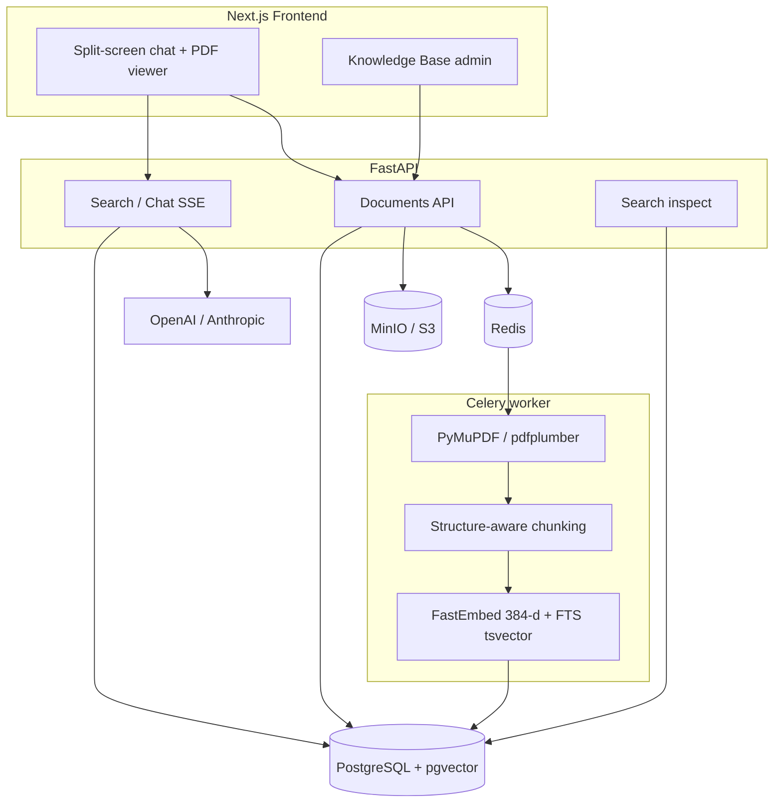

# Docwise architecture

Product requirements: [srs.md](srs.md). Deviations from draft spec: [decisions.md](../engineering/decisions.md).

## 1. Problem

Corporate document corpora (PDF/DOCX: policies, NDAs, finance, contracts) are hard to search and risky to send to an LLM.

| Pain | Why a naive approach fails |
| --- | --- |
| Question semantics | Keyword search does not match phrasing |
| PDF structure | Fixed-size splits break tables and headings |
| ACL leakage | Shared chat without vector filter exposes C-level finance to interns |
| Trust | Without exact page in source, model answers cannot be verified |

Docwise addresses this with: **organization isolation (`org_id`)**, **RBAC on retrieval**, **structure-aware chunking**, **hybrid search + rerank**, **citations in the PDF viewer**. Target deploy — shared B2B SaaS ([tenancy.md](../platform/tenancy.md)).

Vectors — **pgvector** in Postgres (cosine HNSW) plus independent FTS; files — MinIO. Product is **corpus-wide** RAG with ACL on every query, not chat over a single uploaded file.

## 2. Components

| Component | Responsibility |
| --- | --- |
| Next.js | Chat, footnotes, embedded PDF, KB admin |
| FastAPI | Auth, current org in session, upload, statuses, SSE chat, inspect, file delivery |
| Celery | Heavy parsing, chunking, embeddings, chunk upsert in Postgres |
| PostgreSQL + pgvector | Users, organizations and memberships, documents, sessions, audit, dense chunk vectors |
| MinIO | Original file bytes |
| Redis | Celery broker and cache |

## 3. Flow A — document upload

1. Org-admin of current org uploads PDF and selects `access_roles[]` (inner tags, not company id).
2. API computes SHA-256, checks unique `(org_id, file_hash)`, stores object in MinIO with org prefix, row in `documents` (`pending`, session `org_id`).
3. Task `process_document(doc_id)` is enqueued.
4. Worker: page extraction → section/page chunks → dense embedding; FTS (`search_vector`) in Postgres → upsert `document_chunks` (copy document `org_id` and ACL) → `status = ready` or `failed`.

## 4. Flow B — chat question

1. Client sends `POST /api/v1/chat/stream` (cookie session).
2. Session yields `org_id`, role and departments. SQL: `org_id = :current_org AND access_roles && allowed_roles`.
3. Dense Top-25 + FTS Top-25 (independent, same org + ACL) → RRF → Top-15 → cross-encoder → threshold 0.25 → Top-4.
4. First SSE event: citations, then answer tokens, then metrics.
5. UI opens PDF on footnote page and highlights fragment.

Data the user cannot access (foreign org or inner ACL) **never enters** the prompt. LLM cache is keyed with `org_id`.

## 5. Flow C — inspect

1. Org-admin with `ENABLE_SEARCH_INSPECT` sends `POST /api/v1/search/inspect`.
2. Same hybrid retrieval: session `org_id` + SQL ACL (roles from membership). Flag off → `404`; not org-admin → `403`.
3. Response: dense / sparse / rrf / reranked lists with scores and previews. Chunks outside org or ACL are absent.
4. Row in `rag_audit_logs` (chunk UUIDs after reranker, no text; with `organization_id`).

## 6. Boundaries

In product scope: PDF (priority), DOCX where possible; roles and departments **inside** org; shared SaaS with `org_id` ([tenancy.md](../platform/tenancy.md)); EN/RU corporate documents.

Shared SaaS: many organizations on one deploy. Isolation — SQL `organization_id` plus inner ACL. Plans, quotas, SSO, custom domain — [billing.md](../platform/billing.md); billing behind port (`dev` by default).

Out of product scope: platform operator console, SCIM, live payment processing as a deployment requirement (Stripe adapter optional), online file editing, tool-calling agents outside corpus, training custom embeddings, smart-contract audit domain and Qdrant-only vector path.
