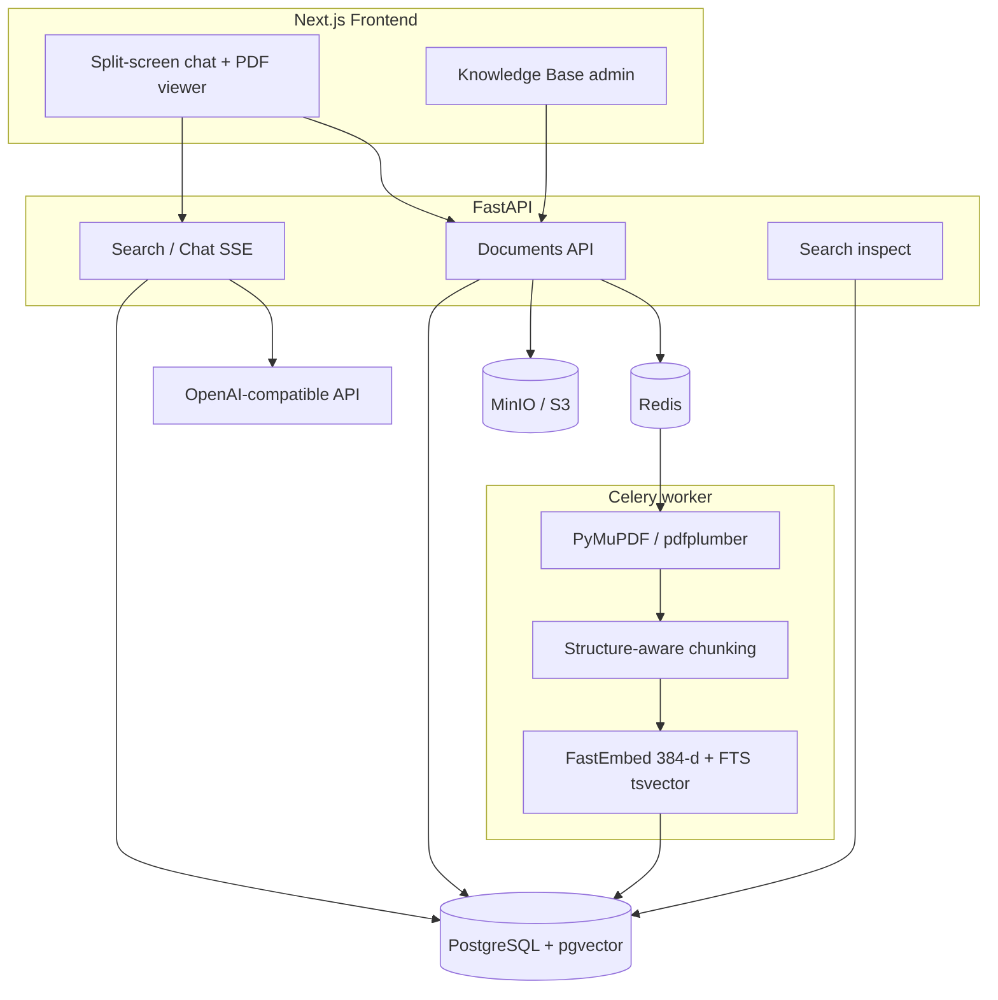

# Docwise architecture

Product requirements: [srs.md](srs.md). Deviations from draft spec: [decisions.md](../engineering/decisions.md). Target deploy: shared B2B SaaS ([tenancy.md](../platform/tenancy.md)).

## Components

| Component | Responsibility |
| --- | --- |
| Next.js | Chat, footnotes, embedded PDF, KB admin |
| FastAPI | Auth, current org in session, upload, statuses, SSE chat, inspect, file delivery |
| Celery | Heavy parsing, chunking, embeddings, chunk upsert in Postgres |
| PostgreSQL + pgvector | Users, organizations and memberships, documents, sessions, audit, dense chunk vectors + FTS |
| MinIO | Original file bytes |
| Redis | Celery broker/result backend, refresh sessions, rate limits, locks and cache |

LLM-клиент в `backend/app/services/chat/llm.py` реализует OpenAI-compatible HTTP.
Отдельного Anthropic adapter в репозитории нет.

## Flow A — document upload

1. Org-admin of current org uploads PDF/DOCX and selects `access_roles[]` (inner tags, not company id).
2. API computes SHA-256, checks unique `(org_id, file_hash)`, stores object in MinIO with org prefix, row in `documents` (`pending`, session `org_id`).
3. Task `ingestion.process_document` with `document_id` is enqueued.
4. Worker: page extraction → section/page chunks → dense embedding; FTS (`search_vector`) in Postgres → upsert `document_chunks` (copy document `org_id` and ACL) → `status = ready` or `failed`.

Detail: [ingestion.md](../pipeline/ingestion.md).

## Flow B — chat question

1. Client sends `POST /api/v1/chat/stream` (cookie session).
2. Session yields `org_id`, role and departments. SQL ACL on every dense and FTS query — [auth.md](../platform/auth.md), [tenancy.md](../platform/tenancy.md).
3. Dense Top-25 + FTS Top-25 → RRF → Top-15 → cross-encoder → threshold 0.25 → Top-4.
4. First SSE event: citations, then answer tokens, then metrics.
5. UI opens PDF on footnote page and highlights fragment.

Detail: [retrieval.md](../pipeline/retrieval.md). Data the user cannot access never enters the prompt.

## Flow C — inspect

1. Org-admin with `ENABLE_SEARCH_INSPECT` sends `POST /api/v1/search/inspect`.
2. Same hybrid retrieval under session `org_id` + SQL ACL. Flag off → `404`; not org-admin → `403`.
3. Response: dense / sparse / rrf / reranked lists with scores and previews.
4. Row in `rag_audit_logs` (chunk UUIDs after reranker, no text; with `organization_id`).

## Boundaries

In scope: PDF (priority), DOCX where possible; roles and departments **inside** org; plans/quotas/SSO/custom domain behind ports ([billing.md](../platform/billing.md)).

Out of scope: platform operator console, SCIM, live payment as a deploy requirement, online file editing, tool-calling agents outside corpus, training custom embeddings. Full FR and OOS lists: [srs.md](srs.md).
