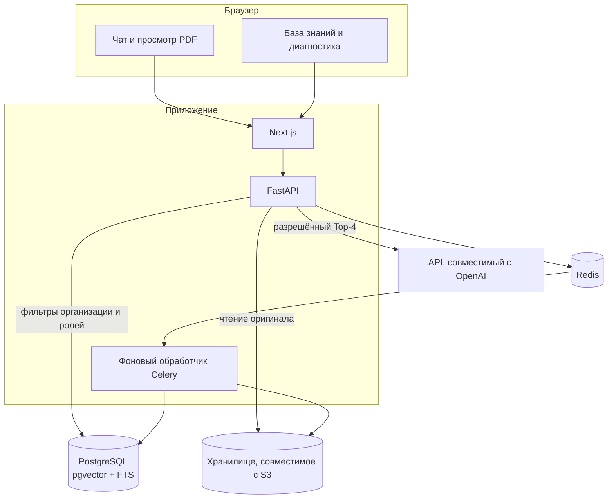
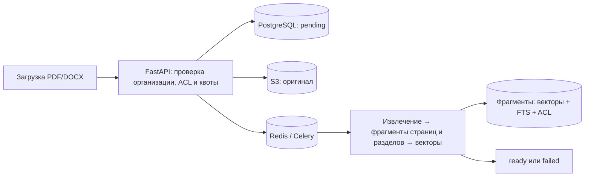
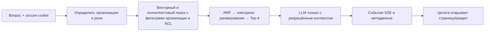

# Архитектура Docwise

Docwise — B2B-сервис для поиска по документам и ответов на вопросы о них. Несколько организаций используют
общую инфраструктуру; принадлежность к организации и ACL документов ограничивают все пути чтения. Требования
к продукту собраны в [SRS](srs.md), архитектурные решения — в [ADR](../engineering/decisions.md), ограничения эксплуатации — в [инструкциях оператора](../operations/operations.md).

## Компоненты

| Компонент | За что отвечает |
| --- | --- |
| Next.js | Чат, список сессий, просмотр PDF/DOCX, управление базой знаний |
| FastAPI | Аутентификация, контекст организации, загрузка, поиск, чат через SSE, диагностика и выдача файлов |
| Celery | Извлечение текста, разбиение на фрагменты, создание векторных представлений и индексация |
| PostgreSQL | Организации, пользователи, документы, сессии, аудит, векторы и полнотекстовый поиск |
| Redis | Очередь Celery, результаты фоновых задач, сессии обновления, ограничения, блокировки и кэш ответов модели |
| Хранилище S3 | Оригиналы файлов; локально MinIO, в публичном профиле Garage |
| LLM | HTTP API, совместимый с OpenAI; отдельного подключения к Anthropic в репозитории нет |

## Загрузка и индексация

API сохраняет оригинал и ставит задачу в очередь; разбор документа не выполняется внутри HTTP-запроса.
Промежуточные этапы видны через `GET /documents/{id}/status`. Подробности, включая повторные попытки
и восстановление очереди: [обработка документов](../pipeline/ingestion.md).

## Вопрос и ответ

Для нового чата, ответа на который ещё нет в кэше, серверная часть создаёт сессию после успешного поиска, но **до** генерации.
Раннее событие SSE `meta` содержит `session_id`, а `message_id` ещё равен `null`. Затем передаются цитаты, части ответа
и финальное событие `meta` с ID сообщения и расходом токенов. Ошибка до успешного поиска не создаёт пустую сессию.
Полный порядок событий и правила ACL описаны в [документе о поиске](../pipeline/retrieval.md).

## Точки контроля доступа

1. `organization_id` определяется текущей аутентифицированной сессией.
2. Векторный и полнотекстовый поиск фильтруются по организации и `access_roles` в SQL до объединения результатов.
3. Тот же ACL применяется к спискам, статусу и выдаче исходного файла.
4. Языковая модель и журнал аудита не получают недоступные пользователю фрагменты.

RLS включена для таблиц документов и фрагментов, но действует только когда среда выполнения использует отдельную
роль `docwise_rls`, не являющуюся суперпользователем. Она дополняет фильтры приложения, а не заменяет их:
[изоляция организаций](../platform/tenancy.md), [безопасность](../security/overview.md).

## Границы продукта

В коде реализованы PDF и DOCX, роли и отделы внутри организации, тарифные планы и оплата в режиме разработки.
В публичном профиле SSO отключён, Garage работает на одном узле; есть проверки состояния, журналы JSON и закрытый
серверный маршрут `/metrics`, но нет централизованного сбора метрик и панели мониторинга. Kubernetes, высокая доступность
и подключение настоящего провайдера SAML/OIDC не входят в текущую конфигурацию среды выполнения.
