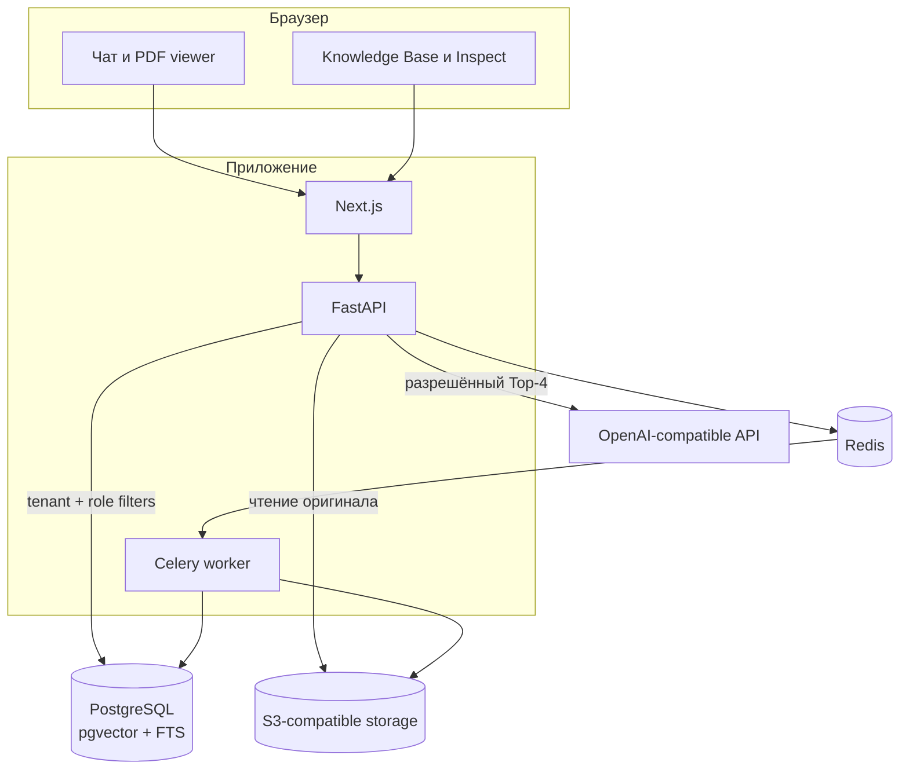
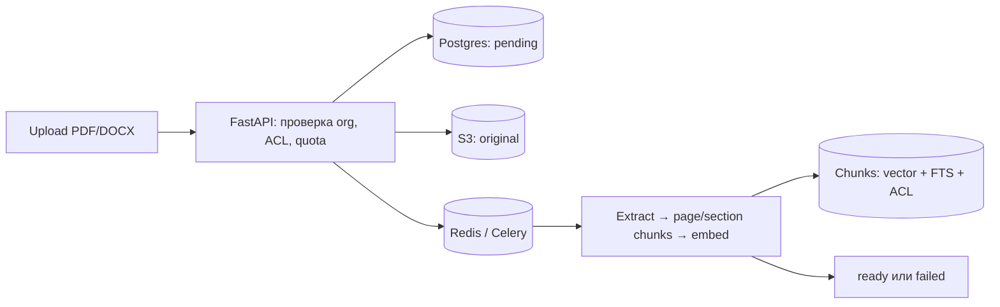
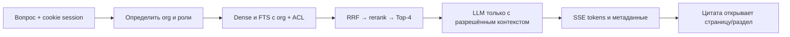

# Архитектура Docwise

Docwise — shared B2B SaaS для поиска и вопросов по документам. Несколько организаций используют один стек;
данные каждой организации и ACL документов ограничивают все пути чтения. Продуктовые требования — в [SRS](srs.md),
архитектурные решения — в [ADR](../engineering/decisions.md), эксплуатационные ограничения — в [operations](../operations/operations.md).

## Компоненты

| Компонент | За что отвечает |
| --- | --- |
| Next.js | Чат, список сессий, PDF/DOCX viewer, администрирование базы знаний |
| FastAPI | Auth, tenant context, загрузка, поиск, SSE chat, inspect и выдача файлов |
| Celery | Извлечение текста, chunking, embeddings и индексация |
| PostgreSQL | Организации, пользователи, документы, сессии, audit, vectors и FTS |
| Redis | Celery broker/result backend, refresh sessions, limits, locks и LLM cache |
| S3 storage | Оригиналы файлов; локально MinIO, в публичном demo Garage |
| LLM | OpenAI-compatible HTTP API; отдельного Anthropic adapter в репозитории нет |

## Загрузка и индексация

API сохраняет оригинал и ставит задачу в очередь; тяжёлый parsing не выполняется в HTTP request.
Промежуточные стадии видны через `GET /documents/{id}/status`. Подробности, включая retry и recovery:
[ingestion](../pipeline/ingestion.md).

## Вопрос и ответ

Для нового uncached чата backend создаёт сессию после успешного retrieval, но **до** генерации:
ранний SSE `meta` содержит `session_id`, а `message_id` ещё `null`. Затем идут citations, token events
и финальный `meta` с ID сообщения и usage. Ошибка до успешного retrieval не создаёт пустую сессию.
Полный порядок и ACL — в [описании retrieval](../pipeline/retrieval.md).

## Точки контроля доступа

1. `organization_id` определяется текущей аутентифицированной сессией.
2. Dense и FTS фильтруются по организации и `access_roles` в SQL до fusion.
3. Тот же ACL применяется к спискам, статусу и выдаче исходного файла.
4. LLM и audit не получают chunks, недоступные пользователю.

RLS включена для corpus-таблиц, но действует только когда runtime использует отдельную non-superuser роль
`docwise_rls`. Она дополняет прикладные фильтры, а не заменяет их: [tenancy](../platform/tenancy.md),
[security](../security/overview.md).

## Границы продукта

В текущем коде реализованы PDF и DOCX, роли/отделы внутри организации, планы/quotas и dev billing.
В публичном демо SSO отключён, Garage — одноузловой; доступны healthchecks, JSON logs и приватный backend `/metrics`, без централизованного scrape/dashboard.
Kubernetes, HA и реальный SAML/OIDC provider не входят в текущую runtime-конфигурацию.
