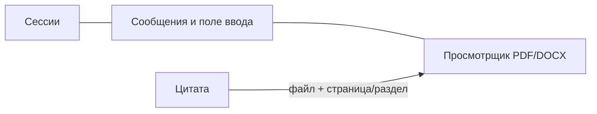

# Интерфейс и его поведение

Клиентская часть использует Next.js App Router, React, TypeScript, Tailwind, shadcn/ui и PDF.js.
TanStack Query хранит состояние, полученное от сервера; Zustand — текущее состояние чата.

## Маршруты

| URL | Назначение |
| --- | --- |
| `/login` | Вход и доступные способы входа |
| `/` и `/chat` | Новый чат |
| `/chat/[sessionId]` | Сохранённая сессия |
| `/documents` | База знаний: загрузка, состояния документов и ACL |
| `/inspect` | Этапы поиска для администратора организации при включённом флаге |
| `/settings` | Организация, план, использование квот, SSO и домен |

Исходный код страниц находится в `frontend/src/app/`, логика возможностей — в `frontend/src/features/`.

## Экран чата

- На любом размере экрана список сессий открывается из панели инструментов в диалоговом окне; на телефоне это компактная нижняя панель с прокруткой.
- На широком экране нет постоянно открытых боковых панелей. Панель инструментов открывает область документа; по цитате источник открывается рядом с чатом. Область можно закрыть или изменить её ширину.
- На телефоне цитата открывает документ на весь экран; пользователь может вернуться к чату.
- Поле ввода на телефоне поначалу компактное, кнопка отправки выровнена по центру, а поле растёт при вводе нескольких строк.
- Уведомления объединяют одинаковые сообщения, одновременно показывают не более трёх и учитывают безопасные отступы экрана.
- Ответ отображается по мере поступления событий `token` через SSE.
- Цитата открывает исходный файл и нужное место; фрагмент PDF подсвечивается, если доступна геометрия текста.
- Ошибки чата и просмотрщика показываются рядом с ответом или отдельным кратким уведомлением на выбранном языке; экран не блокируется целиком.
- Обратная связь доступна после получения `message_id`.

На телефоне база знаний показывается карточками с дополнительными сведениями по раскрытию; на широком экране сохраняется таблица. Диагностика поиска показывает найденные результаты карточками на телефоне и таблицей на широком экране.

### Первый запрос и URL сессии

Для нового чата без ответа в кэше серверная часть после поиска отправляет ранний `meta` с `session_id` и пустым
`message_id`. Клиентская часть сразу обновляет URL и обновляет список сессий. После ответа приходит ещё одно
событие `meta` с `message_id` и расходом токенов. Для существующих сессий раннее событие `meta` не отправляется.

Схема обмена: [поиск и генерация ответа](../pipeline/retrieval.md); типы событий: [контракт API](../engineering/api.md).

## База знаний и доступ

| Действие | Поведение UI |
| --- | --- |
| Загрузка | Принимает PDF/DOCX; отдельно показывает «Вся организация», роли и динамические подразделения; требует выбрать аудиторию и показывает предварительный список тех, кто получит доступ |
| Индексация | Обновляет `pending → processing → ready/failed`, показывает текущий этап и безопасное описание ошибки |
| Изменение ACL | Меняет теги доступа с тем же предварительным списком; устаревший тег `all` при редактировании удаляет остальные теги |
| Удаление | Запрашивает подтверждение; API удаляет запись и ставит очистку S3 в очередь отложенных операций |
| Оригинал документа | Просмотрщик запрашивает файл через API; публичная ссылка на хранилище не используется |

`admin` и `manager` могут управлять базой знаний. Роль `employee` не получает кнопок изменения данных.
Скрытие кнопок — только часть интерфейса: серверная часть повторно проверяет роль, организацию и ACL. Роль и подразделение — разные
группы аудитории; если выбрано несколько групп, достаточно совпадения с одной. `all` выбирается отдельно и несовместим с другими
тегами. Роль администратора не даёт автоматического доступа к содержимому документа.

## Доступность и ошибки

- Цитаты доступны с клавиатуры; Enter открывает соответствующий источник.
- При загрузке PDF чтение уже полученного ответа не блокируется.
- Исчерпанная квота (`402`), ошибка индексации и недоступный документ сопровождаются понятным сообщением.
- Интерфейс не создаёт источники, которых нет в `citations`, и не раскрывает название чужого документа.
- При выходе, смене пользователя или организации данные предыдущего контекста очищаются.

## Технические запреты

- Не отправлять `org_id`, `organization_id` или `access_roles` в тело запроса чата как источник полномочий.
- Не вставлять HTML из PDF или ответа модели через `dangerouslySetInnerHTML` без очистки.
- Не встраивать публичную ссылку MinIO/S3 в `<iframe>`.
- Не повторять отказ модели автоматически без действия пользователя.
