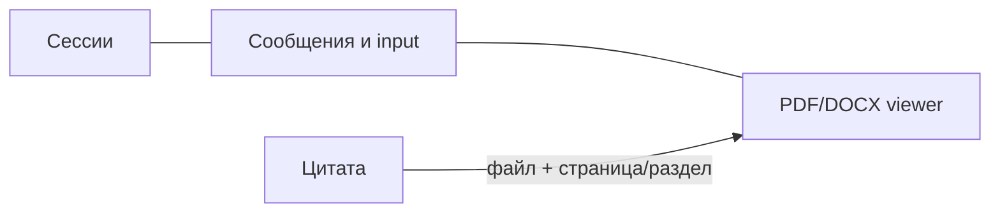

# Интерфейс и поведение frontend

Frontend использует Next.js App Router, React, TypeScript, Tailwind, shadcn/ui и PDF.js.
TanStack Query хранит server state; Zustand — текущее состояние чата.

## Маршруты

| URL | Назначение |
| --- | --- |
| `/login` | Вход и доступные demo-варианты |
| `/` и `/chat` | Новый чат |
| `/chat/[sessionId]` | Сохранённая сессия |
| `/documents` | Knowledge Base: загрузка, статусы и ACL |
| `/inspect` | Этапы поиска для org-admin при включённом флаге |
| `/settings` | Команда, план, usage, SSO и домен |

Реальные страницы: `frontend/src/app/`; feature logic — `frontend/src/features/`.

## Экран чата

- На desktop сессии показаны вертикальной панелью; на мобильных и tablet они открываются вертикальным списком в dialog, без горизонтальной прокрутки.
- PDF/DOCX pane закрыта при первом открытии чата без выбранной цитаты; выбор citation открывает её, пользователь может менять ширину или закрыть pane.
- Поле ввода растёт до заданного предела; длинный RU/EN placeholder полностью виден на узком экране.
- Ответ отображается по мере поступления SSE token events.
- Citation открывает исходный файл и позицию; PDF-фрагмент подсвечивается, если доступна геометрия.
- Ошибки чата и viewer показываются рядом с ответом или через toast локализованным безопасным сообщением; полный экран не блокируется.
- Feedback доступен после того, как известен `message_id`.

### Первый запрос и URL сессии

Для нового uncached чата backend после retrieval отправляет ранний `meta` с `session_id` и пустым
`message_id`. Frontend сразу обновляет URL и инвалидирует список сессий. После ответа приходит ещё один
`meta` с `message_id` и usage. Существующие сессии не получают ранний `meta`.

Схема потока: [pipeline/retrieval.md](../pipeline/retrieval.md); типы событий: [API contract](../engineering/api.md).

## Knowledge Base и права

| Действие | Поведение UI |
| --- | --- |
| Upload | Принимает PDF/DOCX; отдельно показывает «Вся организация», роли и динамические подразделения; требует выбрать аудиторию и показывает preview читателей |
| Ingestion | Обновляет `pending → processing → ready/failed`, отображает текущую стадию и безопасную ошибку |
| ACL update | Меняет access tags с тем же preview; legacy `all` очищает остальные теги при редактировании |
| Delete | Просит подтверждение; API удаляет запись и ставит очистку S3 в outbox |
| Raw document | Viewer запрашивает API; публичный URL хранилища не используется |

`admin` и `manager` могут управлять базой знаний. `employee` не получает write controls.
Скрытие кнопок — только UX: сервер повторно проверяет роль, организацию и ACL. Роль и подразделение — разные
группы аудитории; несколько выбранных групп дают OR-доступ. `all` выбирается отдельно и несовместим с другими
тегами. Admin не получает автоматический доступ к содержимому документа.

## Доступность и ошибки

- Цитаты доступны с клавиатуры; Enter открывает соответствующий источник.
- При загрузке PDF чтение уже полученного ответа не блокируется.
- `402` квоты, ingestion failure и недоступный документ показываются понятным сообщением.
- UI не создаёт источники, которых нет в `citations`, и не раскрывает чужое имя документа.
- При logout, user switch или смене organization данные предыдущего контекста очищаются.

## Технические запреты

- Не отправлять `org_id`, `organization_id` или `access_roles` в chat body как источник полномочий.
- Не вставлять HTML из PDF или LLM через `dangerouslySetInnerHTML` без sanitization.
- Не встраивать публичную MinIO/S3-ссылку в `<iframe>`.
- Не повторять отказ модели автоматически без действия пользователя.
