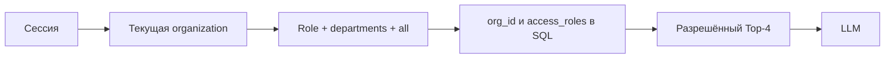

# Спецификация Docwise

**Тип продукта:** shared B2B SaaS для поиска и вопросов по PDF/DOCX.
Для private cloud/on-prem тот же код может работать с одной организацией.

> **Как читать этот документ.** SRS описывает ожидаемое поведение продукта. Реальная конфигурация
> и статус интеграций приведены в [архитектуре](architecture.md), [billing](../platform/billing.md),
> [auth](../platform/auth.md) и [техническом долге](../maintenance/technical-debt.md).
> При расхождении приоритет у кода, миграций, тестов и runtime-конфигурации.

## Проблема и цель

В компаниях лежат тысячи договоров, политик и отчётов. Ключевой риск обычного поиска по документам —
не только плохая релевантность, но и выдача человеку текста, который он не должен читать.

| Проблема | Что делает Docwise |
| --- | --- |
| Вопрос не совпадает с точными словами документа | Dense + FTS hybrid search и reranking |
| Фиксированный chunk теряет структуру PDF | Chunking по страницам и разделам; таблицы сохраняются |
| Роль проверяют только в prompt | SQL ACL до fusion, rerank и LLM |
| Нельзя проверить ответ | Цитата открывает исходную страницу или раздел |
| В контексте нет ответа | Явный отказ без догадки модели |

## Границы доступа

Организация — внешняя граница. `admin`, `employee`, `hr` и `all` не заменяют `organization_id`.
Обязательные правила описаны в [tenancy.md](../platform/tenancy.md).

## Цели

1. Загрузить PDF/DOCX и индексировать структуру документа.
2. Искать только по документам текущей организации и разрешённым ролям.
3. Давать ответы со ссылками на источник; отказывать при недостатке контекста.
4. Измерять качество на golden set и ACL-negative сценариях.
5. Поддерживать пользователей, членства, планы и квоты по организациям.

Вне цели: универсальный корпоративный поисковик по произвольным источникам, редактирование файлов в браузере,
платформенная панель доступа ко всем клиентским данным и автономный tool-calling агент.

## Основные требования

### FR-1. База знаний

- Пользователь с правом `admin` или `manager` загружает PDF/DOCX и назначает `access_roles`.
- API сохраняет файл в private S3 storage и создаёт документ со статусом `pending`.
- Celery обрабатывает документ асинхронно: `pending → processing → ready | failed`.
- Статус и безопасное описание ошибки доступны через API.
- Оригинал выдаётся только при тех же проверках организации и ACL.
- Удаление данных PostgreSQL ставит надёжную задачу очистки объекта storage.

### FR-2. Индексация

- PDF разбивается по физическим страницам; DOCX — по логическим разделам.
- Chunk не пересекает границы страницы/раздела; таблицы сохраняются как Markdown.
- Embedding text может содержать служебный заголовок; UI, reranker и prompt используют текст chunk.
- Перезапуск ingestion для того же `document_id` не должен оставлять дубликаты.

Подробная текущая семантика retry и recovery: [ingestion.md](../pipeline/ingestion.md).

### FR-3. Поиск и чат

- Каждая dense и FTS выборка фильтрует `organization_id` и `access_roles` в SQL.
- Ветки объединяются через RRF; cross-encoder сокращает контекст до Top-4.
- LLM получает только разрешённые chunks. При пустом Top-4 возвращается фиксированный отказ.
- SSE передаёт citations и текст ответа. Для нового uncached чата ранний `meta` сообщает ID сессии
  до генерации; финальный `meta` содержит ID сообщения и usage.

Точные этапы и event contract: [retrieval.md](../pipeline/retrieval.md) и [API](../engineering/api.md).

### FR-4. Интерфейс

- Основной экран объединяет список сессий, чат и PDF viewer.
- Переход по citation открывает нужный файл, страницу/раздел и фрагмент.
- Администратор базы знаний видит статус ingestion и назначенные access tags.
- При смене пользователя или организации UI сбрасывает данные предыдущей сессии.

Детали экранов и доступности: [frontend.md](frontend.md).

### FR-5. Audit и evaluation

- Audit фиксирует query, ID пользователя, найденные IDs chunks и latency.
- Полный текст chunks не записывается в audit.
- Пользователь может оценить собственный ответ; feedback сохраняется с audit.
- Retrieval проверяется на positive вопросах и ACL-negative примерах.

### FR-6. Search Inspect

- Org-admin видит стадии `dense`, `sparse`, `rrf`, `reranked` под тем же ACL, что и chat.
- `ENABLE_SEARCH_INSPECT` отключает endpoint; выключенный endpoint отвечает `404`.
- `admin` не обходит документный ACL: HR-only chunk скрыт без разрешения `hr`.

### FR-7. Организации

- Пользователь глобальный; роли и отделы хранятся на его membership в организации.
- `all` означает всех участников текущей организации.
- Новая регистрация создаёт организацию; приглашённый пользователь входит в организацию пригласившего.
- `organization_id` в теле запроса не выбирает tenant.

### FR-8. Планы, SSO и домен

- Планы ограничивают seats, indexed pages и chat tokens.
- Превышение коммерческой квоты — `402`; rate limit — `429`; отсутствие entitlement — `403`.
- SSO и custom domain доступны только при соответствующем entitlement.
- SSO connector определяет организацию; данные assertion не выбирают tenant.

**Статус интеграции:** текущий runtime имеет только dev SSO fixture; публичный профиль отключает SSO.
Реального SAML/OIDC adapter и обязательной платёжной интеграции в публичном демо нет.
См. [billing](../platform/billing.md) и [auth](../platform/auth.md).

## Технологическая база

| Уровень | Реализация |
| --- | --- |
| Backend | Python 3.12, FastAPI, Pydantic v2, SQLAlchemy 2 sync Session |
| Очередь | Redis 7 и Celery 5 |
| Хранилище | PostgreSQL 15, pgvector, FTS, MinIO/S3-compatible storage |
| Парсинг и embeddings | PyMuPDF, pdfplumber, python-docx, FastEmbed |
| Frontend | Next.js 15, React 19, TypeScript 5, Tailwind CSS 4, PDF.js |
| Доставка | Docker Compose и GitHub Actions |

Версии сверяйте с `backend/requirements.lock` и `frontend/package-lock.json`.

## Приёмка и качество

Тесты покрывают ACL, чат, ingestion и API. Сохранённый eval report от 2026-09-22 содержит 35 кейсов:
28 положительных и 7 ACL-negative. Golden set вырос до 41 кейса (28 положительных, 13 ACL-negative),
поэтому report пока не отражает текущий набор. Результаты и ограничения приведены в
[evaluation.md](evaluation.md) и [reports/rag_benchmark.md](../../reports/rag_benchmark.md).

## За пределами текущего продукта

- SCIM и автоматическая синхронизация IdP-групп;
- platform operator console с доступом к корпусам клиентов;
- онлайн-редактирование документов;
- training собственных embedding-моделей;
- Kubernetes и HA deployment как часть этого репозитория.
