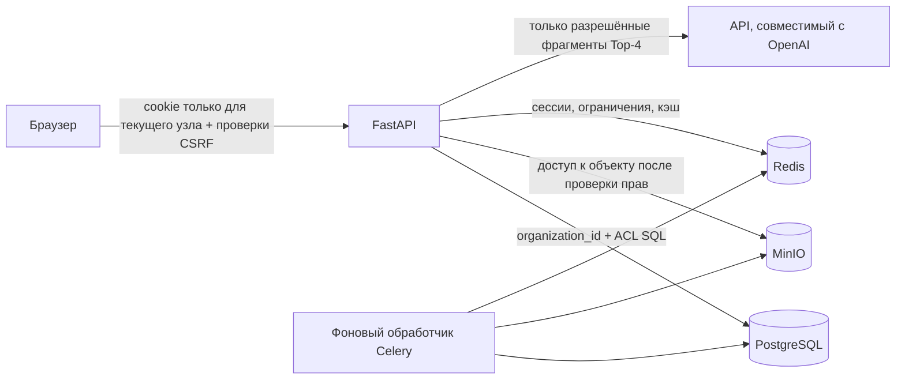

# Безопасность и доверительные границы

Документ описывает реализованные механизмы, а не сертификацию или гарантию отсутствия
уязвимостей. Канонические детали tenancy и сессий: [tenancy](../platform/tenancy.md) и
[аутентификации](../platform/auth.md).

## Доверительные границы



Основная граница организации — `organization_id`; `access_roles` — внутренняя граница доступа к документам
организации. Клиентские поля `organization_id`, `org_id`, `user_id`, `access_roles` и
`document_ids` не являются источником полномочий.

Для чтения документа нет исключения для администратора: роль `admin` управляет организацией, но читает документ только
если его роль совпадает с одним из значений `access_roles`. Тег `all` открыт всей организации и должен использоваться отдельно;
при загрузке и изменении ACL серверная часть отклоняет его сочетание с другими тегами.

## Аутентификация

- API v1 принимает cookie `dw_access` и `dw_refresh`, действующие только для текущего узла; Bearer-аутентификация не реализована.
- JWT содержит `sub`, текущий `org_id`, `typ`, `exp`; токен обновления также содержит `jti`.
- Роль не хранится в токене и читается из `organization_memberships`.
- `jti` токена обновления хранится и меняется в Redis.
- Пароли хэшируются вспомогательными средствами; `hashed_password` не возвращается через API.
- Идентификационный токен Google проверяется с помощью `GOOGLE_CLIENT_ID`.
- Запуск в производственной среде блокируется, если задано значение `SECRET_KEY` по умолчанию.

Cookie не используют родительский атрибут `Domain`, поэтому сессия с одного имени узла организации
не должна автоматически передаваться другому. Имя узла, привязанное к организации, должно
соответствовать `org_id` в сессии.

## Авторизация и изоляция

`allowed_roles = {membership.role} ∪ departments ∪ {"all"}`.

Векторный и полнотекстовый поиск, а также маршруты списков, состояний и исходных документов применяют:

```sql
WHERE organization_id = :current_org
  AND access_roles && :allowed_roles
```

Фильтрация выполняется до RRF, повторного ранжирования, языковой модели и формирования цитат. Роль admin
не обходит внутренний ACL. `require_kb_admin` разрешает запись ролям `admin` и
`manager`; для операций оплаты, приглашений, SSO, домена и диагностики требуется `admin`.

RLS включена миграцией для `documents` и `document_chunks`. Служба Compose подключается к PostgreSQL
через учётную запись инициализации, но API, фоновый обработчик и Beat устанавливают отдельную
роль `docwise_rls` через `DOCWISE_RLS_SESSION_ROLE`; `db-migrate` создаёт роль и выдаёт разрешения до
старта этих процессов. Вне Compose роль нужно настроить отдельно. RLS остаётся дополнительной защитой
и не заменяет фильтры приложения.

## CSRF и CORS

При `COOKIE_SAMESITE=none` запросы, меняющие данные в `/api/v1`, требуют разрешённый `Origin`/`Referer`
или `X-Requested-With: Docwise`. Вебхук Stripe и SSO ACS исключены, поскольку используют собственную
модель проверки. `TenantCORSMiddleware` разрешает настроенные источники и проверенные имена узлов организаций.

Слишком широкое значение `CORS_ORIGINS`, отключение `COOKIE_SECURE` или использование
недоверенного прокси меняют эту границу и требуют отдельной проверки.

## Секреты и внешние сервисы

- `.env` исключён из Git; `.env.example` содержит заполнители.
- Чувствительные значения: `SECRET_KEY`, реквизиты доступа к БД и S3, `OPENAI_API_KEY`,
  `STRIPE_SECRET_KEY`, `STRIPE_WEBHOOK_SECRET`, `SENTRY_DSN`.
- Языковая модель получает только фрагменты Top-4, прошедшие проверку ACL в SQL. Реализован транспорт,
  совместимый с OpenAI; отдельного транспорта Anthropic нет.
- Бакет MinIO проверяется как закрытый, оригиналы выдаются через API после проверки прав.
- Подпись вебхука Stripe проверяется с помощью поставщика; предусмотрена таблица идемпотентности.
- `SSO_PROVIDER=dev` — тестовая заготовка, а не поставщик удостоверений для производственной среды.

## Журналы и конфиденциальные данные

`RedactingJsonFormatter` маскирует чувствительные поля и трассировку стека, оставляя тип исключения для диагностики;
значения исключений и сообщения breadcrumbs в Sentry очищаются перед отправкой. Обычные сообщения журнала об ошибках
инфраструктуры содержат тип исключения, но не его текст.
`rag_audit_logs` хранит запрос пользователя, UUID текстовых фрагментов, задержку, число токенов, оценку и необязательный
комментарий к отзыву, но не полный текст фрагментов. Один планировщик Celery Beat ежедневно удаляет записи журнала
старше `AUDIT_LOG_RETENTION_DAYS` (значение по умолчанию — 90); комментарий удаляется вместе с записью.

В журналах и документации запрещено публиковать:

- токены доступа и обновления, а также значения cookie;
- пароли, ключи API, закрытые ключи и секреты вебхуков;
- содержимое документов клиентов и дампы базы данных;
- закрытые фрагменты или имена файлов в сообщениях об ошибках для другой организации.

`/metrics` использует только метод, шаблон маршрута FastAPI и метки HTTP-статуса. Маршрут не добавляет в метки
идентификаторы пользователя, организации или документа, текст запроса либо исходный путь; публичный Caddy не проксирует его.

## Ограничение частоты запросов

Ограничения частоты запросов на базе Redis применяются к аутентификации по IP, загрузке файлов и чату
по ID пользователя. При ошибке Redis запрос отклоняется с HTTP 503. `X-Forwarded-For` игнорируется по умолчанию;
использовать его разрешено только при явной настройке доверенного прокси. Публичный демонстрационный профиль
включает эту настройку, только если порт серверной части закрыт и Caddy является единственной внешней точкой входа.
Ограничение частоты запросов не заменяет WAF, сетевые средства контроля или квоты поставщика.

## Подтверждённые ограничения

| Уровень | Ограничение | Последствие |
| --- | --- | --- |
| Высокий | Служба миграции Compose использует владельца БД или суперпользователя для DDL и выдачи разрешений | Эта служба не обрабатывает HTTP; API, фоновый обработчик и Beat среды выполнения используют ограниченную роль |
| Высокий | Внешние развёртывания вне базового и публичного профилей Compose | Для них отдельно нужно закрыть порты БД/Redis/S3, настроить TLS, точку входа и роль сессии |
| Средний | Адаптер SSO для производственной среды отсутствует | Тестовую заготовку `dev` нельзя использовать как корпоративный SSO |
| Средний | Одна база Redis используется для брокера, сессий, кэша и блокировок | Сбой Redis затрагивает несколько подсистем и прерывает сессии после восстановления; запросы с ограничением частоты отклоняются с 503 |
| Средний | Срок хранения, очередь удаления объектов и восстановление резервной копии требуют проверки в среде выполнения | Без фонового обработчика и Beat очистка и повторная постановка задач могут задержаться |
| Низкий | OpenAPI скрыт, но маршруты остаются доступны | Это уменьшает их заметность, но не ограничивает доступ |

Полная приоритизация и план устранения: [technical-debt.md](../maintenance/technical-debt.md).
