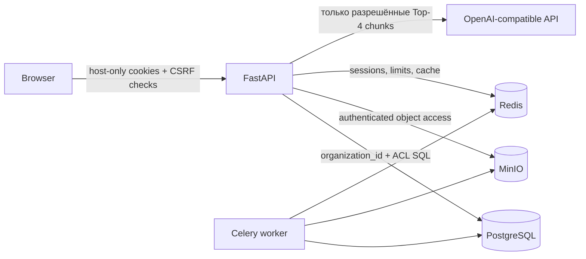

# Безопасность и доверительные границы

Документ описывает реализованные механизмы, а не сертификацию или гарантию отсутствия
уязвимостей. Канонические детали tenancy и сессий: [tenancy](../platform/tenancy.md) и
[auth](../platform/auth.md).

## Доверительные границы



Основная граница tenant — `organization_id`; `access_roles` — внутренняя граница документов
организации. Клиентские поля `organization_id`, `org_id`, `user_id`, `access_roles` и
`document_ids` не являются источником полномочий.

## Аутентификация

- API v1 принимает host-only cookies `dw_access` и `dw_refresh`; Bearer auth не реализован.
- JWT содержит `sub`, текущий `org_id`, `typ`, `exp`; refresh также содержит `jti`.
- Role не хранится в token и читается из `organization_memberships`.
- Refresh `jti` хранится и ротируется в Redis.
- Пароли хэшируются через password helpers; `hashed_password` не возвращается API.
- Google ID token проверяется с `GOOGLE_CLIENT_ID`.
- Production startup блокируется при default `SECRET_KEY`.

Cookies не используют parent `Domain`, поэтому session одного tenant hostname не должна
автоматически передаваться другому. При hostname, привязанном к организации, host pin должен
совпадать с `org_id` сессии.

## Авторизация и изоляция

`allowed_roles = {membership.role} ∪ departments ∪ {"all"}`.

Dense, FTS, list, status и raw document paths применяют:

```sql
WHERE organization_id = :current_org
  AND access_roles && :allowed_roles
```

Фильтрация выполняется до RRF, rerank, LLM и формирования citation. Admin не получает
автоматического обхода внутреннего ACL. `require_kb_admin` разрешает запись `admin` и
`manager`; billing, invites, SSO, domain и inspect требуют `admin`.

RLS включена миграцией для `documents` и `document_chunks`. Compose подключается к PostgreSQL
через initialization account, но API, worker и Beat устанавливают отдельную
`docwise_rls` роль через `DOCWISE_RLS_SESSION_ROLE`; `db-migrate` создаёт роль и grants до
старта этих процессов. Вне Compose роль должна быть настроена отдельно. RLS остаётся
дополнительной защитой и не заменяет application filters.

## CSRF и CORS

При `COOKIE_SAMESITE=none` mutating `/api/v1` requests требуют разрешённый `Origin`/`Referer`
или `X-Requested-With: Docwise`. Stripe webhook и SSO ACS исключены, поскольку имеют
собственную модель проверки. `TenantCORSMiddleware` разрешает configured origins и
проверенные tenant hostnames.

Ошибочная широкая настройка `CORS_ORIGINS`, отключение `COOKIE_SECURE` или использование
недоверенного proxy меняют эту границу и требуют отдельного review.

## Секреты и внешние сервисы

- `.env` исключён из Git; `.env.example` содержит placeholders.
- Чувствительные значения: `SECRET_KEY`, DB/S3 credentials, `OPENAI_API_KEY`,
  `STRIPE_SECRET_KEY`, `STRIPE_WEBHOOK_SECRET`, `SENTRY_DSN`.
- LLM получает только прошедшие SQL ACL Top-4 chunks. Реализован OpenAI-compatible transport;
  отдельного Anthropic transport нет.
- MinIO bucket проверяется как private, оригиналы выдаются через authenticated API.
- Stripe webhook должен пройти provider signature validation и имеет idempotency table.
- `SSO_PROVIDER=dev` — fixture, не production identity provider.

## Логи, audit и sensitive data

`RedactingJsonFormatter` маскирует sensitive fields и traceback, оставляя тип исключения для диагностики;
exception values и сообщения breadcrumbs в Sentry очищаются до отправки. Ошибки инфраструктуры в обычных
лог-сообщениях записывают тип исключения, но не его текст.
`rag_audit_logs` хранит query пользователя, chunk UUIDs, latency, tokens, rating и optional
feedback comment, но не полный chunk text. Один Celery Beat scheduler ежедневно удаляет audit
строки старше `AUDIT_LOG_RETENTION_DAYS` (default 90); comment удаляется вместе со строкой.

В логах и документации запрещено публиковать:

- access/refresh tokens и cookie values;
- пароли, API keys, private keys и webhook secrets;
- содержимое customer documents и database dumps;
- restricted snippets или filenames в ошибках другого tenant.

`/metrics` использует только method, FastAPI route template и HTTP status labels. Endpoint не добавляет user,
organization, document IDs, query text или raw path в labels; публичный Caddy не проксирует этот маршрут.

## Rate limiting

Redis-backed limits применяются к auth по IP, upload и chat по user ID. При ошибке Redis
запрос отклоняется с HTTP 503 (fail-closed). `X-Forwarded-For` игнорируется по умолчанию;
его разрешено использовать только при явной настройке доверенного proxy. Public demo включает
эту настройку только при закрытом backend port и Caddy как единственном ingress. Rate limiting
не заменяет WAF, network controls или provider quotas.

## Подтверждённые ограничения

| Severity | Ограничение | Последствие |
| --- | --- | --- |
| High | Compose migration service работает с DB owner/superuser для DDL и настройки grants | Этот service не обслуживает HTTP; runtime API/worker/Beat используют ограниченную role |
| High | Внешние deployment вне base/public-demo Compose | Для них нужно отдельно закрыть DB/Redis/S3 ports, настроить TLS/ingress и session role |
| Medium | Production SSO adapter отсутствует | `dev` fixture нельзя использовать как enterprise SSO |
| Medium | Один Redis DB для broker/session/cache/locks | Отказ Redis затрагивает несколько подсистем и прерывает session continuity после restore; rate-limited requests отклоняются с 503 |
| Medium | Retention, storage outbox и backup recovery требуют runtime проверки | Без worker/Beat cleanup и requeue могут задержаться |
| Low | OpenAPI скрыт, но routes остаются доступны | Это уменьшает discoverability, но не является access control |

Полная приоритизация и remediation: [technical-debt.md](../maintenance/technical-debt.md).
